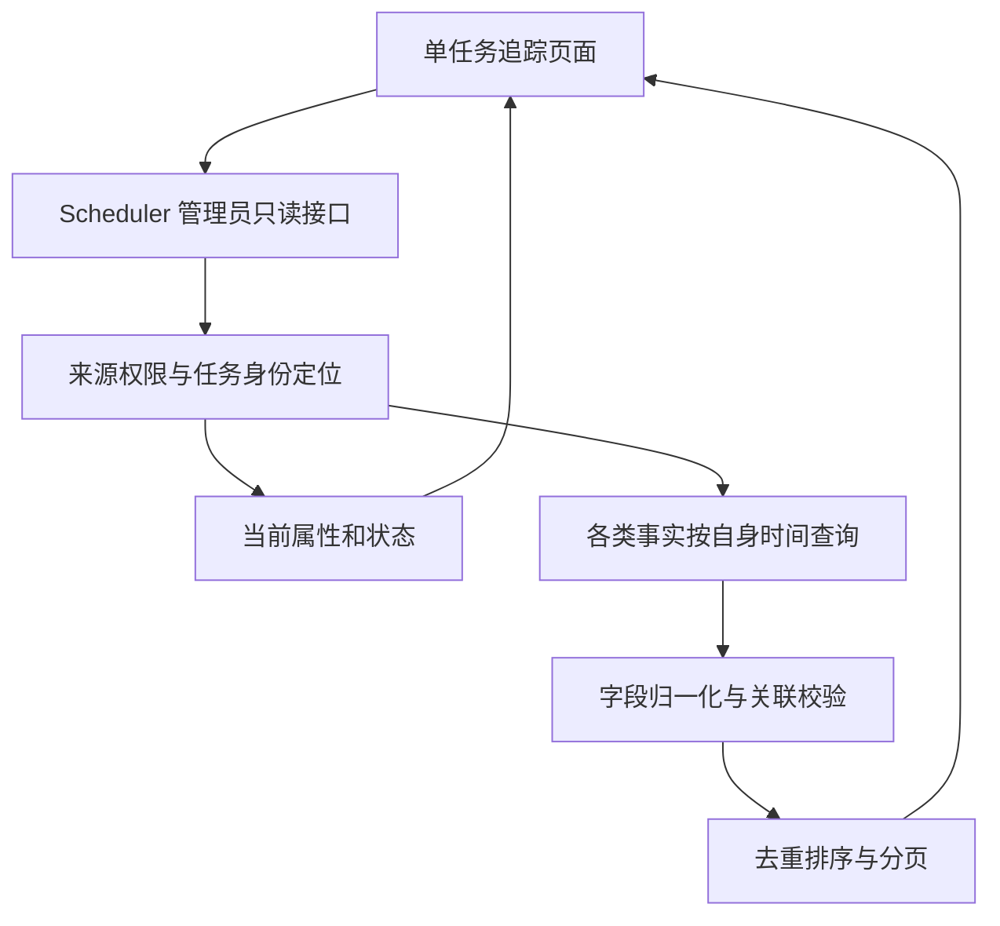

# 新版定时任务单任务追踪页详细设计

## 0. 设计结论与阅读索引

在 Console 的运行监控区域增加只读页面，由 Scheduler 提供三个查询接口，直接聚合共用数据库，不改变 Scheduler、SWE、Monitor 现有状态写入职责，不新增表或后台采集任务。前端菜单与 `/monitor/cron-task-tracking` 页面路径保留；后端统一归 Scheduler，未发布的 Monitor 追踪接口移除。当前属性与历史时间轴分开展示；父子关系仅作标识，只查询输入任务自身。

时间轴的整轮结果统一称为 **“Scheduler 已确认整轮结果”**：优先读取 `swe_cron_managed_dispatch_events` 的 `event_type=settled`、`occurred_at`、`details_json.settled_status/settled_error_code`；缺少该事件时才以 `swe_cron_execution_runs.settled_at/settled_status/settled_error_code` 补充。二者不能重复生成节点，也不称为异步任务实际结束时间。

文档包含 37 个具名节点/补充规则：管理 12 类、触发 3 类、执行及重试 14 类、时间字段补充 6 类、通知和标读 2 类；不是每次执行都必须出现 37 个节点。批次级 `retry_request` 另列为排除规则。

| 想查看的内容 | 阅读位置 |
| --- | --- |
| 页面范围、当前属性、关联条件 | 第 1–3 节 |
| 时区、业务入口、操作人和原因口径 | 第 4 节 |
| 每种管理节点需要的表、字段和出现条件 | 第 5 节 |
| 每种调度/执行/重试节点需要的表、字段和时间 | 第 6 节 |
| 通知、标读以及无法还原时间的状态 | 第 7 节 |
| 接口模型、去重、筛选、分页与前端交互 | 第 8–9 节 |
| 局部故障、性能边界、开发拆分和验收案例 | 第 10–12 节 |

---

## 1. 目标、边界与确认事项

面向管理员，在当前授权来源内输入一个新版任务 ID，查看当前属性及按时间排列的管理、调度、执行、结果、通知记录。第一版只读聚合已有数据库记录，不补采集、不改表、不改执行及通知流程。

设计依据是本次对话及 `docs/demos/cron-task-tracking/` 的交互原型；原型全部使用模拟数据，不构成真实字段已经存在或历史时间完整的证据。本设计以 `base_revision` 的远程代码为准，不依赖原工作区未推送的本地提交。

| 编号 | 已确认要求         | 落地约束                                                                       |
| ---- | ------------------ | ------------------------------------------------------------------------------ |
| R1   | 管理员排障         | 仅 manager/admin，查询受当前可信来源限制；不以裸 ID 绕过权限                   |
| R2   | 只查新版任务       | 当前定义要求 `management_owner='scheduler'`；历史兜底要求新协议执行记录        |
| R3   | 严格单任务         | 父/子任务只做标注，不展开或统计其他任务的执行                                  |
| R4   | 时间轴             | 混排管理、触发、派发、运行结果、通知、标读事实                                 |
| R5   | 时间筛选           | 按节点自己的事件时间筛选，不一律按执行创建时间筛选                             |
| R6   | 业务入口           | 区分普通、批调度、手动执行、人工重试、失败补跑；重投标为过程，不冒充新业务尝试 |
| R7   | 只用现有数据       | 不新增事件表、埋点、后台轮询或历史回填                                         |
| R8   | Scheduler 确认时间 | 整轮节点使用 `settled_at`/对应事件时间，不称为异步实际完成时间                 |
| R9   | 信息缺失可辨认     | 缺失、不可用、无法确认与“没有执行/已经失败”分开                                |
| R10  | 无查询副作用       | 不准备 SWE 工作区，不读写 jobs.json，不触发执行、通知或标读                    |

**非目标：**旧版任务、系统固定业务任务、整批/整组任务看板、实时查询外部调度平台、任意页面/系统/URL 的调用审计、完整通知尝试历史、手动重跑/启停/删除/补发、修改前后完整 diff、历史时点状态回放。

**建议默认值（可调整，不是数据库现有约束）：**默认今天、北京时间；时间正序，可切倒序；每页 50 条、最大 100 条；一次时间范围最多 31 天。任务身份候选最多返回 20 项，超出要求缩小归属条件。没有新增权限或数据源的待决产品问题。

---

## 2. 总体架构与只读边界

前端保留运行监控区域的追踪页面，由 Scheduler 的只读聚合接口直接查询 SWE/Scheduler/Monitor 共用数据库。不上报状态、不通过服务间 HTTP 抓取各实例内存，不复用会创建资源的 SWE 接口。既有业务路由和状态写入者不改变。Scheduler 不 import Monitor/SWE 的运行时模块，也不经 Monitor 转发。

追踪查询不依赖调度后台的 ready 状态，只要求数据库可读；部分来源缺失仍按原规则降级。若 Scheduler HTTP 服务整体不可用，追踪接口也不可用。保留分页、31 天范围限制和查询预算，避免只读排障请求挤占调度资源。

下图表达查询分层，不是要求按图创建新的服务或框架：

不增加 DDL。实施前只读核对实际表/列是否存在，不自动创建、升级或补数据。运行时如某模块不可用，返回局部告警及其他可验证数据；身份无法校验时不降级越权查询。

---

## 3. 数据源目录与关联规则

### 3.1 主干七张表

以下别名在节点表中使用，`J.action` 等均表示真实列名，不是新列。

| 别名 | 现有表                              | 本页面读取的数据                                                                                                                                                                                                                                                                                                                                 |
| ---- | ----------------------------------- | ------------------------------------------------------------------------------------------------------------------------------------------------------------------------------------------------------------------------------------------------------------------------------------------------------------------------------------------------ |
| D    | `swe_cron_jobs_v2`                  | `tenant_id,source_id,agent_id,job_id,management_owner,name,task_type,enabled,cron_expr,original_cron_expr,timezone,spec_json,tenant_name,bbk_id,skill_ids,workflow_binding_id,creator_user_id,definition_version,job_origin,parent_tenant_id,parent_source_id,parent_agent_id,parent_job_id,deleted_at,created_at,updated_at`                    |
| S    | `swe_cron_job_states`               | 完整任务身份；`task_chat_id,task_session_id,ordinary_external_job_id,batch_external_job_id,dispatch_state,pause_reason,auto_paused_at,next_run_at,next_run_times_json,last_status,last_run_at,last_error,management_status,management_version,state_version,unread_execution_count,updated_at`                                                   |
| J    | `swe_cron_registration_journal`     | 完整身份；`operation_id,actor_id,action,request_id,expected_version,payload_json,progress_json,status,stage,error_code,version,created_at,updated_at`                                                                                                                                                                                            |
| T    | `swe_cron_managed_trigger_receipts` | 完整身份；`receipt_id,external_job_id,operation_id,kind,trigger_id,logical_fire_at,physical_fire_at,batch_id,status,response_json,members_json,created_at`                                                                                                                                                                                       |
| R    | `swe_cron_execution_runs`           | 完整身份；`execution_id,queue_order,actor_id,kind,trigger_key,scheduled_fire_at,not_before_at,definition_version,spec_json,dispatch_meta_json,status,dispatch_attempt,accepted_at,started_at,finished_at,settled_status,settled_at,settled_error_code,history_execution_id,error_code,result_json,output_preview,trace_id,created_at,updated_at` |
| E    | `swe_cron_managed_dispatch_events`  | 完整身份；`event_order,event_id,event_key,execution_id,batch_id,member_id,event_type,execution_version,actor_id,occurred_at,details_json`                                                                                                                                                                                                        |
| H    | `swe_cron_executions`               | `id,job_id,tenant_id,job_name,scheduled_time,actual_time,end_time,duration_ms,status,async_status,error_message,output_preview,input_snapshot,trace_id,session_id,meta,is_final,need_notification,notification_status,notification_due_at,notification_timezone,notification_sent_at,notification_attempts,notification_error,is_read,read_at`   |

`H` 是新旧执行历史共用表，不代表本页面兼容旧任务。不得直接用 `H.job_id` 匹配出旧任务结果。

### 3.2 按需读取的补充表

| 别名 | 现有表                             | 关键字段与作用                                                                                                                                                                    |
| ---- | ---------------------------------- | --------------------------------------------------------------------------------------------------------------------------------------------------------------------------------- |
| B    | `swe_cron_managed_batch_members`   | 完整身份、`batch_id,member_id,initial_execution_id,current_execution_id,business_attempt,member_role,created_at,updated_at`；确认本任务的批成员关联及重试前后执行，不加载其他成员 |
| BT   | `swe_cron_managed_broadcast_tasks` | 源身份、`task_id,actor_id,source_definition_version,payload_json,status,sync_status,error_code,created_at,updated_at`；该任务自身发起的分发操作                                   |
| BI   | `swe_cron_managed_broadcast_items` | 目标完整身份、`task_id,index_no,operation,expected_definition_version,status,plan_json,result_json,warning,created_at,updated_at`；只取目标等于输入任务的处理条目                 |
| MI   | `swe_cron_managed_mode_items`      | 目标完整身份、`operation_id,index_no,sync_operation_id,status,error_code`；找出整组切换对该任务的影响，操作时间和操作者仍来自 J                                                   |
| C    | `swe_cron_failure_retry_calls`     | `call_id,source_id,business_date,window_start,cutoff_at,status,error_code,created_at,started_at,finished_at`；按已有补跑事件里的 call_id 展开背景；该表没有补跑调用人字段         |

本期不靠 `swe_cron_managed_dispatch_controls` 产生历史节点，不查询旧定义表 `swe_cron_jobs`、旧派发表/事件表或模型池当前容量来推断历史排队原因。不下钻 `swe_cron_subtasks` 的逐个异步子任务；只展示整轮确认结果。

### 3.3 身份与关联（每一路都必须遵守）

1. 任务键 K = `(tenant_id,source_id,agent_id,job_id)`，字段非空校验并按现有二进制身份比较约定匹配。所有结果必须属于当前可信 `source_id`。
2. D/S/J/R/E/BI/MI/B 的任务关联均以 K 为准，不能只 JOIN job_id；是否有同 ID 多候选在查明后由管理员选定，不自动选第一条。
3. E 到 R：优先使用 `execution_id` 并复核完整 K。无 R 时仍可显示 E 自身可信的事件类型/时间，详情明确执行记录缺失，不借用其他执行补齐。
4. R 到 H：`R.history_execution_id=H.id`，同时复核 tenant_id/job_id 以及 `H.meta` 中 `management_owner=scheduler,managed_execution_id,source_id,agent_id`。关联不一致/关键元数据不可验证时，该块标记“历史关联未确认”，不展示可疑结果和通知。
5. R 到 T：优先用 `R.dispatch_meta_json.trigger_receipt_id`，结合记录自身 K、batch_id 及 B/冻结成员证明关联。子任务只投影“批入口受理涉及本任务”的事实，不能声称回调直接调用了子任务。
6. 对复用的普通执行，批成员索引也可能引用它：可按本任务 B 关联 T.batch_id，并复核 T.members_json 的完整身份、初始 execution_id。不得仅凭当前父子关系认定历史上参与了某批次。
7. 跳过的批回执如果没有该子任务参与的持久证明，不能复制到所有子任务时间轴。主入口记录的跳过只直接属于 T.K 所指任务。
8. MI→J 用 operation_id，并要求 MI.K=输入任务、J.source_id=授权来源；BT→BI 用 task_id 并验证来源。只投影选定任务的条目，不返回完整 members_json/分发目标名单。
9. `is_final=0` 的历史仍可用于原执行追踪，不能因后续重试成功而把早先失败执行隐藏。不得用 B.current_execution_id/B.business_attempt 覆盖旧执行的尝试信息。

### 3.4 顶部当前概况字段

| 页面字段                          | 数据来源                                                                                                                        | 说明                                                                            |
| --------------------------------- | ------------------------------------------------------------------------------------------------------------------------------- | ------------------------------------------------------------------------------- |
| ID、名称、类型、用户、来源、Agent | D.K、D.name/task_type/tenant_name；无名称可显示用户 ID                                                                          | actor_id 不是用户姓名，不为显示姓名额外引入用户目录表                           |
| 当前排程、原始排程、时区          | D.cron_expr/original_cron_expr/timezone                                                                                         | 明确当前排程与原始排程，不把原始排程当成当前值                                  |
| 散列与提前量配置 | D.enable_offset/offset_window_hours/offset_minutes | 展示已保存的配置和提前量，不解释为批内成员仍需等待散列时间 |
| 任务正文与安全配置 | D.spec_json 中白名单任务正文、runtime、模型选择、通知延迟；D.skill_ids/workflow_binding_id/bbk_id/plan_id | 只读展开必要业务字段，不返回完整请求头、认证信息或原始 JSON |
| 启停、逻辑删除                    | D.enabled/deleted_at                                                                                                            | 删除时仍允许只读查已有历史；资源清理失败不等于逻辑删除被回滚                    |
| 模式、暂停原因、管理结果          | S.dispatch_state/pause_reason/auto_paused_at/management_status                                                                  | 当前快照，不跟随时间筛选回放历史                                                |
| 最近执行、下次计划、未读数        | S.last_status/last_run_at/last_error/next_run_at/next_run_times_json/unread_execution_count                                     | 下次计划是已保存的我方记录，不保证平台将按时触发                                |
| 外部定时器 ID                     | S.ordinary_external_job_id/batch_external_job_id                                                                                | 保存的绑定，不称为平台实时状态                                                  |
| 当前定义版本                      | D.definition_version                                                                                                            | 不使用 J.version；后者是操作进度版本                                            |
| 父/子标记                         | 完整 parent*\* 指向时为子任务；否则存在本任务作为源的 BT、D 中引用本任务的 parent*\* 或本任务 B.member_role=parent 时可标父任务 | 仅标注，不展示关联任务。父子字段不完整/证据冲突时显示归属未确认，不猜为普通任务 |

如定义缺行而仍有新协议 R，可显示“历史任务，当前属性不可用”。若 D 行存在但 management_owner 不是 scheduler，不能绕过范围限制用历史回退方式展示成当前新版任务。

概况补充读取的 D 字段为 `enable_offset,offset_window_hours,offset_minutes,plan_id`；执行详情需要模型定位时读取 R.provider_id/model_id。展示执行时配置以 R.spec_json/definition_version 为准，不拿 D 的现状回填旧执行。

---

## 4. 时间口径、入口和状态字段

### 4.1 时间存储与筛选

| 来源                                                                               | 存储/解释口径                                                                                     | 用途                                                                         |
| ---------------------------------------------------------------------------------- | ------------------------------------------------------------------------------------------------- | ---------------------------------------------------------------------------- |
| J、R、E、T、BT、BI 的上述时间                                                      | 新链路按 UTC 写入的无时区时间                                                                     | 读取时明确按 UTC 解释，再输出带 `+08:00` 的北京时间                          |
| H.actual_time/end_time/created_at/notification_due_at/notification_sent_at/read_at | 现有写入转换为北京时间的无时区时间                                                                | 按 Asia/Shanghai 解释，不能再次加 8 小时                                     |
| `settled_at`                                                                       | Scheduler 巡检观察并提交整轮结论的时间                                                            | 只命名“Scheduler 确认时间”，不是 async_status 更新时间或异步任务实际结束时间 |
| T.logical_fire_at/physical_fire_at                                                 | 保存的逻辑/物理时间；可能来自平台输入，也可能由提前量、接收时间推导；当前记录未统一保存其来源标记 | 展示“记录的计划/物理时间（来源未区分）”，不得统一标“平台真实触发时间”        |
| R.scheduled_fire_at/not_before_at、H.notification_due_at、S.next_run_at            | 计划/可派发/预计时间                                                                              | 节点详情或顶部计划字段，不单独制造已发生节点                                 |

所有时间轴节点用下文指定的 `occurred_at`；无可靠时间则只显示状态附注。主执行结束时间不替代整轮确认时间，J.updated_at/R.updated_at/S.updated_at 不能泛化为任意历史状态发生时间。

筛选采用 `[start_time,end_time)`，前端日期选择为整天时转换为当天 00:00 到次日 00:00。请求必须带时区偏移；输出统一北京时间。默认正序，支持倒序。同秒事件按稳定键排序，细节可显示毫秒；同秒展示顺序不宣称是更细粒度的真实因果顺序。

### 4.2 业务入口与“原因”推导规则

按强证据优先判定，不能只依据 R.kind：

| 判定证据                                                                                                                       | 显示入口/原因                               | 不得推断的内容                                                                            |
| ------------------------------------------------------------------------------------------------------------------------------ | ------------------------------------------- | ----------------------------------------------------------------------------------------- |
| R.dispatch_meta_json.daily_failure_retry 或 E.details_json.call_id 且可关联本任务补跑事实                                      | 失败补跑；保留前次执行、call_id             | 不能因 R.kind=ordinary/batch 就显示为新的平台计划触发；不能把原执行 actor_id 当补跑调用人 |
| E 为任务级 retry_accepted/retry_skipped，且为人工批重试来源；或 R 元数据有 previous_execution_id/business_attempt 且非每日补跑 | 人工重试；原因按已存 reason 展示            | 不用当前批成员 business_attempt 回填旧执行                                                |
| R.kind=manual 且元数据完整、没有相反来源证据                                                                                   | 手动执行；原因“手动执行请求”                | 不细分聊天页、管理页、CLI、外部系统；这些来源没有统一保存                                 |
| 本任务有 T.kind=ordinary 的合法关联                                                                                            | 普通调度；原因“普通调度入口受理”            | 不保证一定是平台按 Cron 自动触发，也可能是外部平台人工触发同入口                          |
| 本任务有 T.kind=batch 或自己的 R.kind=batch 且来源元数据可确认                                                                 | 批调度；原因“批入口受理涉及本任务”          | 子任务不能称为“本任务直接收到平台回调”                                                    |
| E.event_type 为 transport_redelivery/transport_requeued/dispatch_unconfirmed                                                   | 原业务入口保留，事件标“运输重投/派发未确认” | 不新增业务尝试，不与业务重试混计                                                          |
| 只剩 R.kind 或关键 JSON 损坏/缺失                                                                                              | 显示已记录执行类型，并标“具体入口未确认”    | 不把缺失元数据当普通调度，不凭时间接近认定来源                                            |

“原因”优先取已存 `E.details_json.reason`、`T.response_json.reason`、对应管理 action/payload；缺失显示“未记录”。当前容量、租约、暂停状态不能反推过去为何排队。

### 4.3 操作人和执行身份

- J.actor_id、BT.actor_id 是该管理操作记录的发起身份 ID；未验证姓名时只显示 ID。
- 人工批重试决策事件的 E.actor_id 来自该请求 actor，可标操作人 ID。
- 每日补跑事件的 E.actor_id 沿用 candidate.actor_id，C 没有调用人字段；该节点的“补跑发起人”显示未记录，原 actor 只作为执行上下文。
- 普通/批回调及 SWE 事件中的 R/E.actor_id 一般是执行上下文，不统一渲染成“某管理员操作”。

---

## 5. 管理操作节点：逐节点字段映射

共同规则：一条持久操作单对应一个管理请求节点，时间统一取 **J.created_at**。徽标明确为“当前记录结果”，数据取 J.status/stage/error_code；详情显示 J.updated_at，不能把当前成功/失败写成提交时刻就已完成，也不能把更新次数当历史步骤。涉及授权失败、参数冲突或事务回滚而没有落库的请求不凭空补节点。

| 节点 ID / 名称           | 生成条件                                                                               | 来源表、具体字段                                                                                                   | 原因、结果和补充约束                                                                                                                      |
| ------------------------ | -------------------------------------------------------------------------------------- | ------------------------------------------------------------------------------------------------------------------ | ----------------------------------------------------------------------------------------------------------------------------------------- |
| M01 提交创建任务         | J.action=create，J.K=任务                                                              | J.created_at/actor_id/operation_id/request_id/status/stage/error_code；payload_json.spec                           | 仅展示安全的提交字段；当前定义另看 D，不用 D 当前值伪装初始内容                                                                           |
| M02 提交修改任务         | action=update                                                                          | 同上，加 J.expected_version、payload_json.spec                                                                     | expected_version 是请求基于的定义版本；不把 J.version 当任务版本，不承诺完整 before/after diff                                            |
| M03 提交启用/恢复        | action=set_enabled，payload_json.enabled=true                                          | J.created_at/actor_id/status/stage/error_code；payload_json.enabled                                                | 本地状态已变与外部平台同步成败分开解释；不声称每次调用都改变了状态                                                                        |
| M04 提交停用/暂停        | action=set_enabled，payload_json.enabled=false                                         | 同 M03                                                                                                             | 具体原因为人工停用，不从 S 当前 pause_reason 回填旧操作                                                                                   |
| M05 提交自动暂停同步     | action=auto_pause                                                                      | J.created_at/status/stage/error_code；payload_json.auto_paused_at/source_execution_id/auto_pause_epoch；J.actor_id | 原暂停事实时间可在详情列出；轴上时间仍为管理同步提交时间，不冒充暂停实际发生时间。actor 是上下文，操作发起主体标系统                      |
| M06 提交删除任务         | action=delete                                                                          | J.created_at/actor_id/status/stage/error_code；D.deleted_at（存在时）                                              | 显示“逻辑删除标记/资源清理结果”两个概念；清理失败不表示任务未被逻辑删除                                                                   |
| M07 提交调度方式切换     | action=dispatch_state 且 J.K=任务                                                      | J.created_at/actor_id/status/stage/error_code；payload_json.state                                                  | state 映射 ordinary/batch_enabled/batch_paused；不展示整组成员计数                                                                        |
| M08 整组切换涉及本任务   | MI.K=任务，MI.operation_id=J.operation_id，J.action=dispatch_state；且不是已展示的 M07 | J.created_at/actor_id/payload_json.state；MI.status/error_code/sync_operation_id；J.status/updated_at              | 标“整组操作对本任务的处理记录”；MI 无独立处理时间，不能伪造该子任务同步完成时刻                                                           |
| M09 提交优先级调整       | action=set_priority                                                                    | J.created_at/actor_id/status/error_code；payload_json.user_ids/branch_ids                                          | 默认只展示“已提交优先策略”，不返回跨用户完整优先名单；不表示历史队列已重新排序                                                            |
| M10 提交标读操作         | action=mark_read                                                                       | J.created_at/actor_id/status/error_code；progress_json.read_watermark（有时）                                      | 这是管理请求记录，不等于具体某条历史已标读；不能仅凭时间相近认定它对应哪个 read_at                                                        |
| M11 本任务发起分发       | BT.K=任务                                                                              | BT.created_at/actor_id/task_id/status/sync_status/error_code/source_definition_version                             | 不返回目标名单、其他任务结果、全组成功失败统计；不把分发受理说成全部完成                                                                  |
| M12 本任务的分发处理记录 | BI.K=任务，合法关联 BT                                                                 | BI.created_at/operation/status/result_json/warning/updated_at；BT.actor_id/task_id                                 | operation 按现存 create/update/retime 等已记录值映射，未知值显示原安全代码。BI.created_at 是条目登记时间，不冒充任务实际创建/更新完成时间 |

`batch_delete` 在父任务 J 中通常是对其他子任务的批量命令，不作为“父任务被删除”节点。本任务实际删除优先读取自身 action=delete 的操作单。未知管理 action 可作为中性“管理操作记录”展示 action/状态，但不得按未知 payload 扩大关联目标。

---

## 6. 调度、执行与重试节点：逐节点字段映射

### 6.1 触发与时间基准

| 节点 ID / 名称             | 生成条件                                                       | 主时间       | 读取数据与展示规则                                                                                                                      |
| -------------------------- | -------------------------------------------------------------- | ------------ | --------------------------------------------------------------------------------------------------------------------------------------- |
| T01 收到普通调度请求并受理 | 合法 T.kind=ordinary、T.status=accepted，关联本任务            | T.created_at | T.receipt_id/external_job_id/operation_id/trigger_id；logical_fire_at/physical_fire_at 作为“记录的时间”详情，不能直接称平台真实触发时间 |
| T02 批调度受理涉及本任务   | 合法 batch 回执；根任务直接匹配，子任务有自身 R/B/冻结成员关联 | T.created_at | T.receipt_id/batch_id/status；仅展示本任务的 R.execution_id 和计划，不显示父任务/其他成员的执行状态                                     |
| T03 触发被跳过             | T.K=任务且 status=skipped；或有足够本任务持久关联证明          | T.created_at | T.response_json.accepted/reason、kind、绑定 ID；没有落库的绑定校验失败/HTTP 拒绝不造节点，父入口跳过不能自动复制给所有子任务            |

手动执行不产生平台回执：其“请求已受理、执行已登记”与下表 queued 节点合并，不再按同一 R.created_at 重复生成一个受理节点。复用原 execution_id 的幂等请求不额外制造新执行。

### 6.2 事件表全部类型映射

下表默认来源 **E**，时间取 **E.occurred_at**；读取 E.event_id/event_order/execution_id/actor_id/details_json，并用 R 补充该执行的快照、入口、结果链接。`details_json` 是当时保存的事件摘要，R/H 最新状态不能覆盖它的历史含义。

| 节点 ID | E.event_type         | 页面节点                                                     | 节点需要的数据                                                                                                                                                                                                                    |
| ------- | -------------------- | ------------------------------------------------------------ | --------------------------------------------------------------------------------------------------------------------------------------------------------------------------------------------------------------------------------- |
| E01     | queued               | 执行已登记/进入待派发队列；manual 时为“手动执行已受理并入队” | E.occurred_at、execution_id、details_json.definition_version/status；R.kind/created_at/scheduled_fire_at/not_before_at/dispatch_meta_json。排队原因无记录则明确未记录                                                             |
| E02     | dispatching          | 开始派发至 SWE                                               | E.occurred_at、details_json.status/definition_version；R.kind/dispatch_meta_json。不把发请求等同于 SWE 已受理                                                                                                                     |
| E03     | accepted             | SWE 已受理                                                   | E.occurred_at、details_json.status；R.accepted_at（作为详情核对）                                                                                                                                                                 |
| E04     | running              | 开始执行                                                     | E.occurred_at、details_json.status/definition_version；R.started_at/spec_json/trace_id。实例/模型等仅展示当前已保存字段并标来源                                                                                                   |
| E05     | success              | 主执行成功                                                   | E.occurred_at、details_json.status；R.history_execution_id/output_preview/trace_id；合法 H.duration_ms/output_preview。不称“异步已完成”，H.async_status 是当前结果而非当时快照                                                    |
| E06     | error                | 主执行失败                                                   | E.occurred_at、details_json.error_code/failure_type；R.error_code/result_json；合法 H.error_message/duration_ms。超时是错误原因，不新造一个不存在的 timeout 事件类型                                                              |
| E07     | skipped              | 执行被跳过                                                   | E.occurred_at、details_json.reason/error_code/status；R.result_json/error_code（如已记录）。不能从当前任务已停用倒推当时跳过原因                                                                                                  |
| E08     | cancelled            | 执行已取消                                                   | E.occurred_at、details_json.status/reason/error_code；R.error_code。没有取消人记录就不猜测是谁取消                                                                                                                                |
| E09     | settled              | Scheduler 已确认整轮结果                                     | E.occurred_at、details_json.settled_status/settled_error_code；现有写入在同一事务中将确认时刻写入 R.settled_at/R.updated_at，再用其作为 E.occurred_at。R 当前字段用于校验/补充。**标注 Scheduler 确认时间，不是异步实际完成时间** |
| E10     | dispatch_unconfirmed | 本次派发未获确认                                             | E.occurred_at、details_json.status/error_code；details_json.dispatch_attempt 仅详情技术上下文。status=queued 与 dispatch_failed 仅解释当次记录，不用 R 后来的成功覆盖它                                                           |
| E11     | transport_redelivery | 重新派发（运输重投）                                         | E.occurred_at、execution_id、details_json.status；入口保留该执行原业务入口，不计成新业务重试                                                                                                                                      |
| E12     | transport_requeued   | 重新排队（运输重投）                                         | E.occurred_at、details_json.reason/error_code/status；保留同一 execution_id                                                                                                                                                       |
| E13     | retry_accepted       | 人工重试/失败补跑已受理                                      | E.occurred_at、details_json.reason/call_id/previous_execution_id/retry_count（存在者）；R.dispatch_meta_json.business_attempt/previous_execution_id/daily_failure_retry；call_id 存在时优先判断每日补跑                           |
| E14     | retry_skipped        | 人工重试/失败补跑被跳过                                      | E.occurred_at、details_json.reason/call_id/previous_execution_id；精确按 E.K 归属，即使没有新 R 也显示该任务的拒绝/跳过决策。不能把“跳过补跑”当作“原执行被跳过”                                                                   |
| —       | retry_request        | 默认不生成任务执行节点                                       | 此记录为批次级请求汇总，execution_id/member_id 可为空，response 可能含其他任务。只取本任务的 retry_accepted/retry_skipped；不得把整批 queued/skipped 数量显示为该任务的结果                                                       |

未知 E.event_type：有合法 K/时间时显示中性“执行事件（已记录代码）”，详情不足告警，不静默改成成功。E.details_json 损坏不阻止其他事件展示，原有事件时间和类型仍可保留。

### 6.3 缺少事件流水时的有限补充

仅当对应事实没有 E 节点、时间字段合法时使用；节点带 `evidence=recorded_timestamp` 标记，不能新增采集或写回 E。

| 节点 ID                      | 来源和主时间                                                | 展示与限制                                                                                                              |
| ---------------------------- | ----------------------------------------------------------- | ----------------------------------------------------------------------------------------------------------------------- |
| F01 执行已登记               | R.created_at                                                | 关联执行和 kind；manual 时合并手动受理。不根据 R 当前状态声称创建时已经运行                                             |
| F02 SWE 已受理               | R.accepted_at                                               | 仅非空才出现；不是 Scheduler 入队时间                                                                                   |
| F03 开始执行                 | R.started_at                                                | 仅非空才出现；定义取 R.spec_json/definition_version，不取 D 当前内容                                                    |
| F04 主执行结束记录           | R.finished_at，且 R 为 success/error/skipped/cancelled 终态 | 结果取 R.status/error_code；合法 H 补摘要和错误。缺少原事件时说明基于结束字段补充，不把 H.async_status 当结束时刻的状态 |
| F05 Scheduler 已确认整轮结果 | R.settled_at，且 settled_status 非空                        | 时间和结果均来自 R；有 E09 则不重复展示。settled_at 缺失时只附注当前异步状态，不生成节点                                |
| F06 逻辑删除标记记录         | D.deleted_at，且没有对应 J.delete 管理记录                  | 标注按当前定义保存的删除时间补充，操作人未记录，不编造外部清理成功                                                      |

派发失败没有独立时间字段时，不能拿 R.updated_at 补“派发失败”节点。主执行结束字段均缺失时，合法 H.end_time 可作为“执行历史结束记录”单独弱证据补充；必须标明来源 H，不标为 SWE 事件，也不替代 Scheduler 确认时间。

---

## 7. 通知与标读节点：逐节点字段映射

先通过第 3.3 节确认 H 属于本次新版执行；H 各时间按北京时间解析。

| 节点 ID / 名称       | 出现条件                                                | 主时间                 | 数据字段及真实语义                                                                                                                       |
| -------------------- | ------------------------------------------------------- | ---------------------- | ---------------------------------------------------------------------------------------------------------------------------------------- |
| N01 通知标记为已发送 | H.notification_status=sent 且 notification_sent_at 非空 | H.notification_sent_at | H.notification_status/sent_at/due_at/timezone/attempts/error；R.execution_id。只代表我方通知处理标记成功，不保证用户已收到，更不等于已读 |
| N02 结果已标读       | H.is_read=1 且 read_at 非空                             | H.read_at              | H.id/is_read/read_at；R.execution_id。只表示已读标记写入，不能声称用户实际阅读报告的精确时间；无精确关联不得从附近 J.actor_id 猜标读人   |

以下状态**不单独创建有时间的通知节点**，放在对应执行的通知详情或当前概况：

| 状态                      | 字段                                                                              | 显示方式                                                                                                                                    |
| ------------------------- | --------------------------------------------------------------------------------- | ------------------------------------------------------------------------------------------------------------------------------------------- |
| 等待通知/发送资格尚未确认 | notification_status=pending、notification_due_at、async_status、need_notification | 展示保存的预计时间及当前资格字段；异步尚未确认或已失败时不能保证会发送，也不能说正在发送。不放未来“通知已发生”节点                          |
| 通知失败                  | status=failed 或 pending 且 attempts/error 有值                                   | 展示当前状态、累计失败次数、最近保存错误；没有失败发生时间就不造失败节点                                                                    |
| 明确不需要通知            | notification_status=not_required                                                  | 展示无需通知；没有持久原因时不猜为节假日、任务类型或手动操作导致。不能只凭 need_notification=0 推定无需通知，因为它可能是异步汇总前的默认值 |
| 已发送但无时间            | status=sent、sent_at=NULL                                                         | 展示状态已发送、时间未记录，不挪用 H.created_at/end_time/due_at                                                                             |
| 已标读但无时间            | is_read=1、read_at=NULL                                                           | 展示已标读、时间未记录，不挪用查询时间                                                                                                      |

`notification_attempts` 当前写入逻辑在失败分支累加，因此 UI 名称为“累计通知失败次数”，不解释成所有发送尝试总数。成功发送会清空 notification_error，但不会据此还原历次失败原因/时间。重复标读操作单与 N02 代表请求和数据标记两个不同事实，不凭同秒或相似 ID 伪造一一对应关系。

---

## 8. 统一节点模型、去重和分页

以下为接口设计方向，不是生产实现代码。

| 字段                                                  | 含义                                                                                                                                                     |
| ----------------------------------------------------- | -------------------------------------------------------------------------------------------------------------------------------------------------------- |
| event_id / node_type / category                       | 跨数据源稳定节点键、上文 M/T/E/F/N 类型、管理/调度/执行/通知分类                                                                                         |
| occurred_at / time_basis                              | 带偏移时间；`operation_submitted,receipt_received,event_recorded,execution_timestamp,scheduler_confirmed,notification_marked,read_marked` 等明确时间含义 |
| title / recorded_outcome / current_status             | 标题、事件记录的结果、读取时当前状态；二者不能混为过去状态                                                                                               |
| entry / original_entry / reason / reason_basis        | 业务入口；运输过程的原入口；已记录原因或未记录标记；来源为 recorded/derived_business_type/missing                                                        |
| execution_id / operation_id / history_id / receipt_id | 仅本任务的关联 ID；缺失允许为空，不互相冒充                                                                                                              |
| actor_id / actor_kind                                 | 操作人、执行上下文或未记录；每日补跑调用人不虚构                                                                                                         |
| evidence / source_refs / details / gaps               | 原事件、记录时间补充等证据级别；表名+本记录主键引用；安全白名单详情；具体缺失项                                                                          |

### 8.1 去重规则

1. 原生 E 用 event_id/event_key 去重。不同 execution_version 的真实重投/重排队不是同一个事实，不按 execution_id 一刀合并。
2. 对 accepted/running/success/error/skipped/cancelled/settled 等相同语义，E 优先于 R 时间字段补充；优先级判定在该执行的完整事件来源上做，不能只看当前分页已返回的数据。
3. 有 E09 时不再生成 F05；即使二者时间有差异也只显示一个确认节点并标记数据不一致，不能当成两次异步完成。
4. T 回执与 E.queued 是入口受理和执行登记两个不同事实，不合并。一个回执通过多条合法关联路径找到本任务时，仅生成一次。
5. 根任务 M07 与同 operation_id 的根任务 MI 投影合并为一个节点；子任务 M08 单独以 operation_id+目标 K 去重。
6. J/BT/BI 节点键包含来源主键及目标 K；同一操作跨不同数据源的不同事实不靠标题或同秒强行合并。
7. 通知发送/标读分别以 H.id+节点类型为键；不能把同一任务的多次执行合成一个通知节点。

### 8.2 查询与分页

- 每个来源先用自己的主时间范围和 K 筛选，再归一化、稳定归并；不能先只查范围内 R.created_at，否则会漏掉早先执行在本窗口内确认、通知或标读的记录。
- 稳定顺序为发生时间、固定来源顺序、来源内部序号、稳定节点键。E 内部使用 event_order；相同时间的顺序是展示稳定性规则，不宣称绝对因果。
- 游标携带边界键、任务 K、筛选指纹、排序方向、首次查询上界。每次请求重新鉴权、重新约束来源及 K；游标是输入，不承担鉴权，也不能带任意 SQL 表达式。
- 固定新增事件的展示时间上界，翻页期间的新记录通过刷新加载。管理状态、通知当前状态仍可能变化，接口明确是查询时的最佳努力视图，不承诺强一致历史快照。
- 返回 `has_more,next_cursor,loaded_count`，不强制全范围 COUNT。分类筛选不能用当前页数量伪装为全区间总数。
- 时间范围只是事件筛选，不改变顶部“当前属性/当前状态”。历史节点展示 R 的执行快照版本，不使用 D 最新版本覆盖。

---

## 9. Scheduler 只读接口及前端设计

拟新增三个 GET 接口，命名为建议契约；现有 Scheduler/SWE/Monitor 接口不变，不从前端拼接多服务鉴权上下文。

| 接口                                                     | 请求字段                                                                           | 返回重点                                                                                   |
| -------------------------------------------------------- | ---------------------------------------------------------------------------------- | ------------------------------------------------------------------------------------------ |
| `/api/scheduler/cron/task-tracking/jobs/{job_id}/lookup`   | 可信身份 Header；可选 tenant_id/agent_id 缩小候选                                  | 当前来源内的候选 K、名称、父子标记、删除标记；一项自动选择，多项让管理员选择，不自动选首项 |
| `/api/scheduler/cron/task-tracking/jobs/{job_id}/overview` | 选定 tenant_id/agent_id；来源只取可信 Header                                       | 当前定义、状态、读取时间、模块可用性及缺失信息；不返回凭据和完整原始 spec                  |
| `/api/scheduler/cron/task-tracking/jobs/{job_id}/timeline` | K 的 tenant_id/agent_id，start_time/end_time，category/entry，order，limit，cursor | 统一节点列表、分页、各数据源 coverage、warnings、查询时间和时间口径                        |

身份与安全：

- 保持原管理员查询对可信 `X-User-Id,X-Source-Id,X-User-Role` 的约定；仅 manager/admin。客户端 query/body 不得覆盖来源或角色，跨租户只在当前已授权来源内进行。不额外要求展示用租户、Agent 或 scope Header 与管理员选中的查询目标一致。
- 信任前提是上游网关会校验并生成/覆盖这些身份头；若部署允许客户端任意伪造角色或来源，实施前必须先确认信任边界，不能把前端隐藏入口或任意 Header 值当授权证明。本期不另建认证体系。
- 不限制任务 ID 必须是 UUID；沿用既有身份长度/控制字符/路径字符校验，SQL 参数化，动态排序只允许固定枚举。
- 所有模块再次复核 K 和新任务归属；H 没有独立 source_id/agent_id 列，不能因此跳过其元数据及 R 关联验证。
- spec/payload/progress/details 均取白名单，不原样返回 Cookie、Token、认证 Header、派发令牌、请求 hash、其他用户名单或整组响应。错误和摘要复用现有脱敏规则并限制长度；前端按文本渲染，不把报告片段直接作为 HTML 执行。
- 日期、枚举、分页不合法返回安全的参数错误；权限不足拒绝；授权范围内未找到统一显示未找到，不能泄漏其他来源是否存在同 ID。
- 新接口的异常边界应记录脱敏原因及查询关联 ID；不返回原始 SQL/连接串。这里不依赖原分支尚未推送的通用日志提交。

页面仍按 UI Demo 的查询、当前概况、时间筛选、分类和展开详情布局。排序/刷新/翻页只 GET 查询；不自动标读。移除演示场景和模拟数据标签后才是生产页面。整轮节点标题固定为“Scheduler 已确认整轮结果”，详情显式标注“确认时间，非异步实际完成时间”。

切换任务、候选、来源/Agent 或筛选时隐藏旧查询的结果并取消/忽略迟到请求；查不到不能残留上次任务详情。时间轴使用页面自然滚动和分页，不设置固定高度后裁剪底部。

---

## 10. 缺失、异常及性能边界

| 场景                               | 页面行为                                                                                  |
| ---------------------------------- | ----------------------------------------------------------------------------------------- |
| 任务存在但所选范围无记录           | 显示该范围暂无记录，保留当前概况；不说任务从未运行                                        |
| 已逻辑删除                         | 展示删除标识及可验证历史，不准备资源恢复任务                                              |
| 当前定义缺行、R 仍有合法新协议身份 | 可查历史，属性标不可用；不从旧定义表补成新版任务                                          |
| S 缺行                             | 属性可显示，实时状态未知；执行/事件记录独立查询                                           |
| E 表或某可选表缺失                 | coverage=unavailable，其他可验证来源继续；依第 6.3 节做有限补充，不把不可用伪装成没有记录 |
| H 关联或 JSON 损坏                 | 保留本任务 R/E；历史结果/通知标无法确认，不串接其他记录                                   |
| 没有 settled_at/settled 事件       | 当前 async_status 只附注，确认时间未记录，不造确认节点                                    |
| 通知失败、没有失败时刻             | 仅附当前错误和累计失败次数                                                                |
| 模块临时 SQL 异常                  | 局部告警，其他模块可看；若核心身份无法确认则拒绝输出而非宽松兜底                          |

现有事件索引主要是 `(source_id,batch_id,event_order)`、`(execution_id,event_order)`；R 有任务身份相关索引，但没有承诺本功能所有“按 job+发生时间”查询都能直接命中理想索引。**不得在执行阶段假设已有索引完全足够。**

实施时用真实数据量评估查询计划；优先复用 execution_id/operation_id/task_id 索引、分来源有界分页、按需求延迟读取大 JSON，不把整个来源的全部事件/回执/成员载入内存。对较早执行在近期发生的通知/确认，必须用对应事实时间查找，不能为提速而截断成“只看近期创建的执行”。

若正确性所需的历史关联在现有索引下无法达到可接受响应，必须报告瓶颈和需要人工评估的索引方案，再征求用户意见；第一版不静默执行 DDL、不漏掉旧执行的晚到事件、不把超时当空结果。具体 SQL、超时预算和索引调整属于实施前的数据库核验项，未在本轮运行 SQL 或测试来伪装为已验证性能。

---

## 11. 实施单元与代码归属

### U1. 任务定位、权限及当前概况

**Requirements:** R1/R2/R3/R9/R10。**Dependencies:** 无。

**Files:** 新增 `scheduler/src/scheduler/app/models/cron_task_tracking.py`、`scheduler/src/scheduler/app/services/cron/tracking_lookup.py`；测试 `tests/unit/scheduler/test_cron_task_tracking_lookup.py`。

**Approach:** 在来源内定位完整 K；支持多候选、逻辑删除和历史身份回退；白名单映射概况。保持三个可信 Header 的管理员来源校验与二进制身份匹配，不依赖 Monitor 权限 helper，先刻画重复 ID 与损坏关联边界。

**Test scenarios:** 不同来源同 ID 不串数据；同来源不同 tenant/Agent 多候选；非管理员拒绝；D legacy-owner 不走新版回退；缺定义但合法新协议 R 可查；S 缺失局部降级；不触发任何执行/标读/准备资源。

**Verification:** 所有候选与结果都有可验证的来源和 K，原接口不变。

### U2. 节点适配、时间归一化与关联校验

**Requirements:** R3–R9。**Dependencies:** U1。

**Files:** 新增 `scheduler/src/scheduler/app/services/cron/tracking_management.py`、`scheduler/src/scheduler/app/services/cron/tracking_execution.py`、`scheduler/src/scheduler/app/services/cron/tracking_notifications.py`、`scheduler/src/scheduler/app/services/cron/tracking_timeline.py`；测试 `tests/unit/scheduler/test_cron_task_tracking_nodes.py`、`tests/unit/scheduler/test_cron_task_tracking_relations.py`、`tests/unit/scheduler/test_cron_task_tracking_time.py`。

**Approach:** 按节点矩阵映射，只读关联；事件优先，缺失使用有明确时间的字段；先写时间口径/错误关联回归，再实现适配。借鉴现有 managed_board_sql 的完整身份校验，但不继承“一个异常批次让整个页面不可用”的整体失败策略。

**Test scenarios:** 15 种事件类型逐项覆盖（retry_request 按规则排除）；所有管理 action 与 payload 缺失；子任务触发必须有冻结参与证明；普通运行复用到批成员仍不串历史；每日补跑身份不冒充调用人；E09/F05 去重且不使用 H.end_time；UTC 与北京时间交叉日期筛选；历史重试 is_final=0 仍保留；通知无失败时刻不造事件；H 关联错误只降级对应块。

**Verification:** 每个节点能指明来源表、主键、时间字段和含义；没有无证据节点或其他任务数据。

### U3. 聚合接口、稳定分页与局部可用性

**Requirements:** R1/R5/R9/R10。**Dependencies:** U1/U2。

**Files:** 新增 `scheduler/src/scheduler/app/routers/cron_task_tracking.py`，注册到 `scheduler/src/scheduler/app/routers/__init__.py`；测试 `tests/unit/scheduler/test_cron_task_tracking_api.py`、`tests/unit/scheduler/test_cron_task_tracking_pagination.py`。

**Approach:** 提供第 9 节只读接口；固定筛选、校验游标、归并多来源，返回 coverage 与告警。记录脱敏查询错误，不启动新的写入后台。

**Test scenarios:** 同秒多事件分页不重不漏；切换 K/筛选不能复用游标越权；较早执行在范围内通知/确认不能遗漏；模块故障不使其他内容消失；查不到与无权限不暴露跨来源数据；读取时新增记录刷新后可见；不把当前页计数冒充全范围总数。

**Verification:** 各来源时间边界一致、游标稳定、所有查询只读；现有接口契约和行为保持不变。

### U4. 生产前端页面接入及验收

**Requirements:** R1–R10。**Dependencies:** U3。

**Files:** 新增 `console/src/api/modules/cronTaskTracking.ts`、`console/src/api/types/cronTaskTracking.ts`、`console/src/pages/Monitor/CronTaskTracking/index.tsx` 及局部组件/样式；接入现有页面路由和 `console/src/layouts/Sidebar.tsx`、`console/src/layouts/constants.ts`、`console/src/layouts/MainLayout/index.tsx`；测试 `console/src/api/modules/cronTaskTracking.test.ts`、`console/src/pages/Monitor/CronTaskTracking/index.test.tsx`、`console/src/pages/Monitor/CronTaskTracking/timeline.test.tsx`。

**Approach:** 依 `console/DESIGN.md` 沿用 Demo 结构但改用项目 React/Ant Design 和现有身份 Header；取消演示数据，明确当前快照/历史事件、记录结果/当前状态、确认时间/实际结束时间。生产路由拟为 `/monitor/cron-task-tracking`，最终按现有集中路由注册点落地，不为 Demo 改动全局架构。

**Test scenarios:** 单候选/多候选/找不到；任务与身份切换迟到响应；时间与类别/入口筛选；长中文/ID/错误折叠；详情安全文本；局部缺失仍可查看；主成功但整轮失败；通知已发送但未标读；管理当前完成不误称提交时已完成；重复打开不标读；标准桌面/窄嵌入宽度、hideMenu、键盘导航和分页。

**Verification:** 不再请求模拟数据，不显示关联任务列表，不新增写操作；前后端授权一致。真实页面验收不能仅以静态 Demo 截图代替。

---

## 12. 验收样例与设计自检

| 场景                                                              | 必须看到                                                      | 不能看到                               |
| ----------------------------------------------------------------- | ------------------------------------------------------------- | -------------------------------------- |
| 08:42 主成功，08:44 Monitor 写 async_status，08:45 Scheduler 收敛 | 08:42 主执行成功；08:45 Scheduler 确认结果                    | 08:45 异步实际完成、或虚构 08:44 事件  |
| 前一天执行，今天通知                                              | 今天筛选能看到对应 N01，并关联前一天该次执行                  | 因 R.created_at 不在今天而漏通知       |
| 创建请求 08:00 提交，后来失败又被重试完成                         | 一条 08:00 的创建请求，当前记录状态完成，显示最后更新时间     | 无依据的中间失败时间和每次平台调用流水 |
| 只知道通知失败累计 2 次                                           | 执行详情里的失败次数/最近保存错误，失败时刻未记录             | 两个推测时间的通知失败点               |
| 输入批子任务 ID                                                   | 子任务标识，本任务成员/执行对应的触发、结果、通知             | 父任务和其他成员的整批状态、名单或计数 |
| 回调未带时间，存储字段经接收时间推导                              | 以 T.created_at 入轴，逻辑/物理字段称“记录的时间，来源未区分” | 保证平台按该时刻触发                   |
| 每日补跑事件 actor 沿用原上下文                                   | 失败补跑已受理；调用人未记录                                  | 原 actor 被当成补跑操作者              |
| 页面查询/展开报告记录                                             | 数据只读，原未读状态不因追踪查询变化                          | 标读接口或真实任务运行请求             |

已按事实来源、时间语义、身份边界、节点去重、范围边界做顺序自检。用户仓库要求主线程顺序执行，本轮没有派发独立审查代理，不能把此自检称为独立评审。没有运行生产接口、数据库查询、测试或 DDL；性能、行内表结构及历史数据完整度仍需实施阶段验证。

---

## 13. 源码依据

- `scheduler/src/scheduler/app/services/cron/managed/schema.py`：主链路表与字段校验。
- `scheduler/src/scheduler/app/services/cron/managed/board_schema.py`、`docs/deployment/cron_batch_board_manual_create.sql`：成员、事件字段与现有索引。
- `scheduler/src/scheduler/app/services/cron/managed/operations.py`：创建/修改/删除操作单及覆盖更新的 checkpoint。
- `scheduler/src/scheduler/app/services/cron/managed/controls.py`：set_enabled/auto_pause/mark_read/set_priority 操作与历史标读水位。
- `scheduler/src/scheduler/app/services/cron/managed/auto_pause.py`：原暂停事实与后续同步的区别、原执行上下文身份。
- `scheduler/src/scheduler/app/services/cron/managed/dispatch_state_store.py`：整组切换操作单及本任务条目。
- `scheduler/src/scheduler/app/services/cron/managed/distribution.py`、`scheduler/src/scheduler/app/services/cron/managed/distribution_worker.py`：分发任务与处理条目，不等于逐步骤审计。
- `scheduler/src/scheduler/app/services/cron/managed/scheduling.py`、`scheduler/src/scheduler/app/services/cron/managed/callback_contract.py`：受理/跳过回执、缺省时间推导。
- `scheduler/src/scheduler/app/services/cron/managed/executions.py`、`scheduler/src/scheduler/app/services/cron/managed/dispatch_events.py`、`scheduler/src/scheduler/app/services/cron/managed/dispatcher.py`：执行快照、事件类型、运输重投。
- `scheduler/src/scheduler/app/services/cron/managed/batch_members.py`、`scheduler/src/scheduler/app/services/cron/managed/batch_retry.py`：成员关联、人工重试决策与批次级 retry_request。
- `scheduler/src/scheduler/app/services/cron/managed/daily_retry_enqueue.py`、`scheduler/src/scheduler/app/services/cron/managed/daily_retry_audit.py`、`scheduler/src/scheduler/app/services/cron/managed/daily_retry_store.py`：每日补跑标记、事件内容和原 actor 语义。
- `scheduler/src/scheduler/app/services/cron/managed/settlement.py`、`scheduler/src/scheduler/app/services/cron/managed/recovery.py`、`scheduler/src/scheduler/app/services/cron/managed/runtime.py`：巡检确认时间。当前每个 lane 完成后默认等 2 秒，单轮限额/积压/DB 耗时会延迟确认，不承诺 2 秒内完成。
- `src/swe/app/crons/managed_results.py`、`src/swe/app/crons/managed_events.py`、`src/swe/app/crons/managed_history.py`：SWE 执行事实、结果、时间转换及历史元数据。
- `monitor/src/monitor/app/services/subtask/query_service.py`：更新 async_status 不同时保存专用变更时间。
- `monitor/src/monitor/app/services/cron/notification_service.py`：sent_at、失败次数/最近错误的写入语义。
- `monitor/src/monitor/app/routers/managed_cron_board.py`、`monitor/src/monitor/app/services/cron/managed_board_sql.py`：现有管理员来源校验、只读关联模式。
- `scheduler/src/scheduler/app/routers/cron_task_tracking.py`、`scheduler/src/scheduler/app/services/cron/tracking_*.py`：追踪接口和查询逻辑现统一在 Scheduler；Monitor 原有看板仅作为参考，不是运行时依赖。
- `docs/deployment/cron_phase2_manual_create.sql`、`monitor/src/monitor/app/database/schema.py`：执行历史、运行表和时间字段；这是代码/脚本证据，不代表行内已建齐。
