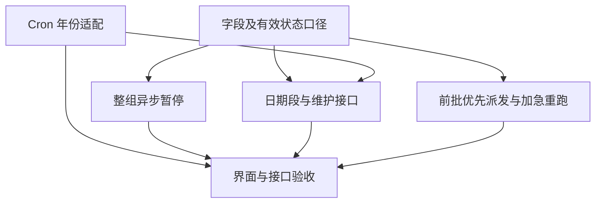

# 新版定时任务四项优化总体设计

## 1. 总体方案

在现有 Scheduler 新版定时任务链路上增加整组异步暂停、Cron 可选年份、运行日期段、同模型池按批次先后优先派发及已结束批次异常重跑加急执行。前批已经进入运行的任务不阻止后批利用剩余容量，不设置整批完成屏障。复用现有管理操作、执行队列、批成员和容量控制，不迁移或重建已有任务身份。

本版是根据最新确认重新归并的整体设计，以本版为后续开发依据，之前“前批必须全部结束才能派发后批”的描述不再适用。

| 模块         | 用户入口                                 | Scheduler 核心处理                                       |
| ------------ | ---------------------------------------- | -------------------------------------------------------- |
| 整组暂停     | 单次调用暂停接口                         | 先暂停数据库中的任务及子任务，再异步关闭平台入口         |
| 年份 Cron    | 创建/修改时填写五段或带年份六段表达式    | 统一校验、本地计算、分发保留年份、转换后注册平台         |
| 运行日期段   | 创建时可选；后续可修改；平台调用维护接口 | 默认不限；组内继承；按实际北京时间限制开始并同步平台开关 |
| 批次派发优化 | 现有普通批次触发及异常重跑入口           | 正常候选前批优先、有空闲可混跑；已结束批次重跑加急       |

本文件是待开发设计，不代表功能已经实现。依据当前分支 `codex/cron-task-tracking`、代码基线 `3ec1e228a` 及本轮逐项确认编写。仅保存设计，不执行 SQL、不修改业务代码、不提交或推送。此前的六个开发单元 U1—U6 保留原编号，便于继续执行和验收。

---

## 2. 已确认的业务规则

| 编号 | 功能               | 最终口径                                                                                                                                                                           |
| ---- | ------------------ | ---------------------------------------------------------------------------------------------------------------------------------------------------------------------------------- |
| R1   | 整组暂停           | 新增异步接口，入参及操作响应结构与删除接口一致，暂停当前任务及全部有效子任务；开启批调度时改为 `batch_paused`，不转普通调度，平台同步关闭                                          |
| R2   | 暂停后的执行       | 已入队但尚未实际开始的执行跳过，恢复后不补跑；正在执行及其已经启动的异步工作继续结束                                                                                               |
| R3   | Cron 年份          | 五段为分、时、日、月、星期；六段为上述五段加末尾年份；支持单年、逗号列表、连续范围；平台端在最前补秒 `0` 并沿用日期/星期的转换                                                     |
| R4   | 运行日期段         | 北京时间起止日期，包含首尾两天；不配置表示不限日期；年份条件和日期段同时满足才允许开始执行                                                                                         |
| R5   | 日期段归属         | 无父任务的任务自行配置；父任务统一配置本组，现有及以后分发的子任务继承，子任务不能单独修改，父任务修改时同步整组                                                                   |
| R6   | 日期暂停恢复       | 进入日期段只解除日期限制，不解除人工暂停、未读自动暂停或手动暂停批调度；日期段外的提前触发跳过、不补跑                                                                             |
| R7   | 日期状态维护       | Scheduler 提供维护接口，由用户自行在外部平台配置调用时间和频率；不增加内部周期巡检，也不自动注册这个维护任务                                                                       |
| R8   | 维护接口简化       | 不做请求幂等记录、多实例抢占、租约、断点续办、下次边界队列或漏调用历史追赶；只处理本次调用观察到的当前状态                                                                         |
| R9   | 普通批次顺序       | 同一 `(source_id, provider_id, model_id)` 池内，空闲容量优先派发较早批次中当前可执行的任务；前批已进入运行或暂时没有可派发任务时，允许后批利用剩余容量；不同池并行，批内原排序保留 |
| R10  | 异常重跑加急       | 已结束批次再次异常重跑不等待正常批次结束，有空闲容量即派发；容量满则释放后优先，不抢占运行中任务，不突破并发限制；仍关联原批次看板，不重新阻塞正常批次                             |
| R11  | 现有职责           | SWE、Scheduler、Monitor 共用数据库；Scheduler 管理和派发，SWE 原子决定实际开始并写执行结果，Monitor 继续现有结果归约和展示；不新增执行结果回传                                     |
| R12  | 前端日期展示与修改 | 新版任务列表及详情展示可执行时间区间，未配置显示不限日期段；父任务可在前端修改并同步子任务，子任务只读展示继承值，不要求重新分发                                                   |

后续技术设计中的路由名、字段名是本次建议，并非已发布契约；实现时不得改变以上业务口径。

---

## 3. 范围与不变项

- 只扩展新版 Scheduler 管理的任务；不改旧 SWE 管理接口、旧页面及旧 Cron 语义。
- 不新增 `jobs.json`、CronManager 内存兼容写入，不改变任务 ID、会话 ID、父子关系和已有外部平台 ID。
- 不修改 `swe_cron_executions` 的表结构，不重写结果、通知、已读或 `is_final` 规则。
- 不新增一键恢复整组接口。恢复仍使用现有启用和三态接口；打开批入口不等于自动启用所有已停用成员。
- 不取消既有批次派发、自动重试和管理操作恢复后台；R8 的简化仅适用于日期维护接口，不撤销既有容量及执行安全控制。
- 不开发新的日历来源、通知策略、模型调度平台或通用任务编排框架。
- 用户自行执行未来提供的表结构 SQL；本设计不进行数据库变更。

---

## 4. 当前实现与系统分工

### 4.1 当前实现可直接复用的部分

- `scheduler/src/scheduler/app/routers/managed_cron_management.py`：删除请求、操作摘要、管理操作查询及续办接口。
- `scheduler/src/scheduler/app/services/cron/managed/controls.py`：任务启停、暂停失效水位、旧表投影和平台启停适配。
- `scheduler/src/scheduler/app/services/cron/managed/dispatch_state_store.py`、`dispatch_state.py`：整组目标、成员清单及逐项平台同步。
- `scheduler/src/scheduler/app/services/cron/managed/recovery.py`：现有异步管理工作恢复循环；日期维护不加入此循环。
- `scheduler/src/scheduler/app/services/cron/managed/batch_members.py`：真实批次与当前成员执行关系。
- `scheduler/src/scheduler/app/services/cron/managed/auto_retry.py`、`settlement.py`：自动重试条件和整轮终态确认。
- `scheduler/src/scheduler/app/services/cron/managed/capacity.py`：现有模型池租约及原子容量控制。

### 4.2 需要改变的现状

- Scheduler 定义校验、平台注册和 SWE `ScheduleSpec` 当前不接受带年份的六段输入。
- `work_query.py` 当前按批内 `dispatch_order`、再按执行 `queue_order` 取工作，后批的第一个成员可能排在前批尚未派发的第二个成员前面；需要改为跨批先比较批次发起时间，再比较批内顺位，而不是禁止批次同时运行。
- 主执行 `success` 不代表异步子任务结束，容量占位和已结束批次重跑资格仍沿用已有整轮收敛事实，但不以整轮结束作为后批派发前提。
- `operations.py` 当前禁止有子任务的源任务修改完整定义，日期段不能仅塞进原完整更新接口而没有独立配置入口。
- 当前没有本次日期段字段及其维护接口；既有未读自动暂停不是日期状态维护。

### 4.3 各系统改动范围

| 系统         | 本次职责                                                                                                         |
| ------------ | ---------------------------------------------------------------------------------------------------------------- |
| Scheduler    | 新增整组暂停、日期配置及日期维护入口；年份校验和平台转换；日期有效性判断；批次先后优先派发与重跑加急派发         |
| SWE          | 新链路定义解析支持年份；实际开始前核对共库日期和暂停条件；保留现有结果持久化、通知和 `is_final` 更新             |
| Console      | 新任务页增加整组暂停操作和日期段设置；年份完整表达式输入、回显和校验；子任务日期只读；聊天及追踪展示有效暂停状态 |
| Monitor      | 原批次、成员、历史和重试次数关联不变；主要做回归，不增加看板列或改变旧批调度逻辑                                 |
| 外部调度平台 | 接受带年份的任务 Cron；按 Scheduler 请求启停既有入口；由用户另行创建日期维护调用任务                             |

---

## 5. 整组异步暂停

### 5.1 接口契约

建议新增 `POST /api/scheduler/cron/jobs/{job_id}/pause`。

Header、身份解析、租户及来源隔离与现有删除接口一致。Body 原样复用删除请求的两个字段：`request_id`、`expected_definition_version`，不要求客户端提交子任务列表或成员版本。

响应沿用删除接口的 `operation` 包装及字段：`operation_id`、`job_id`、`action`、`status`、`stage`、`error_code`、`expected_version`、`version`、`logical_delete_applied`。其中 `action=pause_group`、`logical_delete_applied=false`。首次受理返回 `202`，受理失败按既有 400/404/409/503 规则处理；不等待所有平台调用完成。

客户端提交的业务字段示例（版本取自任务详情，与删除一致）：

```json
{
  "request_id": "pause-group-request-001",
  "expected_definition_version": 1
}
```

查询、恢复当前操作及失败续办继续使用既有 `operations/pending`、`operations/{operation_id}`、`operations/{operation_id}/retry`，不另建查询协议。

### 5.2 内部流程

1. 按当前任务身份鉴权、核对根任务定义版本，读取全部未删除子任务并冻结清单；对子任务调用只处理自身，不扩大到父任务或兄弟任务。
2. 在本地事务中保存暂停操作及逐项进度，立即将清单内任务的 `enabled` 设为 false，写人工暂停语义并推进队列失效水位。批模式组的目标改为 `batch_paused`；普通模式保持普通模式。
3. 提交事务后返回 `202`。活动操作期间拒绝同组分发、模式切换及成员启用等冲突操作，删除沿用既有优先级，不让暂停恢复已删除任务。
4. 后台复用现有管理恢复工作逐项关闭既有普通定时器及本组批入口；不存在的外部 ID 无须为暂停而新注册定时器。
5. 全部同步完成才标记操作 completed；部分失败保留本地暂停与已完成进度，记录错误，按原操作续办，不回滚已生效的暂停。

共享批入口的范围按真实父子关系确定：暂停组根时关闭该组入口；只暂停子任务时不能关闭父任务共享入口或影响其他子任务。不能因为某成员显示为批模式，就把其暂停扩大到整个父组。

### 5.3 执行边界

- 判断是否已经开始，以 SWE 原子 `start` 成功为界。仅 accepted、尚未 start 的执行也应跳过。
- 既有 `queue_invalidation_version` 阻止旧队列在之后启用时重新执行，不只依赖平台关闭结果。
- 已经开始的主执行、异步子任务、结果归约和通知继续按原逻辑结束。
- 不变更任务定义身份、资源绑定、父子关系或日期配置；不把暂停伪装成逻辑删除。

---

## 6. Cron 年份支持

### 6.1 对外及保存格式

业务定义和数据库继续保存用户输入的五段或六段表达式，不保存平台方言作为业务原始排程。

| 输入                    | 含义                        | 注册平台的结果          |
| ----------------------- | --------------------------- | ----------------------- |
| `0 9 * * *`             | 不限年份，每天 09:00        | `0 0 9 * * ?`           |
| `0 9 * * * 2026`        | 仅 2026 年，每天 09:00      | `0 0 9 * * ? 2026`      |
| `0 9 * * * 2026,2027`   | 仅指定的两个年份            | `0 0 9 * * ? 2026,2027` |
| `0 9 * * * 2026-2029`   | 包含 2026 至 2029 年        | `0 0 9 * * ? 2026-2029` |
| `0 9 * * MON 2026-2029` | 2026 至 2029 年每周一 09:00 | `0 0 9 ? * 2 2026-2029` |

五段/六段业务输入的第一段都是分钟，不接受客户端把秒字段混入这两种格式。指定星期时，沿用既有映射将日字段转为 `?`，例如 MON 在平台方言中为 2；不是始终把最后一个星期字段替换为 `?`。字段数量错误、年份越界、反向范围、空列表、超过现有 255 字符字段容量等返回明确参数错误；年份取两端解析能力交集，当前按 1970—2099 校验。不额外开放秒级调度或年份步长等新语法。

### 6.2 统一适配，而非修改第三方库

- 将末尾年份与原五段排程分开识别，所有新版校验、未来时间计算、原始 Cron 保存及平台注册走同一规则。
- 本地计算可以在最前补秒 `0`，使用 `croniter` 的“秒在最前”选项；平台注册继续原日期/星期转换及数字星期映射，末尾保留年份。
- 不修改已安装的 `croniter`、不做全局 monkey patch。Scheduler 与 SWE 各自独立部署，不能为复用解析而互相导入服务运行时。
- SWE 新链路增加专用模型/适配，接入 `managed_resources.py`、`managed_execution.py`、`managed_notifications.py`；旧 `ScheduleSpec` 及旧管理入口继续原来的规则。
- 原五段正常编辑逻辑不变；六段在新页面使用完整自定义表达式输入和回显，不能被旧表单转换为五段或默认 09:00。

### 6.3 散列与未来时间

- 分发子任务、批入口提前执行、更新平台和资源准备都必须保留年份，不允许截掉最后一段。
- 原逻辑执行期和提前后的物理触发期分别计算。跨日/跨年不得只改小时而保留错误年份；无法安全表达的错峰组合延续明确报错规则，不通过丢弃年份、取消错峰或扩大日期集合静默降级。
- 本轮不引入多定时器拼接来扩展原本不支持的复杂散列组合；具体支持边界列入实现测试和联调说明。
- 年份已结束或未来不足三次时，返回实际剩余次数或空数组，`next_run_at=null`；无后续日期不是详情接口 503。
- 未来年份的计算搜索跨度按合法年范围处理，不能把解析器默认搜索窗口耗尽误判为“没有后续时间”。
- 日期段与年份取交集；“下一次运行”不应展示日期段外的周期。暂停原因和“无后续排程”分别表达，不将用户启用意图自动改为 false。

---

## 7. 运行日期段

### 7.1 创建时直接配置，默认没有日期限制

直接扩展现有 `POST /api/scheduler/cron/jobs` 创建接口，在 `spec` 增加可选 `run_date_range`，包含 `start_date`、`end_date`。不需要先创建任务再调用另一个配置接口。

下例仅展示新增的 `spec` 字段片段，其他创建字段继续按原接口提交：

```json
{
  "run_date_range": {
    "start_date": "2026-11-01",
    "end_date": "2026-11-30"
  }
}
```

- 新建请求未传 `run_date_range`，或显式传 null，表示没有运行日期段限制；展开的开始/结束日期为空，默认不会因日期而暂停。
- 传入日期段时，创建流程一次保存配置，并立即判断当天是否允许执行，按该有效状态完成原有平台注册和启停。
- 配置日期时要求两端齐全且开始不晚于结束；只填一端应报参数错误，不能静默当作不限。
- 由分发创建的子任务仍继承父任务日期，不能利用“不传字段”绕过继承规则。

日期严格按北京时间解释，含结束日整天，等价于开始日 00:00 至结束日次日 00:00 的左闭右开区间。

创建的整体顺序保持原链路：校验身份及新字段 → 保存管理操作和待发布定义 → SWE 准备资源 → Scheduler 注册/更新平台并按当前日期设置开关 → 发布可读定义。日期是创建定义的一部分，不引入创建后的第二次必调配置请求；平台或资源准备失败仍使用原操作查询与续办。

父子成员保存同样的日期配置副本，父任务是本组配置入口；以后分发的子任务自动继承。无父任务的普通任务自行配置。日期修改不改变正文、排程、资源绑定或任务身份。

| 条件                                        | 本地有效状态 | 可否开始执行 |
| ------------------------------------------- | ------------ | ------------ |
| 无日期段，且没有其他暂停条件                | 沿用现有状态 | 沿用现有规则 |
| 尚未到开始日                                | 日期限制暂停 | 否           |
| 已过结束日                                  | 日期限制暂停 | 否           |
| 日期内，但任务人工/未读暂停或批入口手动暂停 | 保留其他暂停 | 否           |
| 日期内，其他条件也允许                      | 日期限制解除 | 是           |

日期限制独立于现有 `enabled`、`pause_reason` 和 `dispatch_state`。不使用 `enabled=true` 覆盖原人工暂停，也不使用 `dispatch_state=batch_enabled` 覆盖手动批暂停。

### 7.2 后续修改整组日期：不是创建的额外步骤

创建时已经完成日期配置，无子任务的完整更新也可维护日期。独立日期配置入口仅用于任务创建之后修改当前任务/整组日期：已有子任务的源任务目前禁止完整定义更新，因此建议增加：

`PUT /api/scheduler/cron/jobs/{job_id}/run-date-range`

沿用用户 Header；请求使用 `request_id`、`expected_management_version`、`run_date_range`，以管理版本防止界面覆盖并发控制，而不是把日期调整当成修改正文。直接对子任务调用返回日期配置需由父任务管理的 409。

接口在本地事务中同步保存本组日期副本、立即刷新日期限制状态、管理/运行版本及必要的队列失效水位，记录 `date_range` 管理操作；不提高 `definition_version`，避免使现有平台注册绑定因非正文调整失效。组内并发管理检查仍沿用现有模式。包括清空日期段在内的变更，设置简单的 `date_window_sync_required` 标记，确保后续维护调用仍能找到需要解除旧平台暂停的对象。

保存响应使用既有 `operation` 摘要，可附加 `affected_count`、`platform_sync_required=true` 表示数据库配置已保存，平台状态由维护接口处理，不将“保存成功”误报为“平台全部同步成功”。

新建/完整更新原本就同步平台时，按新的日期有效状态设置入口；本次独立日期配置不在一个数据库事务里逐个调用平台。修改后如要立即同步平台，调用下面的维护接口，无须等待次日。

### 7.3 日期维护接口：按用户要求采用简版

建议新增 `POST /api/scheduler/cron/date-ranges/apply`，同步执行一次并返回当次结果。

Body 只传 `source_id`；不接受用户身份、任意任务正文、人工日期或历史执行时间。采用现有外部平台维护入口的调用形态，不依赖用户 Header，由现有可信内网/网关限制调用来源。不引入新 Token 配置，也不将该入口开放为公网任意调用能力。

每次调用：

1. 固定本次北京时间日期，按来源分页读取配置过日期段、仍有日期暂停标记或 `date_window_sync_required` 标记的 Scheduler 管理任务；未配置日期且从未受日期限制影响的任务不处理。只处理本地可管理的对象，不复活删除或创建失败的任务。
2. 按当前配置判断日期内/外，更新独立日期暂停标记。新进入暂停时推进旧队列失效水位；不会反复恢复已跳过的执行。
3. 对普通任务同步已登记普通定时器；对批模式组按组计算批入口，组外日期关闭、组内且目标仍为 batch_enabled 才允许打开。批成员不另起普通入口。
4. 解除日期限制时仍核对任务自身暂停和整组目标，不能复活已删除任务、人工暂停任务或手动批暂停。
5. 平台启停允许重复下发；每次按当前状态设置，不为此增加去重键或操作租约。成功清除简单的待同步标记，失败保留标记、记录日志并计入响应，其他对象继续；没有内部后台负责重试。

响应建议包含 `source_id`、`evaluated_date`、`scanned_count`、`date_paused_count`、`date_released_count`、`platform_updated_count`、`failed_count` 和有界的 `failures` 摘要。成功及部分失败都返回当次结果，调用级数据库不可用等错误返回 503；必须通过计数区分“解除日期标记”和“实际启用平台”。

**明确不做：** 独立调用表、`call_id`、请求幂等、多实例抢占、分布式锁、后台异步续办、下次边界索引/队列、漏调用事件重放、历史边界追赶或业务补跑。现有普通数据库事务及任务版本更新用于保存有效状态；一个待同步布尔标记只用于避免“清空日期后漏同步”，不保存或恢复某次调用的步骤，不另搭调用级协调体系。

因此，本版就是每次调用检查该来源配置了日期段的任务，不再承诺“只查到期行”。数据库读取可以分页，但调用同步完成，不向调用方暴露断点游标。用户在平台控制单路调用，避免同一来源重叠运行；重复启停、部分完成或超时后的手工复查是简版接受的限制。

失败不由本功能内部定时重试；运维决定是否再次调用。再次调用只计算当时日期，不补开/补关已经过去的历史时间点，更不补跑业务任务。

### 7.4 即时防线及边界

- Scheduler 新触发受理、手动执行、重跑及派发前检查日期；SWE 原子 start 前读共库再次检查当前日期，不能只相信入队快照或平台已关闭。
- 日期外的已登记但未开始工作应及时进入“跳过结案”处理，不因批次排序长期滞留；正常容量控制不能让无效执行一直占住候选分页。
- 已开始的执行及其异步结果、通知不受日期到期中断；日期外不能再启动其新的业务重试。
- 实际北京时间在范围外就不开始。例：11 月 1 日开始、该轮提前到 10 月 31 日触发，则跳过，不推迟补跑。
- 不承诺在开始日零点一定完成平台开启。维护接口由用户配置调用时刻；如零点触发先于平台开启，该轮不补发。回调/执行校验只保证“不越界开始”，不保证“漏触发也执行”。
- 未调用维护接口时，范围外的执行仍会被实时校验阻止，但外部平台可能保持旧开关，范围内也可能因入口未开而漏执行；这属于简化后的运维责任。

---

## 8. 同池按批次先后优先派发及异常重跑加急

### 8.1 普通批次顺序

作用域固定为 `(source_id, provider_id, model_id)`。不同池独立取任务；同一池内的批次也可以同时运行，区别是有空闲容量时优先从较早批次取当前可执行的任务，而不是较晚批次的低序号成员插到前批待派发成员之前。

批次发起时间使用 `swe_cron_managed_trigger_receipts.created_at`，不是原排程 `logical_fire_at` 或成员更新时间。时间相同时用该批首次执行的最小 `queue_order` 作稳定顺序，不改写已有历史时间。只对已经持久受理的批次排序；尚未回调或受理事务尚未提交的工作，不预先占住模型池。

正常批次的可派发候选先按批次发起时间、该批稳定顺序排序，再按批内 `dispatch_order`、执行 `queue_order` 排序。批内继续沿用用户、分行、阅读热度等冻结顺位，不重新计算已经冻结的批内优先级。

例：模型池容量为 10，较早批次 A 的 6 个任务已经进入运行，池里还空 4 个名额，则可以派发后批 B 的 4 个任务，不需要等待 A 完成。A 如果仍有当前可派发的任务，则先用空闲名额派发 A，再取 B。派发顺序优先不保证各批的实际完成顺序。

### 8.2 当前可派发与容量占位分开

- 已运行、已受理等待开始，或主执行结束但异步仍占位的工作，继续按已有模型池规则占用容量；不因为“前批已经派发”就提前释放其占位。
- 前批剩余容量以模型池真实可用值为准，不另外为前批或其未来自动重试预留空闲名额。
- 尚未到派发/重试时间、受单任务并发限制或不满足当前领取条件的候选，不阻止后批其他可执行工作使用空闲容量；过滤条件沿用既有规则，不为批顺序新增等待屏障。
- 前批的自动重试到期后重新进入候选，按原批次时间和批内顺位优先于较晚正常批次尚未开始的任务，不抢占已经运行的后批任务。等待重试期间，后批可以继续运行。
- 复用现有自动重试次数、间隔、不重试错误及结果确认规则；已停用、删除或失效工作及时跳过，结果不明的工作仍按现有恢复/超时处理，不伪装成结束。

### 8.3 复用现有领取及容量保护，不增加批次完成门禁

调整候选查询的跨批排序，并在既有 `ExecutionDispatcher` 领取事务中保留任务版本、到期时间、暂停状态、单任务并发及共享模型池容量校验。继续复用 `ManagedCapacityGate` 和 `swe_cron_dispatch_scope_leases`，不增加“当前独占批次”、批次完成屏障或新的批次锁表。

跨实例不重复领取和不超并发仍由现有保护保证；本功能不是要求两个批次不能同时运行，也不阻挡运行中工作的恢复及终态确认。

普通调度、非批次手动执行继续原有路径和并发规则，不因这次功能被改造成全局 FIFO；新旧任务原有共享容量核算保持不变。

对已经通过到期、暂停和单任务并发等过滤的批次候选，本轮派发逻辑是：

1. 读取当前池实际可用容量，没有容量则等待下一次原有派发机会，不额外扩容。
2. 有到期加急重跑时优先尝试加急候选。
3. 正常候选按批次发起先后、批内原顺位选取；前批暂时不可领取的记录不占住后批可执行候选的分页。
4. 在现有事务中再次核对任务条件和容量后领取，已领取/运行工作按原规则占位。
5. 仍有剩余容量则继续选取，不因为前批还有运行或异步工作就停止。

这只是候选优先级，不是新调度器或整批状态机；不保证前批一定先完成。

### 8.4 已结束批次重跑走加急通道

在服务端确认批次已结束后，异常重跑创建/恢复的执行标记为 `dispatch_lane=urgent`，不由客户端传入或伪造。服务端覆盖批看板重试及当日失败补跑等实际重跑入口。

- 重跑受理事务提交后，复用带现有容量门禁的派发入口立即尝试一次；有容量即派发，不受正常批次的先后排序等待。未能领取时交回既有派发循环，容量释放后优先于普通新领取候选，不新增独立定时器，也不抢占正在运行任务。
- 不是无限额额外 Worker；单任务并发、日期段、人工暂停、删除及执行幂等等原有约束仍生效。
- 仍使用原 `batch_id`、成员身份和原逻辑执行期，更新当前执行指针和业务尝试次数；不创建假的新平台触发回执。
- 普通批次没有整批完成屏障；urgent 标记用于明确加急优先级，不改写旧批发起时间，也不以旧批还有未完成重跑为由阻止其他正常批次派发。
- 未闭批期间的重试仍属于当前正常批。加急执行后续若按现有条件继续自动重试，保持 urgent 通道；未到重试时间时不预留容量。
- 外部 HTTP 已受理未确认的同次投递恢复，不凭空增加业务重试次数；沿用现有规则，不更换 `execution_id` 规避幂等。
- 看板仍显示原批次的成员和最新重试结果，重试次数与 `is_final` 沿用现有结果链路，普通投递次数不新增展示。

---

## 9. 接口总览

| 类型 | 接口                                                   | 作用及执行方式                                                                         |
| ---- | ------------------------------------------------------ | -------------------------------------------------------------------------------------- |
| 新增 | `POST /api/scheduler/cron/jobs/{job_id}/pause`         | 整组暂停；异步受理，沿用删除请求及 operation 响应                                      |
| 新增 | `PUT /api/scheduler/cron/jobs/{job_id}/run-date-range` | 独立保存当前任务/整组日期配置，突破“有子任务不能完整编辑”的限制，不修改正文            |
| 新增 | `POST /api/scheduler/cron/date-ranges/apply`           | 平台按来源调用；同步做一次当前日期检查及平台启停，不自建后台定时                       |
| 扩展 | `POST /api/scheduler/cron/jobs`                        | 创建时直接接受可选 spec.run_date_range；未传或 null 默认不限日期，无须额外调用配置接口 |
| 扩展 | 既有完整更新、分发、任务列表和详情                     | 支持年份及日期属性；分发子任务继承父配置，保持原身份和响应主结构                       |
| 扩展 | 既有 operations 查询及 retry                           | 识别 pause_group；date_range 配置操作作为普通已完成管理记录                            |
| 扩展 | 既有普通/批 callback、执行及重跑入口                   | 日期门禁、跨批派发优先级及服务端加急标记；旧路径不变                                   |

不新增外部平台回执接收接口，也不新增 Scheduler 向 SWE 询问执行终态的 HTTP 链路。

为避免把几种日期入口混为一谈，调用关系固定为：

- 创建任务：只需现有创建接口；有日期就随 `spec` 提交，没有就省略。
- 后续调整已有父组日期：调用独立日期配置接口，避免绕开已有“禁止修改有子任务源正文”的限制。
- 根据当天日期切换平台开关：由用户配置的外部平台调用维护接口，不由前端或 Scheduler 自己创建周期任务。
- 触发任务实际运行：仍走现有 callback → 执行队列 → SWE，不由日期维护接口补发执行。

---

## 10. 表结构及数据写入设计

### 10.1 建议新增字段：不新建业务表

| 现有表                    | 建议字段                    | 类型及默认值             | 中文含义                                       |
| ------------------------- | --------------------------- | ------------------------ | ---------------------------------------------- |
| `swe_cron_jobs_v2`        | `run_start_date`            | DATE，可空               | 允许运行开始日期（北京时间，含当天）           |
| `swe_cron_jobs_v2`        | `run_end_date`              | DATE，可空               | 允许运行结束日期（北京时间，含当天）           |
| `swe_cron_job_states`     | `date_window_paused`        | TINYINT(1)，默认 0       | 日期限制暂停标记，不覆盖其他暂停原因           |
| `swe_cron_job_states`     | `date_window_sync_required` | TINYINT(1)，默认 0       | 日期配置变更或平台同步失败后仍需同步的标记     |
| `swe_cron_execution_runs` | `dispatch_lane`             | VARCHAR(16)，默认 normal | 派发通道：normal 正常、urgent 已闭批后重跑加急 |

日期在 `spec_json.run_date_range` 保留配置，并展开两列便于维护接口按来源读取；二者在同一事务更新。状态标记用于管理投影和队列失效转换，实际开始仍核对当天日期，不能以标记代替实时判断。

不增加单独年份列，不修改 `cron_expr`、`original_cron_expr` 的业务语义。两列继续使用现有 VARCHAR(255)，校验业务输入长度，避免较长年份列表在写库时才失败。批次优先不增加“当前批 ID”“独占批状态”或完成屏障字段。

既有行默认空日期、不受限制，现有执行默认 normal，不重新注册存量外部定时器或改写历史。升级 SQL 由用户执行，发布前 Scheduler 与 SWE 的实际 schema 校验一起更新。

### 10.2 复用的表

| 表                                   | 本次用途                                                                          |
| ------------------------------------ | --------------------------------------------------------------------------------- |
| `swe_cron_registration_journal`      | pause_group 的异步操作和失败续办、date_range 的配置审计；不拿来存每次日期维护调用 |
| `swe_cron_managed_mode_items`        | 复用逐成员同步结构记录 pause_group 进度，以 action 区分，不混入三态模式结果       |
| `swe_cron_managed_dispatch_controls` | 保留整组批目标，手动整组暂停时设 batch_paused；日期限制不擅自覆盖目标             |
| `swe_cron_managed_trigger_receipts`  | 真实批次发起时间和成员清单                                                        |
| `swe_cron_managed_batch_members`     | 当前成员执行、业务重试次数、批内顺位及已结束批次加急重跑资格判定                  |
| `swe_cron_managed_dispatch_events`   | 沿用实际派发/重试/收敛事实及原因；不伪造日期维护历史时间点                        |
| `swe_cron_dispatch_scope_leases`     | 沿用模型池最终领取保护，不为日期维护增加独立租约                                  |
| `swe_cron_executions`                | 继续 SWE 的历史、异步、已读、通知及最终尝试写入，无本次新增列                     |

现有 `swe_cron_jobs` 投影写入继续调用原 `write_projection` 路径，仅补充新任务日期有效状态的映射；不修改旧任务管理入口，不另造双写或同步机制。

### 10.3 索引

跨批优先查询复用批成员的 current_execution_id、source/batch 索引。回执表目前只有 callback_key 和任务逻辑时间索引，需要评估补充 batch_id 查找及来源/发起时间排序索引；加急工作查询评估模型池、通道和执行状态联合索引。不为批次完成屏障新增状态或索引。

日期维护无需“下次边界”索引或调度事件表。只按来源、Scheduler 管理、未删除等现有条件分页扫描；实现时核对实际 MySQL 索引并验证执行计划，避免重复建索引。本设计未执行任何 DDL。

---

## 11. 前端、追踪和兼容

1. 新任务管理页增加“暂停任务及全部子任务”，复用现有操作查询 UI，不在聊天页新弹出管理进度弹窗。
2. 新版任务列表增加“可执行时间区间”列，详情同步展示，格式为开始日期至结束日期，明确按北京时间且含首尾两天；没有配置显示“不限日期段”。此列展示配置的日期段，不把“下次运行时间”当成区间；Cron 年份条件仍在排程中展示。
3. 创建表单提供可选日期范围选择，只选日期、不增加时分；父任务（包括没有父任务的独立任务）提供“修改可执行时间区间”入口，回显当前值，支持修改及清空为不限日期。已有子任务也能使用该独立入口，不走被禁止的源任务正文完整更新。
4. 修改调用 `PUT /api/scheduler/cron/jobs/{job_id}/run-date-range`，使用最新管理版本；保存后刷新当前列表和详情。后端同步所有有效子任务，重新打开子任务即可看到新值，不修改正文、不重新分发。子任务只读展示“继承父任务”，隐藏或禁用独立修改操作，后端同样拒绝绕过。
5. 日期配置保存和平台实际启停分开表达：保存后本地配置及执行日期门禁立即生效，外部平台开关由维护接口同步；不把配置保存成功显示成“平台已全部同步”。版本冲突时提示刷新后重试，不自动覆盖。
6. 带年份任务完整回显，不丢失列表、范围或退回默认时间；旧五段快捷表单及旧页面不变。
7. 用户启用开关表达原有启用意图，日期暂停单独展示“未到生效日期/已过运行日期”等有效状态，不用自动翻转开关掩盖人工意图；待同步标记只表示尚需同步，不能冒充外部平台的实时查询结果。
8. 新任务详情、聊天任务列表及任务追踪读取同一有效暂停口径；追踪补充日期属性、真实 pause_group/date_range 管理记录及加急派发原因，不新增事实采集后台。
9. Monitor 批看板保留原批 ID、成员数、失败详情、重试次数与历史，无需新增一套批次看板；对加急重跑的原批关联和完成进度进行回归。

---

## 12. 建议开发拆分

以下是依赖关系示意，用于评审，不是待复制的实现代码。U1 与 U2 为基础；U3/U4/U5 汇合到 UI 和验收，不代表必须拆成同样次数的上线。



### U1. 数据契约与有效状态口径

**Goal / Requirements:** 明确日期、用户启用意图、暂停原因、队列失效和加急标记的独立职责，覆盖 R2/R4/R6/R10/R11。无前置依赖。

**Files:** 修改 `scheduler/src/scheduler/app/services/cron/managed/schema.py`、`repository.py`、`views.py`、`projection.py`、`src/swe/app/crons/managed_results.py` 的读取及状态映射；补充手工升级文档。测试新增 `tests/unit/scheduler/test_managed_cron_date_state.py`，扩展 `tests/unit/app/test_managed_cron_execution_boundaries.py`。

**Approach / Patterns:** 沿用共库原子 start、状态版本和 write_projection；先用特征测试锁定旧启停及已读行为，再增加独立日期状态。对当前生效日期使用统一北京时间规则，不迁移结果写入职责。

**Test scenarios:** 空日期不影响已有任务；日期外但手动启用仍不开始；解除日期条件不清空人工/未读暂停；日期到期不终止运行中任务；旧执行未设置通道时按 normal 处理；已失效队列不在之后恢复执行。

**Verification:** 用户意图与有效暂停不混淆；三服务读取同一数据库事实；旧结果及通知写入没有字段改造。

### U2. 年份语法及端到端适配

**Goal / Requirements:** 覆盖 R3。可独立于日期功能推进。

**Files:** 修改 `scheduler/src/scheduler/app/services/cron/managed/definition.py`、`platform.py`、`scatter.py`、`views.py`、`distribution.py`、`distribution_worker.py`、`dispatch_state.py`；新增轻量新版语法适配模块；SWE 新增 `src/swe/app/crons/managed_models.py` 并切换三个新链路解析入口。测试新增 `tests/unit/scheduler/test_managed_cron_year.py`，扩展 `tests/unit/app/test_managed_cron_resources.py`、`test_managed_cron_execution.py`、`test_managed_cron_notifications.py`。

**Approach / Patterns:** 用户五/六段、平台六/七段分别转换；不改库、不全局改变旧模型；有限未来时间正常返回不足三条。

**Test scenarios:** 五个已确认表达式得到精确平台值，包含 MON 加年份范围；星期数字/名称维持原映射；非法年、倒置范围及过长年份列表拒绝；期限穷尽不报详情 503；分发、批提前量、更新、SWE prepare/execute/notify 不截断年份；不安全错峰组合明确报错。

**Verification:** Scheduler 受理至 SWE 执行及通知全链路兼容年份，原五段与旧入口回归通过。

### U3. 整组异步暂停

**Goal / Requirements:** 覆盖 R1/R2，依赖 U1。

**Files:** 修改 `scheduler/src/scheduler/app/routers/managed_cron_controls.py`、`managed_cron_management.py`、`services/cron/managed/controls.py`、`recovery.py`、`operations.py`、相关三态/逐项同步工具；新增 `pause_group.py`。测试新增 `tests/unit/scheduler/test_managed_cron_group_pause.py`，扩展 `test_managed_cron_controls_api.py`、`test_managed_cron_mode_recovery.py`。

**Approach / Patterns:** 复用 DeleteRequest/operation_summary、异步批量删除和三态操作模式；数据库先暂停并失效旧队列，平台调用在事务外，操作续办只处理未完成对象。

**Test scenarios:** 删除接口同样的请求可用于暂停；普通根、批根、零子任务、子任务自身范围；batch_enabled 转 batch_paused 而不注册普通入口；accepted 未开始跳过、running 继续；平台局部失败与续办；分发/成员启用冲突；已删除成员不复活。

**Verification:** 返回结构与约定一致，202 后本地已停、操作只有在全部平台同步完成时结束，失败可查可续办。

### U4. 日期配置、继承及简版维护入口

**Goal / Requirements:** 覆盖 R4—R8，依赖 U1/U2。

**Files:** 修改新建、控制、分发、视图及平台启停相关模块，新增 `scheduler/src/scheduler/app/routers/managed_cron_date_ranges.py`、`services/cron/managed/date_ranges.py`；扩展 `executions.py`、`scheduling.py`、`dispatcher.py` 和 SWE `managed_results.py` 的日期门禁；不得给 `recovery.py` 新增日期维护 lane。测试新增 `tests/unit/scheduler/test_managed_cron_date_ranges.py`、`test_managed_cron_date_ranges_api.py`，扩展 SWE 边界测试。

**Approach / Patterns:** 配置接口沿用用户控制；维护入口参考 `routers/daily_failure_retry.py` 的来源校验及无用户 Header 调用形态，但不复制其异步调用表和后台恢复；只按本次日期分页检查、同步返回结果。

**Test scenarios:** 创建未传/null 日期时默认不限，传日期时一次保存并按当天状态注册平台，单端日期拒绝；有子任务的源可独立改日期但不能改正文；以后子任务继承且不能用缺省值绕过、子任务不能改；边界首尾当天有效；前一日晚提前触发跳过；人工/未读/批暂停不误恢复；全组日期外关闭批入口；清空日期后仍可同步解除原平台暂停；平台启用失败保留待同步标记；无 Header 的有效来源请求可维护，非法来源输入拒绝；平台单项失败不吞日志；没有内部日期轮询、call_id 或补跑；普通/手动/加急重跑均不能绕过日期。

**Verification:** 用户可通过 Postman 和平台单次调用验证启停；不依赖新后台计划；返回的是当次处理结果而非业务执行结果。

### U5. 前批优先派发和闭批后加急重跑

**Goal / Requirements:** 覆盖 R9/R10，依赖 U1；与 U4 合并时补日期失效结案回归。

**Files:** 修改 `scheduler/src/scheduler/app/services/cron/managed/work_query.py`、`dispatcher.py`、`batch_retry.py`、`daily_retry_enqueue.py`、`auto_retry.py`、`batch_failures.py`；仅复用 `capacity.py` 的现有保护，不增加批次独占门禁。加急资格复用已有终态/重试条件，不复制另一套规则。测试新增 `tests/unit/scheduler/test_managed_batch_priority.py`、`test_managed_batch_urgent_retry.py`，扩展 `test_managed_cron_capacity_dispatch.py`、`test_managed_batch_auto_retry.py`、`test_daily_failure_retry_boundaries.py`。

**Approach / Patterns:** 当前成员及回执作为关系事实，候选按批发起时间优先、批内原顺位排序；既有领取事务继续检查真实容量，不等待整批完成。闭批后重跑通道由服务端判定，保留原批成员指针和结果规则。

**Test scenarios:** A/B 同池且都有可执行任务时优先 A，即使 B 批内顺位更小；容量 10、A 的 6 个成员已运行时允许 B 使用剩余 4 个名额；A 等异步时只有其真实占位减少剩余容量，不阻止 B 使用空闲；A 等五分钟自动重试时 B 可运行，重试到期后 A 在剩余正常候选中优先但不抢占 B；前批单任务并发受限不造成整个池空等；不同池并行；同时间戳稳定顺序；两实例不重复领取、不超容量，允许不同批同时运行；urgent 有容量即执行/满容量释放后优先；日期及单任务限制仍生效；is_final/业务尝试次数与看板关联保持。

**Verification:** 既证明前批可执行任务优先，也证明其全部进入运行后后批能利用空闲容量；不增加 Worker 上限、整批完成屏障或抢占逻辑。

### U6. 页面、追踪、文档和预发布验收

**Goal / Requirements:** 覆盖 R12 及本轮所有用户可见入口，依赖 U2/U3/U4/U5。

**Files:** 修改 `console/src/api/modules/schedulerCron.ts`、`console/src/api/types/schedulerCron.ts`、`console/src/pages/Control/SchedulerCronJobs/` 对应页面和表单、新版任务有效状态查询；修改 `scheduler/src/scheduler/app/services/cron/tracking_management.py`、`tracking_lookup.py`、`tracking_common.py` 的白名单；更新现有部署、接口和 Postman 文档。测试扩展对应 `ManagedJobEditor.test.tsx`、`scheduleForm.test.ts`、`index.test.tsx` 及追踪 API/节点测试，添加日期设置和整组暂停交互测试。

**Approach / Patterns:** 样式与现有新任务页一致；只补本轮功能和真实状态展示，不新做看板或聊天弹窗。

**Test scenarios:** 202 暂停操作可刷新查询和续办；列表及详情展示可执行时间区间和不限日期段；父任务有子任务时可回显、修改及清空区间，提交到独立日期接口而非正文更新接口；保存后父子数据一致且不触发重新分发；子任务只读，绕过前端直接修改也拒绝；日期保存平台未同步时不误报已启停；版本冲突不静默覆盖；年份完整回显不丢失；日期暂停与人工开关分别可理解；原批看板仍看得到加急重跑；追踪只展示有真实时间依据的管理节点；旧页面回归不变。

**Verification:** 新增功能可用 Postman 完整验收，前端沿用既有布局，SQL 由用户执行后再发布依赖字段的服务。

---

## 13. 风险、发布及验收

### 13.1 明确接受的简化

| 风险                                                   | 本轮处理                                                                                     |
| ------------------------------------------------------ | -------------------------------------------------------------------------------------------- |
| 日期维护接口漏调用、同来源重叠调用、重复启停或请求超时 | 不做调用级幂等/抢占/续办；平台配置单路调用，运维检查当次日志和失败数；必要时自行再次调用     |
| 开始日零点平台入口尚未开启                             | 不承诺补发业务任务；提前规划维护时刻与业务 Cron，实时校验只保证不越界                        |
| 日期维护对象很多导致同步耗时                           | 服务内部读库分页、日志按项汇总；实际容量联调后设置平台超时，超时不等于数据库和平台完全未处理 |
| 把前批优先误实现为等前批完成                           | 只排序当前可派发候选；已有运行和等待重试不预留额外容量，后批可使用真实空闲空间               |
| 前批自动重试到期后与后批已有运行并存                   | 前批到期重试优先于后批待派发任务，但不抢占已有运行，不保证先发起的批一定先完成               |
| 带年份错峰及行内平台兼容性                             | 本地规则和平台实际注册两端验证；不安全组合明确失败，不静默丢失年份                           |

### 13.2 发布顺序

先由用户执行审核后的增列/索引 SQL；兼容旧值的 Scheduler 和 SWE 后端先发布，再发布 Console，最后由用户在平台配置日期维护接口。原有五段、无日期任务不需数据迁移或重新注册。

年份任务会同时经过 Scheduler 和 SWE 新链路校验，因此不能只发布其中一个服务就开放六段输入。发布时若已有多个普通批正在运行，不抢占它们；让已领取工作继续完成，后续新领取按前批优先的候选排序处理，不能借发布引入整批串行等待。

### 13.3 Postman 核心验收

1. 创建普通父/子和批父/子，调用 pause，核对 202、操作查询、数据库暂停、外部关闭、已排队跳过、已运行继续。
2. 按本文件五个 Cron 示例创建/更新，核对任务原值、平台值、详情未来时间和 SWE prepare/execute/notify，尤其核对 MON 不被变成每天。
3. 创建时不传/null 日期，核对默认不限；创建时传日期，核对无需第二个配置请求即生效。再调整整组日期，核对已有/新增子任务继承和子任务拒绝修改；调用维护接口核对范围内/外及人工暂停保护；不传用户 Header 也可按来源维护。使用相对当日的起止日期构造未开始/已过期/有效三类样例，不给维护接口加入人工模拟时间参数。
4. 人工将平台关闭失败、漏调用等场景留在可观测状态，确认接口没有偷偷创建日期后台任务、历史追赶或业务补跑。
5. 同池发起两批，核对有空闲时优先取前批可执行任务；前批全已进入运行、等待异步或尚未到重试时间时，后批可以使用剩余容量；到期的前批自动重试重新优先，但不抢占运行中任务；对已结束批异常重跑验证加急通道。
6. 回归原批看板、任务追踪、聊天状态、业务重试次数、结果错误详情、`is_read/read_at` 和 `is_final`。

---

## 14. 研究依据与当前限制

- 当前仓库参考：第 4 节列出的实现，以及 `src/swe/app/crons/managed_results.py` 的原子开始门禁、`docs/deployment/cron_phase2_manual_create.sql`、`docs/deployment/cron_batch_board_manual_create.sql` 的实际字段/索引。
- 年份和秒位置参考 [croniter 官方说明](https://github.com/pallets-eco/croniter#about-year)；平台日期/星期规则参考 [Quartz CronExpression 文档](https://www.quartz-scheduler.org/api/2.2.3/org/quartz/CronExpression.html)。文档不能替代行内平台实际版本的注册验证。
- 具体查询和索引须在实现时以实际 MySQL 的执行计划验证；本轮不连接业务数据库，不运行实现测试或修改运行数据。
- 本 worktree 未注册 GitNexus 索引，本轮查询失败，未将其他 worktree 的图谱当成本分支证据；设计依据为本分支源码和已有契约。
- 按用户 AGENTS.md，在主线程顺序核对和文档自检，不派发子代理；不得把本轮自检称为独立评审。

---

## 15. 尚待实现验证，不再增加业务澄清的问题

- 行内平台的年份范围及表达式实际接受能力；无法安全平移的年份错峰组合清单。
- 前批优先查询在实际数据量下的索引选择、分页和既有容量锁顺序，避免候选页被暂不可执行的前批任务占满而无法取到后批可执行任务。
- 日期同步接口在该来源任务规模下的耗时及外部平台调用超时；本轮不以新增调度框架来规避这些实际验收。

以上属于实现与联调验证，不表示已经开发完成，也不授权修改旧任务逻辑或自动执行 DDL。

文档主线程自检覆盖：创建日期缺省与继承、日期开关与任务实际开始的边界、五段/带年份六段及 MON 转换、前批优先但允许混跑、重试等待不预留容量、加急重跑及既有容量限制、清空日期后的待同步处理。没有运行独立代理评审或实现测试；本轮仅核对源码契约、需求一致性和文档格式。
