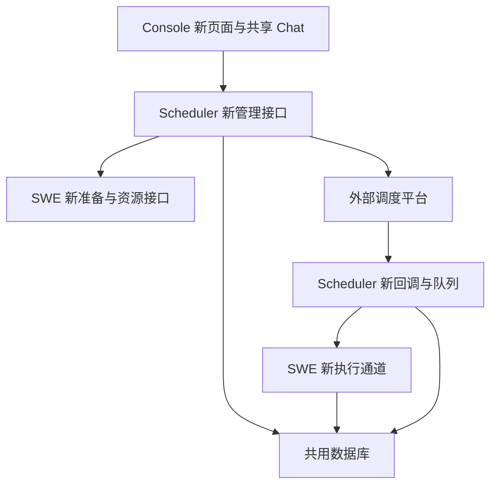

# 第二阶段开发计划

## Summary

覆盖已经澄清的第二阶段：Scheduler 管理新任务，SWE 准备和执行、直接写共库结果，Console 增加与原页面一致的新任务页面并适配 Chat。分发与调度方式独立操作；不修改存量链路。用户已确认在当前 v1.0.0 工作区开发。

---

## Requirements

- 管理归属为 Scheduler 的定义以 swe_cron_jobs_v2 为准，运行及管理状态使用 swe_cron_job_states；legacy 快照不接管。
- 创建和更新同步，删除先逻辑删除；失败保留可查进度、人工续办。新任务不写 jobs.json 或旧 _states，仍维护 swe_cron_jobs 兼容投影，不修改原写入逻辑。
- 分发异步、0～1000 人、同源串行；失败通过新轮重试。散列沿用均匀提前算法，不支持时回退原排程并告警。0 人只改全部既有子任务排程；明确新轮遇到删除对象才另建隔离身份。
- 三态异步，外部失败不全组禁触发；逐对象生效、允许临时混合，未完成不得换目标，可人工重试；停用、删除及批暂停仍遵守数据库业务限制。
- 单任务停用跳过尚未开始工作、在途继续。恢复清理已有未读，不清新结果。手动执行拒绝停用和运行中的任务，复用已受理但未开始的请求。
- SWE 按执行身份登记受理、开始和结果，Scheduler 读共库收敛队列，不要求完成回调。运行失败不自动重跑，不扫描定义补生未收到的平台触发。
- 前端保留原样式、表格、表单抽屉、状态和交互；新增独立入口，不重写原页面。Chat 旧列表在前、新列表在后，动作和预览已读按真实归属分流，失败不回退旧写接口。
- 关联子任务逐项授权，源管理者可管理关联对象，接收人只管理自己；完整 Header 身份、版本校验、敏感信息脱敏及稳定分页。

---

## Scope Boundaries

- 不接智拓应用代码（第三阶段），不全量迁移存量，不改变普通任务的外部时间触发职责。
- 不执行业务 DDL，不修改 swe_cron_executions 结构，不更新行内包，不自动提交或推送。
- 保留当前未提交的 pre-commit 配置和本地检查工具；不把它们纳入业务变更。
- 不把 Chat/会话/产物存储整体改成数据库，不移除运行所需锁、信号量和在途对象。

---

## Context & Research

- Scheduler 为独立 Python 包，只有旧批回调、旧执行反馈及运行状态管理，不能直接依赖 SWE 应用包。
- Scheduler 数据库封装位于 scheduler/src/scheduler/app/database/connection.py；SWE 迁移仓库已使用事务和两表身份、所有权保护，可对照但不改变其 legacy 导入语义。
- 原 UI 位于 console/src/pages/Control/CronJobs，使用 AgentScope Design/Ant Design、CSS Modules 和既有主题；新页复用样式与纯组件，独立管理适配器。
- 旧批次优先级按用户顺序、支行顺序快照；Workflow 绑定在入队前冻结版本。原执行器承担会话提交、追踪和结果产物，不应绕过。
- 当前任务按 AGENTS 在主线程顺序执行。Superpowers 技能不可用，采用本计划和测试优先方式；自查不冒称独立多代理评审。

---

## Key Technical Decisions

| 边界 | 方案 | 保证 |
| --- | --- | --- |
| 新旧隔离 | 新管理路由和新执行协议，严格管理归属 | 导入快照不被误用；旧接口协议不变 |
| 身份与授权 | Header 解析完整 tenant/source/Agent，源子关系数据库鉴权 | 不凭裸任务 ID 或前端来源标记授权 |
| 状态并发 | 管理与运行分字段写；执行 ID、定义版本和操作版本各司其职 | 不用旧状态整行覆盖，不重复累计未读 |
| 外部调用 | 先登记操作，确认已有绑定，保存逐步进度 | 超时不误判未创建，不重复注册 |
| 前端一致性 | 原样式、原纯表单组件，新请求模块和控制器 | 新接口错误不回退旧写接口 |

---

## Implementation Units

### U1. 新任务契约、授权、只读仓库与查询路由

**Goal:** 提供独立可测试的新任务列表、详情和关联子任务查询基础，保持 legacy 隔离。

**Dependencies:** 无。

**Files:** 新建 scheduler/src/scheduler/app/services/cron/managed/ 下 contracts.py、identity.py、repository.py、views.py；新建 scheduler/src/scheduler/app/routers/managed_cron.py；注册到 routers/__init__.py；测试 tests/unit/scheduler/test_managed_cron_queries.py。

**Approach:** 只读参数化 SQL 和稳定 keyset 分页；同 scope/Agent 查询，排除 legacy；按源子关系判授权，状态与定义映射到原前端形状；不存在不回退旧表。读取不准备资源、不扫描目录、不修复状态。

**Execution note:** 先写 SQLite 真实查询及 ASGI 路由失败测试，再实现；不以 mock SQL 返回替代关系查询验证。

**Patterns to follow:** migration_repository.py 两表字段和完整身份；task_view.py 原展示语义；tests/unit/scheduler 的 ASGI 测试。

**Test scenarios:** 正常分页与详情；legacy 和其他 source/Agent 不可见；缺少 Header 拒绝；伪造 scope 拒绝；接收方不能访问其他用户；源创建者可查子任务；同 ID 不同 scope 隔离；缺失状态不虚报就绪；数据库错误不伪造空列表；读取零写入。

**Verification:** 查询路由测试和旧路由回归通过，新读操作不触碰文件、旧缓存或外部平台。

### U2. 创建更新删除与 SWE 准备、平台适配

**Goal:** 新管理入口具备同步创建/更新、逻辑删除、进度查询及人工重试。

**Dependencies:** U1。

**Files:** managed/ 下 management.py、operations.py、platform.py、swe_client.py、projection.py；SWE 新建 app/crons/managed_resources.py、managed_api.py；tests/unit/scheduler/test_managed_cron_management.py、tests/unit/app/test_managed_cron_resources.py。

**Approach:** 两表事务、操作身份及版本门禁；SWE 只准备绑定，Scheduler 注册平台及写新旧表；不调用旧 create_or_replace_job。更新先保存待生效版本，保留入队快照；删除不自动级联。原适配器纯协议可提取复用，但不把平台操作委托 SWE。

**Test scenarios:** 创建三种任务；请求幂等和内容冲突；SWE/平台各阶段失败及原操作续办；平台结果不明先核对；新任务无文件条目；源有子任务拒绝内容编辑；分发中拒绝源删除；删除资源延后及失败重试；运行状态不被管理默认值覆盖。

**Verification:** 实际路由→服务→测试数据库链路通过；测试替身仅用于 SWE 和平台边界，旧 CRUD 回归不变。

### U3. SWE 新执行通道与共库执行登记

**Goal:** 新普通、批、手动请求都按持久执行快照运行，SWE 自己保存状态与结果。

**Dependencies:** U1、U2。

**Files:** managed/executions.py、dispatcher.py；SWE app/crons/managed_execution.py、managed_results.py；tests/unit/scheduler/test_managed_cron_executions.py、tests/unit/app/test_managed_cron_execution.py。

**Approach:** 独立执行 ID 和运行登记；复用原执行器的合法执行能力，不通过旧按 ID 读文件的 run_job。先持久受理再启动；重复请求同身份只启动一次；SWE 写运行字段和历史，Scheduler 查询收敛，不增加最终完成回调。

**Test scenarios:** Agent/文本/Workflow 执行；重复和并发受理；受理响应丢失查表不另起执行；运行失败不自动重跑；旧版本迟到不覆盖新状态；重复结果不增加未读；结果落库失败不虚报成功；删除在途不复活；Workflow 历史版本不可用时显式失败。

**Verification:** 执行测试证明没有 jobs.json/旧 _states 依赖；共库结果只保留一份，通知和追踪适配回归通过。

### U4. 独立启停、手动执行、已读和批优先级

**Goal:** 覆盖原页面、Chat 需要的任务控制能力。

**Dependencies:** U2、U3。

**Files:** managed/controls.py、priority.py；managed_cron.py；tests/unit/scheduler/test_managed_cron_controls.py。

**Approach:** 单任务启停与三态分离，已读水位与运行完成事务协调；手动请求持久去重；优先配置只影响新批次，复用原优先算法。

**Test scenarios:** 停用跳过待开始但不取消在途；恢复清旧未读、新结果保留；停用/运行中手动请求拒绝；已有待执行手动请求复用；源自身停用不暂停整组；优先级不重排旧意图；逐项批量操作权限及部分失败。

**Verification:** 并发受理、已读和暂停竞争测试通过，不改变旧启停接口。

### U5. 异步分发与逐对象三态切换

**Goal:** 完成分发/结果/current、0 人散列及独立三态接口和恢复。

**Dependencies:** U2、U4。

**Files:** managed/distribution.py、dispatch_state.py、workers.py；tests/unit/scheduler/test_managed_cron_distribution.py、test_managed_cron_dispatch_state.py。

**Approach:** 数据库领取/租约/进度恢复，不以 create_task 内存代替持久化；同源分发串行。三态分组目标与对象生效方式分离，失败不全组阻断，未完成不得换目标。散列和准备失败分别记录，失败目标通过新一轮处理。

**Test scenarios:** 0/1/1000/1001 人；0 人仅改全部既有未删除对象排程；Cron 回退告警；重复目标、版本冲突；删除对象新轮新 ID、旧轮不能复活；失败后新轮复用资源；实例退出和多实例抢占；三态混合时跨入口去重；失败重试不重复成功项；未完成换目标拒绝；批暂停保留既有队列。

**Verification:** 持久后台流程和并发测试通过；不扫描用户目录，不写旧文件，不因外部失败增加整组门禁。

### U6. 新普通和批回调、队列协议隔离

**Goal:** 接通平台→Scheduler→SWE 新执行路径，存量入口不变。

**Dependencies:** U3、U5。

**Files:** routers/managed_callbacks.py；managed/scheduling.py、reconciliation.py；scheduler app lifespan 仅增新后台装配；tests/unit/scheduler/test_managed_cron_callbacks.py、test_managed_cron_recovery.py。

**Approach:** 绑定与计划时间校验；同逻辑执行期跨普通/批去重；新协议队列仅由新处理器领取；已有队列不因当前三态改变取消；只恢复已受理工作，不新增定义到期扫描。

**Test scenarios:** 平台重试不重复批次；新旧记录不串派；批切普通旧批队列继续；部分切换对象按实际生效方式；租约过期、响应超时、安全接管；源自身执行沿用旧批规则；普通计时器不被批扫描器重复触发。

**Verification:** 新旧回调和派发回归通过；平台真实稳定标识与 Header 支持需在预发布实证核验。

### U7. 原样式新页面、Chat 双来源及报告已读

**Goal:** 新页面可完整管理新任务，旧页面不变，共享入口按来源分流。

**Dependencies:** U1～U6。

**Files:** console/src/api/modules/schedulerCron.ts、新类型文件；pages/Control/SchedulerCronJobs/；layouts/MainLayout/index.tsx、Sidebar.tsx、constants.ts；Chat/taskJobs.ts、Chat/index.tsx、Chat/sessionApi/；FilePreviewModal/index.tsx；对应 Vitest 测试。

**Approach:** 复用原 CronJobs 的 CSS Modules、表格和纯表单组件；新 controller 不复用旧写 API。新增独立调度方式弹窗，三态与分发分开。Chat 并行读取新旧列表，旧在前新在后，分页完整遍历，错误不当删除；身份/管理归属不能仅凭 ID 推测。

**Test scenarios:** 原页操作请求地址不变；新页全动作走新接口；分发不携带调度模式；0 人散列；操作进度和失败重试；Agent 切换时旧响应不覆盖新数据；Chat 单来源失败保留另一来源；报告标读无写接口探测；批量子任务跨身份正确授权。

**Verification:** Vitest、TypeScript、构建通过；浏览器对照原页截图验证样式、抽屉、表格和拆分控件，未截图不能声称视觉验证完成。

### U8. 手工 SQL 差异、联调验证与隔离审查

**Goal:** 提供能人工部署和 Postman 验证的新链路交付材料。

**Dependencies:** U1～U7。

**Files:** docs/superpowers/specs/ 第二阶段接口/验证文档；手工执行 SQL 单独交付文档，不加入应用启动 DDL；tests/integrated/scheduler/ 下新链路数据库测试。

**Approach:** 每项实际使用的字段与已有手工表方案对照；只输出必要建表/更新语句及中文说明。原 swe_cron_executions 不改结构，执行登记引用既有结果。明确旧表兼容投影和只读 legacy 边界、预发布灰度、失败与回退验证。

**Test scenarios:** MySQL 事务、唯一约束、相同请求并发、新旧任务同库共存；无新文件仍创建/执行/查询；服务重启恢复；旧管理/回调/Chat 回归；前端完整流程。

**Verification:** 记录实际运行的测试、跳过项和真实环境未验证事项，不以单元测试替代业务数据库或平台验证。

---

## System-Wide Impact

普通/批入口与 legacy 不交叉兜底。跨服务异常保留真实进度，数据库错误不得被映射为空列表或成功。管理、运行、已读并发分别有字段及身份约束。

---

## Verification and Checkpoints

实施采用各单元先失败再实现的测试策略；验证使用项目虚拟环境，Scheduler 包通过其 src 路径导入。针对新层运行 pytest，沿用旧 scheduler/cron suites 做回归；前端运行既有 Vitest、typecheck 和 build。每单元先检查差异及复杂度上限 15，再进入依赖单元；未经用户要求不创建新的提交。

## Deferred to Implementation

- 手工创建的目标表实际字段版本、外部平台稳定触发字段、绑定核对能力，需要实证而非假定。
- SQL 操作使用当前连接封装的实际事务能力，旧封装若需补充则新增窄适配器并先测，不重写全部数据库模块。
- 生命周期、资源准备和执行共用函数如需提取，先做 GitNexus 影响分析及旧行为特征测试，禁止把旧方法的文件副作用带入新通道。
- 不具备真实 MySQL、平台或浏览器验证条件时，交付中明确其限制，不伪造已完成验证。

## Review

本计划由主线程按一致性、可行性、权限、UI 一致性、生命周期和范围逐项自查；受用户 AGENTS 的顺序执行约束，不计为独立多代理评审。
