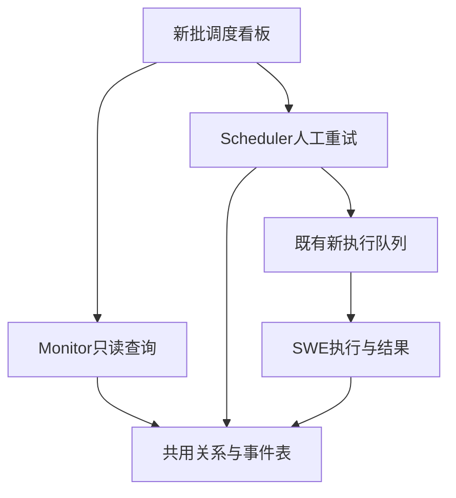

# 新版批调度看板实施计划

## Summary

按已确认设计完整复刻新看板，不缩成只读页：正规化新批次成员、保存真实执行事件、Monitor只读查询、Scheduler人工失败重试，Console保留原样式。2026-10-17用户明确“开始做吧”，确认实施；不再重复询问是否进入开发。

---

## Requirements

- R1：旧页/旧接口/旧队列不变，新页独立入口；只显示真实批回执，不把分发轮次或普通手动执行当批次。
- R2：批次成员稳定，最新业务尝试通过成员指针归约；普通入口产生但被批回执引用的执行也计入，不按kind筛漏数据。
- R3：Scheduler/SWE在写入事实的原事务内记事件，只有安全分类和摘要，不保存原始密钥异常；Monitor不生成事件。
- R4：全局筛选、概览、批次分页，成员和事件独立分页，失败分类与前200项预览；共享策略/容量完整游标读取并标明共享口径。
- R5：人工重试有真实管理角色/source授权、1～200明确候选、版本校验、危险失败停止确认、请求/响应幂等；运输恢复保留执行ID，业务重试增加尝试但不膨胀成员数。
- R6：旧样式、完整状态/错误/身份切换保护、中文注释和日志、手工SQL与回填核对、单元/跨服务/数据库及浏览器证据。

---

## Scope Boundaries

- 不切换旧看板，不改原队列或swe_cron_executions结构，不添加第二套计时器/派发器，不自动重跑失败业务。
- 不修改智拓应用，不回填jobs.json或旧展示内存；不改变已入队工作和当前调度三态。
- 业务DDL仅交付手工文件，应用不执行；测试可在专属隔离库中验证，不连接业务库。
- 保留全部已有暂存/未暂存工作；不换分支、不暂存、不提交、不推送。主线程顺序执行，禁止子代理。

---

## Context & Research

原页面为console/src/pages/Monitor/CronBatchDispatch，使用Ant Design、CSS Modules、lucide及WorkerHistoryChart，已有日期、状态、关键词、分页、详情和失败面板。新管理页不是本看板。

旧Monitor查询在monitor/src/monitor/app/services/cron/query_service.py，现有容量历史已有游标；旧失败接口在scheduler/app/services/cron/batch_operations.py。新执行和批回执已独立持久化，共库无最终完成回调。

OpenSpec中没有本看板对应变更，不借用其他功能的OpenSpec任务；沿用本仓库docs/superpowers设计/实施流程。已有数据库/分页/授权/事件形状可直接核对，不为本功能引入第三方框架。使用ce-plan形成计划后转ce-work测试优先执行；前端使用ce-frontend-design的现有系统模式及React异步状态规则。Superpowers不可用，且用户禁止代理，审查按主线程多角度自查，不冒称独立评审。

---

## Key Technical Decisions

| 边界 | 决定与原因 |
| --- | --- |
| 成员 | 新增swe_cron_managed_batch_members，只存关系/当前尝试指针/冻结顺位，不复制运行状态；以回执成员而非runs.kind归属。 |
| 事件 | 新增swe_cron_managed_dispatch_events，稳定去重键及单调分页序号；请求审计也用该表，不另建异步重试任务。 |
| 重试 | 先锁源定义，再锁回执/目标定义、成员及运行，保持与现有受理/执行的定义先行顺序；事务内不发HTTP。 |
| 快照 | 业务重试使用当前定义/已发布Workflow重新冻结，保留批次逻辑期，not_before为本次受理时间；运输重投保持原快照。 |
| 状态 | 主status和settled_status分别展示；主success未settled时整轮仍活动，异步error使成员失败，但不改写主status。 |
| 权限 | 新看板跨用户，Monitor和Scheduler入口核对可信manager/admin、真实用户及source；不接受Body扩大source，不伪造接收人角色。 |
| 时间 | 新事实UTC，旧容量北京时间；边界转换后输出带时区ISO，不直接混排裸时间。 |
| 历史 | 手工从回执成员清单回填；缺关系/错身份显式报不可用，不用当前状态伪造历史事件。 |

---

## Implementation Units

### U1. 成员、事件契约及新批受理关系

**Goal:** 固定每批逻辑成员和可查询的事件基础。

**Requirements:** R1、R2、R3、R6。 **Dependencies:** 无。

**Files:** 新建scheduler/src/scheduler/app/services/cron/managed/batch_members.py、dispatch_events.py、board_schema.py；修改managed/scheduling.py、storage.py、runtime.py。新建docs/deployment/cron_batch_board_manual_create.sql及对应人工回填说明；测试tests/unit/scheduler/test_managed_batch_members.py、test_managed_dispatch_events.py。

**Approach:** 同一受理事务在真实回执之后登记关系；首轮member_id固定为初始执行ID，重放不重置当前指针。事件接口接受内部安全字段，稳定键防重复。启动检查无DDL，核心容量统计不因看板结构缺失忽略已有占位；新工作在必要结构未就绪时拒绝。

**Execution note:** 测试优先。 **Patterns to follow:** managed/storage.py、schema.py及现有SQLite真实SQL适配。

**Test scenarios:** 原子回滚；重放不重复；ordinary执行被批次引用；零成员批；跨source/Agent身份冲突；已重试成员不会被初始登记重置；缺表不假空；日志不泄漏。

**Verification:** 关系及事件与事实同事务提交，原回调重放行为保持。

### U2. 执行事实事件与安全失败分类

**Goal:** Scheduler和SWE在原写入点记录真实生命周期，保留可用失败分类。

**Requirements:** R2、R3。 **Dependencies:** U1。

**Files:** managed/executions.py、dispatcher.py、settlement.py；src/swe/app/crons/managed_events.py、managed_execution.py、managed_results.py、managed_receipts.py；新增tests/unit/app/test_managed_cron_events.py及scheduler事件测试。

**Approach:** Scheduler记queued/dispatch/运输未确认/收敛；SWE记accepted/running/主结果。各独立包使用相同小契约，不让Scheduler导入SWE应用。旧ordinary初始事件通过成员关系关联，重试运行携带批次/成员元数据。分类在执行侧遇到异常时生成安全枚举，结果凭证也保留；未记录原因只显示其他，不解析不存在的原文。

**Execution note:** 测试优先。 **Patterns to follow:** ExecutionWriter._change的版本围栏、SessionResultReceipts、settlement的主/异步分工。

**Test scenarios:** 重复受理/完成不多事件；版本竞争回滚；结果提交失败与凭证恢复不重跑；主成功异步失败；文本/Agent/Workflow异常分类；密钥异常不入事件；旧owner不写迟到事件。

**Verification:** 事件与对应写入原子，查询不生产事件，旧结果/未读围栏不变。

### U3. 失败预览与人工批量重试

**Goal:** 完整支持分类预览和显式单次人工续办。

**Requirements:** R2、R4、R5。 **Dependencies:** U1、U2。

**Files:** 新建managed/batch_failures.py、batch_retry.py及routers/managed_batch_operations.py，注册新路由；测试tests/unit/scheduler/test_managed_batch_retry.py、test_managed_batch_operations_api.py。

**Approach:** 全批分类计数及前200候选，候选带成员版本、当前执行及定义版本。先校验完整批归属/权限/格式，成员状态变化逐项跳过。请求摘要与结果事件同事务幂等保存；并发管理员只推进一次当前失败。业务新尝试复用新队列并更新指针，运输只解除同ID投递退避。批暂停不挡显式人工操作，但自身停用/删除/更新/旧队列失效不得绕过。

**Execution note:** 先并发及API失败测试。 **Patterns to follow:** ExecutionStore快照冻结、ManagementStore幂等摘要、完整身份授权。

**Test scenarios:** 0/1/200/201候选、重复候选、错批/source、非管理员、确认缺失、同请求换内容409、两管理员竞争、网络响应丢失重提、定义变更、成功/运行/取消/跳过成员拒绝、运输不增尝试、业务重试成员数不增、失败不自动重跑、事务中途异常回滚。

**Verification:** 只持久受理，不直接执行；同次重提不追加业务尝试。

### U4. Monitor新批次、成员/事件及共享模型池查询

**Goal:** 提供真实全局统计和独立分页。

**Requirements:** R1、R2、R4、R6。 **Dependencies:** U1、U2；与U3契约对齐。

**Files:** 新建monitor/src/monitor/app/services/cron/managed_dispatch_query.py及辅助SQL/视图模块、routers/managed_cron_dispatch.py，注册路由；测试tests/unit/monitor/test_managed_cron_dispatch_queries.py及API测试。

**Approach:** 源范围关系JOIN与数据库统计，先全局筛选再分页，不在当前页加总。当前尝试通过成员指针读取，旧attempt留在事件；批成员缺失或错关联显式503。共享策略/容量复用现有只读查询，保留完整游标并统一时区表示。

**Execution note:** 测试优先。 **Patterns to follow:** 原QueryService容量历史游标与参数化SQL；新服务不往旧大服务混状态机。

**Test scenarios:** 超过一页的全局筛选/总计、独立成员/事件页、同ID跨source隔离、ordinary被引用、新旧数据共存、缺关系、零成员、主成功未异步终态、容量多页及中途失败、输入时区非法、读取零写入。

**Verification:** 新Monitor路由只读且不调用平台/SWE，原查询响应不变。

### U5. 原样式独立看板与失败交互

**Goal:** 完整复刻原看板交互，切换新契约和真实字符串ID。

**Requirements:** R1、R4、R5、R6。 **Dependencies:** U3、U4。

**Files:** 新建console/src/pages/Monitor/ManagedCronBatchDispatch/、api/modules/managedBatchDispatch.ts及类型/测试；修改MainLayout、Sidebar两种模式、constants和中文导航。旧CronBatchDispatch文件默认不改，复用其CSS及适合的WorkerHistoryChart。

**Approach:** 日期/状态/关键词、概览与批列表、成员/事件详情、容量/策略、分类失败面板。新旧API零写兜底；source/用户/角色/批次切换有代次围栏。失败预览版本与原Body用于重提，真正新点击换request_id，危险类别保留停止确认。异步结果独立显示，不伪造完整历史或已完成。

**Execution note:** 先请求链/交互回归。 **Patterns to follow:** 旧看板布局、现有requestIdentity及新任务管理页代次保护。

**Test scenarios:** 新菜单与导航高亮、全动作新路径、完整容量分页、200候选提示、已变化逐项跳过、未知响应原请求重提、身份往返和迟到响应、卸载/旧确认不提交、原页请求不变、真实字符串ID、状态/空/错/加载。

**Verification:** Vitest/TypeScript/构建，浏览器打开新旧页及失败面板对照截图；模拟边界明确说明。

### U6. 人工部署、历史回填与完整验收

**Goal:** 提供可部署材料和可复查证据，不以局部通过宣布整体完成。

**Requirements:** 全部。 **Dependencies:** U1～U5。

**Files:** docs/deployment/cron_batch_board_*材料；tests/integrated/scheduler/下新关系/重试MySQL及跨服务测试；独立进度文件。

**Approach:** 新两表及必要索引全部中文COMMENT；回填只读真实回执数组，错误身份/缺执行/已推进指针不得覆盖。升级前已丢失事件不伪造。MySQL版本相关回填语法明确适用版本，实际业务库由用户人工执行。先DDL/回填再应用，验证缺结构拒绝新工作、旧链路仍可用。

**Test scenarios:** 真实事务/唯一键、并发重试、主/异步结果事件原子、回填幂等/坏关系、完整API及页面、新旧隔离、停止/重启/失败重提；记录未运行环境和旧基线失败。

**Verification:** 手工SQL、Postman步骤、结果证据及已知限制齐全；不自动提交推送。

---

## System-Wide Impact

旧页和旧队列仍独立；共享池继续统一占位，不因重试额外计两次。事件插入失败必须使对应事实事务失败并使用已有结果恢复，不能悄悄吞事件或重新执行业务。

---

## Risks / Deferred to Implementation

- 回填SQL须按目标MySQL能力核对，不能把JSON_TABLE当成所有版本均支持；先提供版本前提和错误检查。
- 本轮只做设计内的新看板，不扩大到用户全量存量接管、全量报表修复或旧失败逻辑重写。
- 源批/成员/运行的锁顺序和主成功等待异步须用实际竞争测试核对，不能以界面标签代替。
- 新表应先人工部署；历史未回填要显式报错，不允许静默少计。

---

## Plan Review

主线程按一致性、可实现性、权限/并发、交互和范围自查，已明确普通复用关系、异步收敛、锁顺序和缺回填边界。用户已授权开始开发，直接转ce-work；禁止代理的约束优先，不冒称多代理评审。进度记录另存，不改本计划正文。
