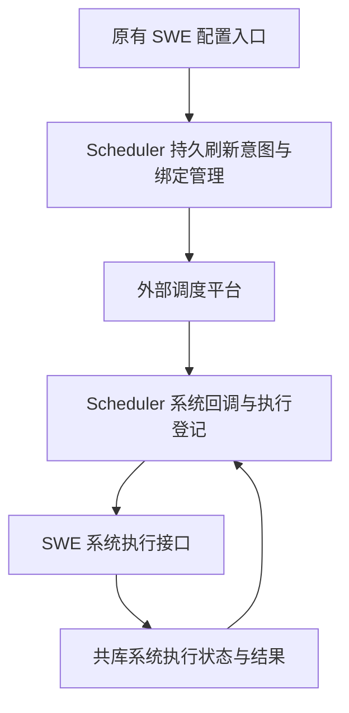

# 系统任务调度迁移与对外查询兼容方案

## 方案摘要

系统任务由 Scheduler 接管平台注册、启停、绑定、触发去重和执行登记，SWE 保留配置入口与实际维护动作。对外任务列表保留原接口契约，但只从数据库返回 Scheduler 新任务，不读 jobs.json 或旧内存；Monitor 子任务计数保留最近已落历史执行的语义。

基于本地提交 `1759d5d4c`。这是待讨论的设计草案，不是开发授权、已实现能力或已执行的数据库变更。用户已确认“对外列表只返回新版任务”；其余技术选择为本方案建议。

---

## 范围与要求

- R1：迁移 heartbeat、dream、task_session_cleanup、archive_maintenance 四类系统任务；保持原业务语义与配置入口。
- R2：平台仍负责定时触发，Scheduler 不扫描 Cron 自行补造未收到的周期；SWE 直接写共库执行状态和结果，不向 Scheduler 回传最终业务结果。
- R3：系统任务绑定及调度运行事实持久化；同一系统任务不因多实例初始化、回调重放或传输超时而盲目重复执行。
- R4：保留对外列表路径、Header 及数组返回结构，仅展示 management_owner=scheduler 的未删除用户任务，不返回旧任务或系统任务。
- R5：对外查询不得启动工作区、初始化租户、补绑定、注册平台任务、写表或读取旧运行内存。Agent 配置的必要只读解析不等于读取任务文件。
- R6：Monitor 外部计数验证新任务兼容；保留现有任务投影查询、数字历史 execution_id、trace_id 和 subtask_count，不主动排除原有可查询任务，不改成新版执行 UUID 或当前运行进度接口。
- R7：三服务共库；内部访问继续沿用现有可信网关与内网隔离，不引入必配内部 Token。共库不等于工作区、会话或产物共盘。
- R8：切换时处理已有系统定时器，防止双注册、双执行；不要求搬迁旧用户任务和历史数据。

不包括：智拓应用对接、旧用户任务接管、旧历史回填、关闭旧页面、旧写接口保护、CLI 改接、旧批队列退役、新增系统任务管理大页面，以及归档自动删除。旧写接口误用新任务 ID 的风险作为独立工作保留，不宣称本方案已经解决。

---

## 已有能力与必须保留的差异

| 系统任务 | 唯一作用域 | 当前定义及绑定来源 | 实际业务动作 |
| --- | --- | --- | --- |
| heartbeat | tenant + source + Agent | Agent 心跳配置；system_jobs.json 保存平台 ID | 活跃时间判断、心跳业务与通知仍在 SWE |
| dream | tenant + source + Agent | Agent 梦境配置；system_jobs.json 保存平台 ID | 记忆整理及既有治理记录，不能重新加入文件归档副作用 |
| task_session_cleanup | source | swe_source_system_config 与 swe_source_system_task_binding | 按 source 遍历已有租户范围，调用现有会话清理能力 |
| archive_maintenance | source | 同上，独立 archive_maintenance 配置 | 有界扫描并归档孤儿文件，不自动 purge，不启动 Agent runtime |

当前系统回调是 SWE `/api/internal/cron/callback`；source 清理在平台参数中使用 cleanup，业务类型是 task_session_cleanup，需显式映射，不能误当作 Agent 级任务。来源级任务不能按“修改配置的管理员 tenant”拆成多条任务。

参考：`src/swe/app/crons/manager.py`、`src/swe/app/source_system_config/task_scheduler.py`、`src/swe/app/source_system_config/task_binding_store.py`、`src/swe/app/routers/internal.py`。

现有 Scheduler 用户任务已具备管理状态、持久去重、异步受理和 SWE 共库写结果模式；可复用设计和底层工具，但不能直接把四类系统任务塞进只接受 agent/text/workflow 的用户任务协议。来源级维护没有必然的 tenant/Agent，也不应伪造模型标识进入批调度模型池。

本方案使用仓库已有协议，不新增框架或外部平台能力。`docs/solutions/` 当前不存在；不引用不存在的历史解决方案，也不把 GitNexus 定位结果视为运行验证。

---

## 一 系统任务迁移设计

### 职责与执行流程

以下是用于评审的方向示意，不是实现代码；接口和表的名称是建议契约，尚未开发。

最后一条关系表示 Scheduler 读表观察结果，不是 SWE HTTP 完成回调。系统配置仍在原 Agent/source 配置中维护；Scheduler 保存已解析的有效排程、绑定、版本和同步状态，成为调度控制的权威来源，不接管心跳内容、梦境业务或归档实现。

配置保存或工作区启动后，SWE 向 Scheduler 提交指定身份的刷新意图，不再直接操作外部平台。Scheduler 在持久互斥下读取当前有效配置并同步平台。请求不携带旧配置全文作为最终权威，避免迟到通知把新配置覆盖回旧值。

Scheduler 读取 SWE 的配置接口必须纯只读，不能调用 get_agent、触发 workspace bootstrap 或系统任务注册。工作区启动只提交刷新意图，不反向等待整个平台注册，避免“启动工作区→刷新→再次启动工作区”的循环。

### 存储建议

建议新增两张独立系统表，后续另行提供带中文 COMMENT 的人工 DDL；本轮不生成或执行 DDL，也不把它们当成已经包含在先前的十一张任务表中。

| 建议表 | 保存内容 | 关键约束 |
| --- | --- | --- |
| swe_cron_system_jobs | 稳定身份、作用域、任务类型、期望及已生效配置摘要、平台 ID、绑定代次、接管状态、当前同步操作和失败阶段、刷新水位、版本与租约 | 逻辑作用域唯一；平台绑定不能被两个系统身份认领；版本和租约围栏 |
| swe_cron_system_executions | 平台触发标识、逻辑期、绑定及配置快照、受理/运行/终态、执行者、租约、必要汇总和安全错误码 | 同任务同逻辑期去重；受理状态与任务锁在同一事务确认 |

稳定身份包含 scope_kind 与 task_type：Agent 级使用 tenant/source/Agent；source 级仅用 source，tenant/Agent 维度用约定空值规范化，不用 NULL 唯一键冒充唯一性。平台注册所需 tenant/fromId 作为独立路由信息保存，不参与来源任务唯一性，不把后台服务伪装成业务用户。

为控制范围，管理同步只保存当前/最近一次操作，不另建通用操作日志平台；失败续办只针对当前操作。请求携带稳定请求号和任务版本，相同请求复用当前结果，旧版本拒绝，不把久远重提解释成新配置；完整管理变更历史不在本期承诺内。

`swe_source_system_task_binding` 与 `system_jobs.json` 仅作为一次接管的输入或回退核对材料。接管成功后停止其作为系统绑定的日常写入来源，不长期双写两套系统绑定；原 Agent 业务配置文件可以继续存在。

### 建议接口

| 服务 | 建议接口 | 用途与主要入出信息 |
| --- | --- | --- |
| Scheduler | POST /api/scheduler/cron/system/jobs/refresh | SWE 提交系统类型、scope_kind、稳定请求号和期望版本；身份沿用 Header；返回稳定系统任务 ID、当前操作及同步状态 |
| Scheduler | GET /api/scheduler/cron/system/jobs/{system_job_id} | 供授权管理查询：期望/生效状态、平台绑定、当前操作和安全错误；不返回配置凭据 |
| Scheduler | POST /api/scheduler/cron/system/jobs/{system_job_id}/retry | 明确续办当前失败的管理同步；不是重跑系统业务 |
| Scheduler | POST /api/scheduler/cron/system/callback | 平台真实绑定、逻辑期和稳定日志标识受理；返回去重后的执行 ID 或明确跳过原因 |
| SWE | GET /api/internal/cron/system/config | 按可信身份读取四类任务当前有效排程和必要配置摘要，不初始化 runtime |
| SWE | POST /api/internal/cron/system/execute | 只接收已登记的系统任务 ID、执行 ID 和派发围栏；定义和身份从共库核对，不接任意命令、路径或任务正文 |

这些系统接口是内部/管理员能力，不作为普通用户创建维护任务的通用 CRUD；关闭系统任务通过保存原配置的 enabled=false 完成，不新增普通用户 DELETE 语义。系统任务不出现在用户任务新页面、分发列表或用户批看板中。

配置保存成功的原 JSON 结构保持不变。同步受理但未完成时，应通过兼容的附加状态信息（建议响应 Header）标明尚未生效，并提供管理查询标识；同步未受理或失败不能继续宣称平台已更新。原配置已持久保存时，错误提示要说明这一事实，不能假装事务回滚或静默回退 SWE 直接注册。

### 刷新、触发和执行约束

1. 按稳定系统身份串行同步平台；数据库只持有短事务锁，外部 HTTP 不放入长事务。刷新处理中有新配置通知时，记录更高刷新水位，再读取当前配置接续；旧执行者不得宣布新水位已完成。
2. heartbeat 的 every→Cron 转换、dream 排程和业务过滤沿用原语义；平台继续按现有北京时间约定。不借迁移修改活跃时间、记忆整理、清理阈值和归档限制。
3. 平台回调校验已登记平台 ID、绑定代次及系统身份；同任务同逻辑期只登记一次，去重不能仅依赖进程内锁。更新绑定的旧回调明确跳过，不能由旧、新入口各执行一遍。
4. 必须使用平台实际可提供的稳定日志或原计划时间。没有足够字段时先确认平台实际协议，不用“收到请求的当前时间”制造去重键，也不承诺仅靠 jobParam 能识别每次触发。
5. 同一个系统任务正在运行时，新周期记录 skipped，不堆积维护任务、不取消在途任务、不补跑停机期间未收到的周期。不同类型分别控制并发，保留底层原有文件/会话锁。
6. SWE 受理前持久核对执行 ID 和派发围栏；受理后启动本地业务工作，快速返回受理事实。重投同一执行只确认已有状态，不再次调用维护动作；Scheduler 直接查共库，无最终回传。
   冻结的是调度身份、绑定代次和已受理事实；SWE 在开始动作前仍按原业务规则检查当前有效配置和 enabled，记录实际使用摘要，不把新保存的业务配置回写成旧快照。已开始动作不因配置更新被强行取消。
7. SWE 更新运行租约并写最终结果。主动作正常结束但没有业务返回值时只记“动作正常结束”，不伪造报告；来源级结果保留已有计数，部分租户失败记 partial，异常摘要脱敏且有长度上限。
8. 运行租约失联而无法确认动作是否已发生时记待核实，不凭超时自动业务重跑，也不在尚有不确定在途动作时启动同身份另一轮。传输恢复与重新执行业务分开。
9. 系统执行不直接占用用户批调度队列的虚构 provider/model 池，不顺带重做既有心跳/梦境模型限流策略。
10. 平台没有注册查询接口，沿用已确认的策略：已保存 ID 始终复用；未保存 ID 按失败提示，人工重试可能再次新增并留下孤立定时器。不得声称可以自动查回或绝对防止这种外部重复。
11. 归属数据库查询失败时，不能当作“尚未接管”而退回旧注册或执行；只有成功查明尚属旧路径的身份才能继续原行为。刷新不是自动接管：已识别旧绑定的任务进入接管流程，不因一次配置保存就另建新定时器。

### 已有系统定时器的接管与回退

“不迁旧任务”指旧用户任务及历史，不表示能无视现有系统定时器。推荐在维护窗口按身份接管，不搬它们的运行历史。

1. 先部署带数据库归属检查的 SWE 注册/回调桥接与 Scheduler 新能力，但不自动大范围接管。普通旧任务和其平台入口不动。
2. 按明确来源/租户/Agent 读取已有绑定，心跳/梦境只读 system_jobs.json，来源任务读原绑定表；采集不启动全部 Agent、不顺便扫描用户 jobs.json。
3. 为目标身份建立接管记录，取得互斥，暂停已知平台定时器并阻断该身份旧注册及新旧触发；等待已进入旧执行流程的动作结束。旧系统运行没有新执行账本，不能仅靠新表为空认定没有在途工作，无法确认就不放行接管。
4. 已知 external_job_id 更新原定时器的回调及参数，复用 ID；没有可靠绑定时先平台人工核对，不把“旧文件没读到”当作平台一定没有任务。
5. 发布 Scheduler 归属、绑定代次和同步结果，再按实际 enabled 恢复平台。新回调走 Scheduler，新登记的执行走 SWE 新接口；迟到旧回调只跳过，不转成一次新的维护执行。
6. 角色为 scheduler 或 transferring 时，SWE 的工作区启动和配置刷新都不能再直接注册平台任务。绑定代次只增不回退。
7. 回退先暂停该身份入口并确认在途和待核实执行已收尾，再恢复唯一一条旧绑定及其参数，最后释放旧注册门禁；保留新执行和绑定记录，不删表、不同时开启两套注册器。

方案不新增常驻全用户配置扫描器。可按显式范围一次接管；冷工作区在启动时确保刷新，但不能因此声称所有未加载工作区已接管。新任务注册恢复只处理已持久接收的刷新意图，不从全部定义补造业务周期。

---

## 二 对外查询兼容设计

### SWE 对外列表

保留 GET `/api/external/cron/jobs` 及尾斜杠的既有行为。返回仍是完整 `CronJobListItem[]`，不替换成 Scheduler 的分页对象；内部可按稳定身份键分段读完整结果，禁止只返回第一页或静默截断。

| 项目 | 设计口径 |
| --- | --- |
| 数据范围 | swe_cron_jobs_v2 联 swe_cron_job_states；仅 owner=scheduler、未删除、当前 tenant/source/Agent 的用户任务；排除 legacy 和系统表 |
| 必填 Header | 继续只有既有身份协议要求的 X-Tenant-Id 与 X-Source-Id；不新增必填 X-User-Id、X-Agent-Id 或管理版本 |
| 可选用户 | X-User-Id 仅影响 visible_in_my_tasks 等个人视图，不用于替换查询 tenant，不伪造为真实操作者 |
| 可选 Agent | 显式 Header 选择既有启用 profile；省略继续取 active_agent，无配置按既有 default 规则处理，不擅自一律改成 default |
| profile 与时区 | 必要时仅只读解析 config.json；不得调用会修复/备份配置的加载器、启动工作区或读取 jobs.json |
| 空与失败 | 确认没有新版任务返回 []；数据库/结构或关键状态损坏返回明确不可用，不拿 [] 或文件回退掩盖故障 |

不直接复用强制 actor 身份的管理接口来读取，避免把 tenant 冒充 actor 或凭空加必填 Header。建议在 SWE 增加专用只读 Repository 和响应适配器，使用本服务已初始化的共库连接；不绕 HTTP 再访问 Scheduler，同库事实不重复搬运。

字段映射以现有模型为准：

| 原字段 | 新数据来源与语义 |
| --- | --- |
| 顶层任务定义 | v2 的已发布定义，经公共脱敏规则适配，不返回内部令牌或服务专用元数据 |
| state.last_status/last_error/last_run_at/last_prefetch_at | 状态表当前运行字段，保持原合法枚举及时间序列化 |
| state.next_run_at/next_run_times | 按当前 Cron 与时区只读计算未来时间，不写状态表，不冒充平台生效证明 |
| state.external_job_id | 对应普通绑定 ordinary_external_job_id；批绑定仍作为独立元数据，不把两种 ID 混成一个 |
| task.chat_id/session_id | 状态表的固定聊天和会话，不能直接取可能落后的定义 meta |
| task.has_scheduled_result/latest_scheduled_preview/unread_execution_count/last_scheduled_run_at | 状态表最新结果及未读水位 |
| task.is_paused/pause_reason/auto_paused_at | 沿用单任务暂停语义；整组 batch_paused 不冒充单任务手动暂停 |
| task.visible_in_my_tasks/is_running | 创建用户与可选 viewer 比较，以及当前实际运行状态；缺 viewer 时不把全部任务标成“我的任务” |

既有 task_* 元数据若仍在原契约中返回，应由状态表构造一致的只读投影，不出现“顶层 task 未读为 3，而 meta 仍为 0”的矛盾。为复用展示逻辑可以构造内存对象，但不重新引入共享缓存或写回旧运行内存。

保留原缺身份、缺 Agent、停用 Agent 与存储不可用的错误类别。真正的数据库结构异常不能被当成没有 Agent 或没有任务。外部授权仍由现有网关确认，后端按完整业务身份缩小查询范围；Header 不是新的认证凭据。

### Monitor 最近执行子任务计数

保留 GET `/api/monitor/external/cron/jobs/{job_id}/latest-execution/subtask-count`、原必填 X-Source-Id，以及 job_id、数字 execution_id、trace_id、subtask_count 四字段。

保持现有查询路径：在 swe_cron_jobs 中按 job_id 与 source 查询未删除投影，取保存的 tenant，再按 job_id/tenant 查询 swe_cron_executions；按 actual_time 降序、历史数字 id 降序选最近一条，再按 trace_id 统计 swe_cron_subtasks。新链路已经维护这两张兼容表，所以无需仅为“支持新版”就重写 Monitor 查询或新增外部必填 Header。

本期用跨服务用例证明 Scheduler 任务发布产生投影、SWE 结果提交产生历史、Monitor 随后能查到同一任务。外部列表只显示新版，不代表其他既有查询也必须拒绝旧 ID；不主动改变 Monitor 原有可查范围，也不迁移旧数据。若以后决定停止写旧投影或历史，再单独设计 Monitor 的 v2 直接查询及完整身份定位，不能在这里提前删除依赖。

没有历史记录时返回 execution_id/trace_id=null、数量为零；最新历史没有 trace 时数量为零，不寻找更早有 trace 的记录。正在执行的新一轮尚未写入历史时仍返回上一条已落历史，或首次无历史的空结果，不承诺当前轮实时计数。实时执行查询继续使用新版 Scheduler 执行接口，不在本期改变该外部接口含义。

本部分无新增业务表，无历史搬迁，不以 swe_cron_execution_runs 的 UUID 替代外部原数字执行 ID，也不改 swe_cron_subtasks 的写入协议。

---

## 开发拆分与验收设计

这里只描述后续实施单元，不执行开发或测试。系统任务与外部查询可分别交付，不要求一份大变更同时上线。

### U1 系统身份及持久管理记录

**目标/要求**：R1、R3、R7、R8。建立两类作用域和两张系统表，当前管理操作、绑定代次和执行去重边界明确。无前置单元。

**文件**：建议新增 `scheduler/src/scheduler/app/services/cron/system/contracts.py`、`repository.py`、`schema.py`；新增 `docs/deployment/cron_system_manual_create.sql`；测试 `tests/unit/scheduler/test_system_cron_repository.py`、`tests/unit/scheduler/test_system_cron_schema.py`。

**方式与参考**：参考 managed/storage.py 的短事务、版本和 schema.py 的只读启动检查；不改用户任务类型约束，不在应用执行 DDL。

**测试场景**：同 source 不同管理员的来源任务只有一个身份；不同 Agent 的心跳隔离；双实例刷新只推进一个当前操作；旧版本/过期租约不能发布绑定；schema 缺失失败而不建表。验收以真实唯一键和并发事务核对为准，不以 SQLite 单测替代目标 MySQL。

### U2 配置刷新及平台代理

**目标/要求**：R1、R2、R3、R7。依赖 U1。原配置入口继续使用，但平台写入只由 Scheduler 完成。

**文件**：建议新增 `scheduler/src/scheduler/app/routers/system_cron_management.py`、`scheduler/src/scheduler/app/services/cron/system/management.py`、`scheduler/src/scheduler/app/services/cron/system/platform.py`；修改 `src/swe/app/_app.py`、`src/swe/app/routers/config.py`、`src/swe/app/source_system_config/router.py`、`src/swe/app/source_system_config/task_scheduler.py` 及 `src/swe/app/crons/manager.py` 的系统注册桥接；新增 SWE 只读系统配置路由。测试 `tests/unit/scheduler/test_system_cron_management.py`、`tests/unit/routers/test_system_cron_config_api.py`；补现有 `tests/unit/app/test_source_system_task_scheduler.py`。

**方式与参考**：复用当前平台传输及凭据格式、用户任务注册/启用分步模式，但隔离系统回调协议；纯配置读取不启动工作区，使用刷新水位处理并发配置变化。

**测试场景**：四类型开关/改排程作用于同一已知平台 ID；迟到刷新不回写旧配置；保存配置后平台失败如实展示；无 ID 注册超时不假装成功，人工重试风险明确；有 ID 续办不再次新增；读取配置和启动工作区不会互相递归。验收需使用实际平台新增、修改、暂停与恢复样例。

### U3 系统触发与 SWE 执行

**目标/要求**：R1、R2、R3、R7。依赖 U1、U2。建立独立系统回调和持久执行，不新增自动业务重跑。

**文件**：建议新增 `scheduler/src/scheduler/app/routers/system_cron_callbacks.py`、`services/cron/system/runtime.py`、`dispatcher.py`；新增 `src/swe/app/crons/system_execution_api.py`、`system_execution.py`；复用现有维护动作。测试 `tests/unit/scheduler/test_system_cron_callbacks.py`、`tests/unit/app/test_system_cron_execution.py`、`tests/integrated/scheduler/test_system_cron_http_chain.py`。

**测试场景**：重复平台日志只受理一次；相同周期跨绑定重放不执行两次；同身份在途时新周期跳过；SWE 已受理但 HTTP 丢失后重投不重跑；过期执行者不覆盖结果；部分来源失败记录 partial；梦境不归档、归档不 purge 且不启动 Agent；执行不污染用户模型池和用户批看板。租约失联按不确定性处理，不能以计时器证明业务已停止。

### U4 系统绑定接管与旧路径围栏

**目标/要求**：R3、R8。依赖 U2、U3。提供按明确范围的接管/核对入口和运行手册，不迁旧用户任务。

**文件**：建议新增 `scheduler/src/scheduler/app/services/cron/system/handover.py`、受控接管路由、`docs/deployment/cron_system_handover.md`；修改 `src/swe/app/routers/internal.py` 的系统旧回调归属门禁；保留普通旧回调分支。测试 `tests/unit/scheduler/test_system_cron_handover.py`，补 `tests/unit/app/test_external_cron_scope_refresh.py` 与心跳作用域测试。

**测试场景**：来源绑定复用与 Agent 文件绑定只读导入；接管后工作区初始化不再读写 system_jobs.json；无可靠 ID 停止自动接管；多实例启动不重复注册；切换中旧回调跳过；已在途旧动作未确认结束时不放行；部分平台失败保留接管进度；回退不同时打开两套注册，旧用户任务原回调仍可用。

### U5 SWE 对外新版任务列表

**目标/要求**：R4、R5、R7。独立于 U1～U4，可先交付。修改只读来源和映射，不改旧管理 API。

**文件**：修改 `src/swe/app/routers/external_jobs.py`；建议新增 `src/swe/app/crons/external_query.py`；参考 `src/swe/app/crons/task_view.py`、models.py；保留中间件外部查询免 bootstrap 规则。测试补 `tests/unit/app/test_external_job_list.py`，新增 `tests/unit/app/test_external_managed_job_mapping.py`。

**测试场景**：文件有旧任务但 DB 无新任务返回 []；DB 有新任务而 jobs.json 不存在仍返回；超过内部一页完整返回；source/tenant/Agent 隔离；无可选用户仍可查但不可伪装“我的任务”；省略 Agent 继续 active_agent；禁用/不存在 profile 保持错误规则；状态实时来自 DB；不读文件任务、不注册、不补绑定、不写库；损坏状态/断库返回不可用而非空成功。先补现有契约刻画测试，再改变数据源。

### U6 Monitor 外部计数与部署契约

**目标/要求**：R4、R6、R7。定义与历史沿用已上线新任务链路，不依赖系统表；建议与 U5 一起更新对外说明。

**文件**：默认不改 `monitor/src/monitor/app/services/cron/query_service.py`、`routers/external.py` 及 `models/cron.py`；测试补 `tests/unit/monitor/test_cron_latest_subtask_count.py`，新增跨服务兼容用例 `tests/integrated/scheduler/test_external_cron_query_compat.py`；补部署说明和 Postman 请求材料。若联调发现写入映射缺口，先确认原因，再作必要的定向修复，不预先重写查询。

**测试场景**：新定义产生兼容投影后可查，原有可查询任务保持原语义；错误 source 返回不存在；同时间按历史 ID 排序；无历史、无 trace 返回原空值；新一轮运行中不冒充其已有结果；计数读不到表时不返回假零。验证真实 SWE 写入历史后由 Monitor 查出同一数字历史 ID 和真实子任务数量；不得把新版 UUID 当成外部数字历史 ID。

---

## 上线与整体影响

外部查询可先上线：原 URL 不变，但数据集合从旧任务切为新任务，必须提前通知外部调用方；这是刻意的数据范围切换，不能只称“完全无感兼容”。其失败不依赖 Scheduler HTTP 在线，但依赖共库和必要 profile 配置可读。

系统任务先人工建两表、部署带桥接/门禁的新 SWE 与 Scheduler，再按维护窗口逐范围接管；不用把所有系统定时器同时重建。新平台回调路由到 Scheduler、新执行接口路由到 SWE，既有配置路径和普通用户任务路由不变。沿用当前 Scheduler→SWE 与平台配置，不增加必配管理开关或 Token。

| 风险 | 处理边界 |
| --- | --- |
| 配置已保存但平台未同步 | 分离期望/生效状态，保存失败不假回滚，同步错误可查和人工续办 |
| 注册响应丢失 | 平台无查询接口，人工处理可能遗留的孤立绑定，不宣称强一致或绝对一次注册 |
| 旧系统运行无法从新表看到 | 接管前暂停入口并确认旧在途结束，不凭新表为空放行 |
| 文件业务与数据库不能同事务 | 去重、执行者围栏及不确定状态减少重复；不承诺任意崩溃下业务副作用恰好一次 |
| source 级维护涉及多个 SWE 实例文件 | 共库不代表共盘；必须证明承接实例能访问原范围资源，否则先补按 scope 路由方案，不能以最后修改人 Header 覆盖全部来源资源 |
| 外部计数继续依赖旧投影/历史 | 保留新链路对两张表的兼容写入；停止写入前另作查询迁移，不因“不迁旧历史”删表 |
| 旧写接口误操作新 ID | 独立待办，本轮不自动扩展；调用方新任务管理必须使用 Scheduler，不能拿查询兼容当写兼容 |

对来源资源可达性的确认是系统接管上线闸门，不是对外查询上线闸门。本轮不设计新 source 扇出队列；若现网不共享资源，需要单独明确范围后再放行该 source 系统任务。

实施时应覆盖真实 MySQL 唯一键/租约、多实例配置并发、实际平台回调和文件资源路由；本文没有启动服务、运行测试、访问平台或执行 DDL。对外契约测试可以复用当前用例，但旧文件列表的成功断言需要按已确认的新数据范围调整，不能把它们当作应继续兼容旧列表的需求。

## 评审结论与后续确认

按仓库约定未启动子代理。主线程从一致性、可实现性、范围和安全边界自查；不能称为独立多人评审。重点已补入：可选用户不能伪造操作者、默认 Agent 不变、来源任务身份不能按管理员拆分、系统接管必须等待旧在途、系统执行不混入用户模型池，以及数据库失败不伪装空结果。

需要上线材料确认的项目：平台系统回调是否提供足够的稳定日志/原计划时间；来源维护能否访问全部目标资源；现有系统绑定及旧在途如何核实。这些事实未取得前，不承诺系统接管可直接放量。用户如希望“当前正在执行轮次的子任务实时计数”，另行设计版本化契约，本稿不包含。

参考材料：`docs/superpowers/specs/2026-06-15-source-level-task-session-cleanup-design.md`、`docs/superpowers/specs/2026-07-02-source-archive-maintenance-design.md`、`docs/superpowers/plans/2026-07-15-cron-latest-execution-subtask-count-api.md`、`docs/superpowers/plans/2026-09-10-external-job-list.md`、`docs/deployment/cron_phase2_deployment.md`、`docs/integrations/zhituo-scheduler-cron-api-v1.md`。
