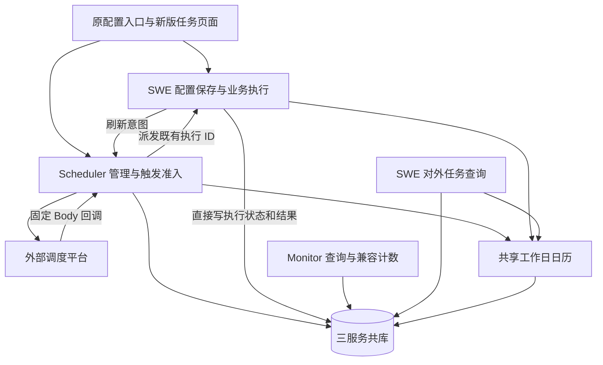
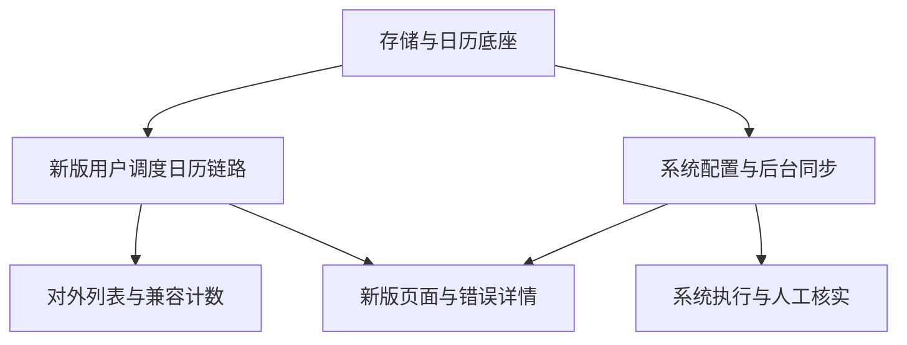

# 新版定时任务统一扩展总体设计

## 1. 摘要与文档边界

将系统任务调度、工作日日历及排程、对外查询兼容、相关页面能力统一纳入 Scheduler 新链路。Scheduler 管理调度，SWE 执行业务并直接写共库结果，Monitor 保留兼容查询与监控；旧用户任务链路不因本次扩展改变。

本文是总体设计与开发边界，不代表功能已经实现、测试已经通过或数据库已经变更。本轮只形成文档，不开发代码、不执行 DDL、不合并分支、不提交或推送。

设计输入：

- 当前 `v1.0.0`，参考基线 `7e945aa67`。
- 原系统与外部查询草案：`docs/superpowers/plans/2026-10-18-001-feat-system-cron-external-query-plan.md`，对应桌面 `cron_trans_system_external_plan_20261018.md`。
- `codex/cron-workday-local-changes` 关联 worktree 的实际工作区内容。其 HEAD 为 `4430b9239`，相关功能主要是未提交修改，不是合并分支即可取得的独立提交。
- 本轮逐项确认的用户决定。与旧草案、分支默认行为冲突时，以本轮决定优先；未另行确认的部分沿用既有方案，并在本文标出设计假设。

旧草案保留为背景，本文替代其中“接管旧系统绑定、全量初始化、系统按周期去重、查询绝不写任何表”等不再适用的部分。

---

## 2. 已确认的关键决定

| 事项 | 本次确定口径 |
| --- | --- |
| 系统任务回调 | 每次平台请求都是新触发，不按周期合并；同一执行 ID 的内部重投幂等 |
| 同身份并发 | 同一系统任务已有在途执行时，新触发记 skipped，不排队、不取消在途动作 |
| 结果不确定 | 无法确认旧动作是否结束时记待核实，阻塞同身份后续执行，不自动重跑 |
| 人工解除 | 只提供管理员接口，通过 Postman 核实与解除；原设置页显示状态，不加处理按钮 |
| 文件部署 | SWE 实例共享工作区、会话及归档相关文件；不新增跨实例文件分发机制 |
| 旧系统任务 | 不迁平台 ID、旧绑定和旧执行历史；运维上线时统一停用或删除旧系统定时器 |
| 旧系统入口 | 停止旧系统自动注册和旧系统执行入口，旧用户任务入口保持原样 |
| 首次注册 | 只在工作区启动或相关配置保存时按需创建，不做全量初始化 |
| 配置同步 | 配置先保存，Scheduler 后台同步，原设置页显示待同步/失败并支持重试 |
| 更新失败 | 允许已经有效的新版绑定继续触发，新排程标记为待生效；首次注册失败不视为可调度 |
| 关闭开关 | 配置保存后立即禁止新业务开始；平台异步停用，已开始动作继续完成 |
| 日历适用范围 | 仅新版用户自动任务及其批任务；系统任务和用户手动执行不受此过滤 |
| 缺少日历开关 | 按 `run_on_non_workday=false`；已有新版任务同样在非工作日跳过 |
| 对外查询只读 | 不改任务业务数据，但允许刷新共享日历缓存；不得启动工作区、补绑定或注册平台 |
| 服务数据关系 | SWE、Scheduler、Monitor 使用同一数据库；执行结果不通过 HTTP 回传 Scheduler |

“有效触发”不等于必须执行：关闭、在途、待核实、绑定无效等门控仍可使本次新触发登记为跳过。

---

## 3. 总体架构与模块

下图用于说明职责和数据流，不是要求照抄的实现代码。外部平台仍是定时触发者，Scheduler 后台只处理已登记的配置操作和执行，不从定义扫描补造业务周期。

### 模块一：系统任务配置与调度管理

- 保留心跳、梦境、来源级会话清理和归档的原配置入口、业务配置与权限。
- Scheduler 持久保存期望状态、生效状态、平台绑定及当前同步操作。
- 启动/保存时按需提交刷新意图，后台串行同步同一系统身份。
- 原设置页展示同步结果与重试入口，不增加系统任务管理大页面。

### 模块二：系统任务执行与异常恢复

- 每次平台回调独立登记，按系统身份控制并发。
- SWE 快速确认持久受理，再执行原业务动作并直接写结果。
- 传输重投只复用同一执行 ID，不创建第二次业务执行。
- 失联进入待核实，通过管理员接口确认结束并解除阻塞。

### 模块三：工作日日历与特殊排程

- Scheduler 统一管理日期缓存、外部日历查询和故障降级。
- 支持普通排程的非工作日过滤，以及考虑节假日、调休的 LW/nW。
- 统一业务日期、批次准入、下次运行预览和完成提醒的日期规则。
- 保持日历缓存跨用户、跨服务共享，不为每个任务建立一份日历。

### 模块四：新版用户任务链路扩展

- 创建、修改、分发、排程调整和执行快照完整保留日历字段。
- 外部平台使用候选排程，Scheduler 决定该次是否真正入队。
- 批次冻结准入结论，排队跨日或内部重投不重新判断实际开始日期。
- 保留现有异步分发/删除、调度三态、优先顺位、未读和 is_final 规则。

### 模块五：对外查询兼容

- SWE 原对外列表 URL 和数组结构不变，只返回数据库中的新版用户任务。
- 保留 tenant/source 与可选 viewer/Agent 的既有身份含义。
- Monitor 继续提供最近已落历史执行的数字 ID、trace 和子任务数量。
- 无数据与不可用分开，不回退 jobs.json 或旧内存来掩盖数据库故障。

### 模块六：页面、错误详情与业务入口

- 新版管理页和相关快捷创建入口增加日历能力，样式沿用原页面。
- 保留 hour/hours 修复和复杂 Cron 原样保存能力。
- 保留当前错误 hover，补充按需查看最近已落库执行错误的弹窗。
- 保留财富规划 workflow 绑定要求及接口交接；智拓应用对接仍按原分工由相关同事完成。

---

## 4. 需求与范围

- R1. 新增功能只落到新版用户任务和本次新建系统调度链路，不改旧用户任务的执行与管理行为。
- R2. 外部平台负责定时触发；Scheduler 管理平台和调度事实；SWE 执行业务、直接写共库结果；Monitor 负责查询监控。
- R3. 系统任务分 Agent 级与 source 级身份，四种类型互不混淆，不进入用户任务表或虚构用户模型池。
- R4. 系统配置先保存、后台同步；迟到刷新不覆盖新配置，失败可查、可重试，已有有效绑定仍可触发。
- R5. 旧系统定时器由运维停用；代码不读取旧绑定接管，不全量初始化，只按工作区启动/配置保存创建。
- R6. 系统回调每次独立登记；同身份在途时新触发跳过；同执行 ID 内部重投不重复业务。
- R7. 系统执行结果不确定时阻塞同身份；管理员核实后解除，不能把超时自动解释为业务已结束。
- R8. 系统开关关闭保存后立即禁止新业务开始，不等待平台停用；已开始动作不强行取消。
- R9. 新版用户自动任务缺少日历开关也按 false，非工作日跳过；手动执行、系统任务及旧用户任务不受此规则影响。
- R10. LW/nW 定义、平台候选、回调过滤及预览一致；时区和月份限制不因批调度提前触发而失真。
- R11. 共享日历保留既有缓存、租约及周末降级规则；对外查询只允许日历缓存写入这一项例外。
- R12. 用户批次按父任务原计划业务日期准入并冻结；已入队任务继续执行，不增加批内二次散列。
- R13. 完成提醒保留原来源开关，按北京时间原定通知日期解释为非工作日过滤，不影响结果和未读保存。
- R14. SWE 对外列表保持既有路径、Header 和完整数组，仅查询新版未删除用户任务，禁止业务写入和工作区初始化。
- R15. Monitor 外部计数保持最近已落历史语义和数字 execution_id，不替换成新版执行 UUID 或实时轮次。
- R16. 新版页面及相关快捷入口接通日历字段、错误详情和新接口；既有绑定规则及 is_final 能力复用，不搬回旧结果回传路径。

不包括旧用户任务/历史搬迁、旧系统绑定接管、旧系统历史回填、全用户初始化扫描、常驻 Cron 补跑器、新系统管理大页面、归档自动 purge、CLI 改接和无关 pre-commit 整理。

---

## 5. 系统任务详细设计

### 5.1 类型与身份

| 类型 | 稳定唯一身份 | SWE 保留的动作 |
| --- | --- | --- |
| heartbeat | tenant + source + Agent + type | 心跳、活跃时间判断及原有提醒 |
| dream | tenant + source + Agent + type | 记忆整理及原治理记录；不加入归档副作用 |
| task_session_cleanup | source + type | 按原范围清理会话，不按最后修改管理员拆多条任务 |
| archive_maintenance | source + type | 有界扫描归档，不自动 purge、不启动 Agent runtime |

source 级记录将 tenant/Agent 维度规范化为空值而非 NULL 唯一键，平台路由需要的身份单独保存，不作为 source 级任务唯一性的一部分。不同类型各自控制并发，保留底层文件/会话锁。

现有平台清理类型 `cleanup` 与业务类型 `task_session_cleanup` 显式映射，不由名称猜测作用域，也不因此恢复旧系统回调入口。

### 5.2 配置与平台同步

1. SWE 先保存原 Agent/source 配置，原响应业务结构保持兼容。
2. 提交稳定身份、请求号及刷新水位，Scheduler 短事务持久受理后快速返回。
3. 后台读取当前有效配置，而不是盲信较早请求携带的旧配置全文；保存期望摘要和同步状态。
4. 同身份只推进一个管理操作，HTTP 平台调用放在事务外；并发修改记录更高水位，旧工作者通过版本/租约围栏不能宣布新水位完成。
5. 有平台 ID 的新版任务更新、启停复用该 ID；首次创建没有 ID 时注册新定时器。
6. 成功后发布已确认生效的绑定与摘要；失败保留期望/生效差异和失败阶段，原设置页显示并可重试。

已有有效绑定同步失败时不一刀切禁用。绑定已知、更新响应丢失的操作，可按已登记身份、平台 ID 及该次操作快照核对回调；不能仅因 HTTP 响应丢失就断言平台没有更新。精确接线沿用当前新版已知绑定处理模式，旧/新操作引用的接受窗口须有回归测试。

首次注册响应丢失且未保存平台 ID，仍按注册失败处理；平台没有查询接口，不设计自动查回。人工重试可能新增孤立定时器，须在提示和运行手册中写明，不能承诺外部恰好一次注册。

### 5.3 关闭开关的即时效果

“立即停止”指禁止新的业务动作开始，不指平台瞬间停止回调，也不指取消在途动作。

- Scheduler 能读到关闭状态时直接登记 skipped，不派发业务。
- SWE 开始动作前必须再次只读检查当前有效配置与 enabled；即使刷新意图因网络问题尚未送达，配置已保存为关闭也不得开始业务。
- 配置保存成功但同步受理失败，必须提示“配置已保存、平台未同步”，不假装文件已经回滚。
- 已开始的动作可正常结束；关闭不会偷偷重开已停任务。

### 5.4 平台回调与执行状态

系统采用独立回调协议，但复用平台当前能传的固定 Body 字段。`job_id` 定位系统任务，`task_type` 表达类型，`operation_id` 引用绑定操作，`callback_protocol` 区分新系统协议；tenant/source/Agent/scope/fromId 按现有身份含义传递。不得要求平台新增 Header、日志流水、external_job_id 或原计划时间。

平台 ID、绑定版本和配置引用从共库核对。每次收到合法请求生成新的触发/执行 ID；记录接收时间，不把推算时间伪装成平台原计划时间，也不建立“系统任务 + 周期唯一”约束。

| 条件 | 处理 |
| --- | --- |
| 类型、身份或绑定引用不合法 | 明确拒绝/跳过，不执行任意维护命令 |
| 已关闭 | 本次记 skipped |
| 同身份已有已登记、已受理或运行中的执行 | 本次记 skipped，不排队 |
| 同身份有未解除的待核实执行 | 本次记 skipped，保留原阻塞记录 |
| 可执行 | 锁系统身份，创建执行并占用 active_execution，提交后派发 SWE |

运行生命周期采用“已登记待派发 → SWE 已受理 → 运行中 → 成功/失败/partial”，另有 skipped 和待核实。状态名和枚举在实施时与现有命名规范收敛，不新增通用工作流引擎。

SWE 以执行 ID、完整系统身份及围栏原子受理和启动，然后快速返回受理事实。只有状态已写成运行中后才能调用业务动作。重复执行 ID 只查询/恢复原状态，不能再次开始业务。Scheduler 从共库观察结果，不依赖最终 HTTP 回执。

明确未开始业务的传输失败允许重投原执行 ID；已进入运行中后失联、租约到期或副作用不确定，进入待核实。数据库不可用不能被解释为“尚未受理”，也不能回退旧执行路径。

### 5.5 人工核实与解除

只提供管理员接口，原设置页只显示状态和执行标识。请求限定系统任务 ID、执行 ID、期望版本、稳定请求号、已确认结束声明和原因；不接任意文件路径、任务正文或命令。

接口核实该执行仍是当前阻塞项后，记录操作者、时间和原因，解除 active_execution，并推进围栏。重复请求幂等，旧版本或已切换到另一执行时拒绝，迟到结果不能覆盖新状态。

人工解除只表示管理员确认旧动作已结束、允许后续正常周期，不把未知业务结果伪造成成功，不自动重跑本轮。若实际动作仍在运行，数据库围栏不能撤回已发生的文件副作用，因此“确认结束”必须是真实运维核实。

---

## 6. 工作日日历与新版用户排程

### 6.1 沿用 workday 分支的规则

| 规则 | 口径 |
| --- | --- |
| 业务日期 | Asia/Shanghai，北京时间判断节假日和调休 |
| 默认开关 | 字段缺失或未设置时按 false；已有新版用户任务同样适用 |
| 手动运行 | 不做自动日历准入过滤 |
| 普通 Cron | 只筛选已有候选，不为周一至周五表达式补造调休周末触发 |
| LW | 当月最后一个实际工作日 |
| nW | 当月距离指定日期最近的实际工作日；不跨月，等距取较早，短月以月末为锚点 |
| W 与开关 | 日历工作日规则自身不被“允许非工作日执行”开关取消 |
| 正常日历结果 | 缓存 24 小时，按日期共享 |
| 异常/未知结果 | 按周一至周五兜底，缓存 5 分钟，明确标记 fallback |
| 外部超时与并发 | 单次 2 秒；10 秒数据库刷新租约，写回校验 token；失去租约者不能覆盖新值 |

外部地址沿用 `SCHEDULER_WORKDAY_API_URL` 和现有 dev/prd JSON 加载、覆盖优先级，不恢复已废弃的独立 YAML。数据库不可用可周末兜底；已有明确接口判定但缓存写入失败时保留本次判定。不会引入新的必配内部 Token 或一组必配管理开关。

### 6.2 定义、注册和预览必须一体改造

新增字段保存在 `spec_json.schedule.run_on_non_workday`，不为用户任务额外增加业务列。创建、修改、查询重建 schedule、SWE 模型、分发复制、零人调排程、执行快照和兼容元数据都必须保留该字段。

当前 `_schedule()` 和 `job_view()` 只重建 type/cron/timezone，不能只改前端开关。日历生效范围根据新版归属明确限定，不向旧 CronManager 的普通执行分支注入新过滤规则。

W/LW 的业务表达式保持不变。外部平台注册每日候选，保留时分语义，月份限制在逻辑业务日期准入时判断，避免提前触发跨到上月后漏执行。创建、修改、分发调排程、模式切换及平台续办必须使用同一候选展开规则。

下次运行预览使用同一日历能力，不再直接以通用 croniter 结果替代工作日计算；只生成展示时间，不写任务状态或补造执行。一个列表/一轮预览复用日期观测，避免逐用户对上游重复查询。慢外部查询和缓存刷新不占用任务写事务锁，也不放在逐行同步渲染函数里。

### 6.3 普通与批调度准入

- 普通入口沿用当前新版的时间恢复和绑定校验；有可信带时区原计划时间时使用它，否则按固定 Body 能力恢复候选并记录时间依据，不能承诺识别严重延迟回调的真实原周期。
- 批入口按父任务逻辑计划日期做一次准入，提前执行时间不是业务日期。
- 非工作日或规则不满足时保留跳过触发事实，入队数为零，不创建伪造成功批次。
- 允许入队时冻结 business_date、判定来源、规则及配置版本；父子成员继承该结论，排队跨日、传输重投不重新按开始日期过滤。
- 批内不增加二次散列等待，仍按既有冻结优先顺位和共享模型池容量派发；batch_paused 只关闭平台入口，已入队继续执行。

### 6.4 完成提醒

沿用来源设置键 `cron_notifications.skip_weekend_zhaohu_enabled`，文案升级为“非工作日不提醒”。开启时按原定通知时间的北京时间日期判断，包含通知延迟及批次原计划通知策略；不按实际完成时刻重新解释日期。

按分支现有设计，任务是否允许非工作日执行与来源提醒开关独立：任务可以执行并保存结果，但招乎提醒仍可能被来源开关抑制。这是本次停止提问后沿用的既有规则，不是新增联动选项。结果、报告和未读持久化不受提醒过滤影响。

SWE 使用日历能力计算提醒决策时，应在结果写入短事务前取得必要观测并传入写入层；不把外部 HTTP 直接塞进 `ExecutionWriter` 结果事务。

---

## 7. 存储设计

新增三张独立表，后续提供带中文 COMMENT 的人工建表/升级材料；本轮不生成生产 DDL，不在应用启动时自动建表。

| 表 | 主要内容 | 关键约束 |
| --- | --- | --- |
| swe_workday_calendar | 北京业务日期、是否工作日、api/fallback、获取/过期时间、刷新租约和 token | 日期唯一；缓存与租约时间使用 UTC；日期缓存无用户身份 |
| swe_cron_system_jobs | 稳定系统身份、当前业务启用状态、期望/生效配置摘要、平台 ID、当前同步操作/水位/版本、同步租约、在途或待核实执行引用 | scope_kind/source/规范化 tenant/Agent/type 唯一；版本围栏；同身份最多一个阻塞执行 |
| swe_cron_system_executions | 每次触发标识、系统任务/绑定/配置引用、受理运行状态、执行者与租约、结果计数、安全错误及人工核实信息 | 执行 ID 唯一；不按周期去重；占用与受理同事务；旧围栏不能覆盖新执行 |

系统表只保存必要的业务配置摘要、调度引用和结果，不复制原始凭证、完整请求体或任意文件内容。人工核实信息在执行表持久保存，不新增通用审批平台。

现有 `swe_cron_jobs_v2`、`swe_cron_job_states`、`swe_cron_execution_runs` 继续服务新版用户任务，不塞入四类系统任务。新用户任务仍维护 `swe_cron_jobs` 兼容投影，并由 SWE 写 `swe_cron_executions` 历史；不能因外部列表切新版就停止这些写入。

`is_final` 已有结构及新版替换实现，按现有业务重试链核对即可，不重复设计旧 intent 回传事务，不修改“入队时不清旧标记、新结果落库时同事务替换”的规则。

旧 `system_jobs.json` 和 `swe_source_system_task_binding` 不作为新版绑定来源、不双写、不自动导入；原配置文件/来源配置仍是业务设置来源。旧文件和旧表是否清理是独立运维动作，本设计不擅自删除。

---

## 8. 接口边界

以下是总体契约方向，最终 DTO 与错误码在实现时沿用现有项目约定；不是已存在接口清单。

| 服务 | 接口方向 | 用途 |
| --- | --- | --- |
| Scheduler | POST /api/scheduler/cron/system/jobs/refresh | 保存指定身份的刷新意图，返回任务/操作标识及同步状态 |
| Scheduler | GET /api/scheduler/cron/system/jobs | 按授权身份、scope_kind/type 查询原设置页所需状态，不新增管理大页面 |
| Scheduler | GET /api/scheduler/cron/system/jobs/{id} | 查询期望/生效状态、绑定、当前同步及阻塞执行 |
| Scheduler | POST /api/scheduler/cron/system/jobs/{id}/retry | 续办当前管理同步，不重跑系统业务 |
| Scheduler | POST /api/scheduler/cron/system/callback | 平台固定 Body 新触发登记和门控，不要求 Header/流水号 |
| Scheduler | GET /api/scheduler/cron/system/jobs/{id}/executions | 管理员查看执行和待核实记录，分页，不返回派发令牌 |
| Scheduler | POST /api/scheduler/cron/system/jobs/{id}/executions/{execution_id}/confirm-ended | 管理员核实结束并解除阻塞，版本及请求号控制幂等，不自动重跑 |
| SWE | GET /api/internal/cron/system/config | 纯只读有效业务配置，不初始化工作区或触发系统注册 |
| SWE | POST /api/internal/cron/system/execute | 只执行已登记 ID，核对共库身份、围栏、当前 enabled，快速受理 |
| Scheduler | POST /api/scheduler/cron/calendar/resolve | 复用 workday 分支能力，返回日期判定或未来预览，可刷新日历缓存 |
| SWE | GET /api/external/cron/jobs | 原外部路径与数组契约，只查新版用户任务 |
| Monitor | GET /api/monitor/external/cron/jobs/{job_id}/latest-execution/subtask-count | 保持原历史执行计数契约 |

系统管理和人工处理按既有可信网关身份、原配置权限及管理员角色限制范围；source 级操作不能凭修改请求中的另一 tenant 来扩大权限。内部调用延续现有可信内网隔离，不引入必配内部 Token。共库、Header 和 ID 校验不能替代网关访问控制。

新增错误弹窗优先复用/扩展新版执行查询，按完整 tenant/source/Agent/job 身份关联已落库历史；若现有查询无法表达“最新历史”再增加专用只读能力，不改旧 Monitor 查询含义。

---

## 9. 对外查询与页面设计

### 9.1 SWE 对外列表

保留原路径及尾斜杠行为、完整数组返回；内部稳定分段读全量，不只返回第一页。

- 仅查询当前 tenant/source/Agent 下 `management_owner=scheduler` 的未删除用户任务，排除旧用户任务及系统表。
- 原必填身份仍是 tenant/source；不新增必填 actor、Agent 或版本 Header。viewer 仅决定“我的任务”等个人视图，不能冒充查询 tenant。
- Agent 未显式指定时继续既有 active_agent/default 解析，必要时只读配置，禁用/不存在 Agent 的错误类别保持。
- 定义来自 v2；会话绑定、状态、结果及未读来自状态表。普通平台 ID 和批平台 ID 不混用。
- 保留原 `spec`、`state`、`task` 及兼容元数据的字段位置、状态枚举和时间序列化；同一事实在多个位置暴露时由同一数据库快照映射，不能一处读新表、另一处读旧内存。下次运行时间只是规则预览，不代表平台同步已生效。
- 预览可刷新日历缓存，但不能写用户定义/状态/执行、补会话绑定或启动工作区。缺缓存时按既定降级提供预览来源提示；关键状态损坏或业务库不可用返回明确不可用，不伪装空数组。

### 9.2 Monitor 外部计数

继续通过旧兼容投影定位 source/tenant，通过 `swe_cron_executions` 最近已落历史及 trace 查询 `swe_cron_subtasks`。保留 job_id、数字 execution_id、trace_id、subtask_count。

最新历史按 actual_time、id 降序；没有历史或 trace 时保留原空值/零语义，不向前查找更早有 trace 的记录。新一轮尚未写历史时仍返回上一条已落历史，不宣称当前轮实时进度，也不新增 is_final 过滤改变原接口范围。

### 9.3 新版页面和入口

- 新版管理页增加非工作日开关和北京时间月末工作日预设；nW 通过自定义表达式保留，不强行增加一套复杂日期编辑器。
- 保留原时区；只在用户明确选择月末工作日预设时使用北京时间，不在打开旧定义时偷偷改写。复杂表达式继续自定义，原样保存不丢多时间、月份等条件。
- 管理页、详情、聊天任务列表及外部列表的下次运行预览同源；不由浏览器自行假装掌握法定节假日。
- 错误状态继续支持当前详情 hover，另提供按需弹窗：显示最近已落库记录的时间、数字历史 ID、状态和 error_message。最新非 error、无历史、无错误文本、加载失败均有明确提示，不倒查更早失败来冒充当前失败。
- 列表加载不逐项查询执行历史；关闭/切换任务后忽略迟到响应。弹窗与接口严格按四维身份隔离。

快捷创建/精选案例需调用 Scheduler 新接口并传日历字段，处理操作受理与失败；保留原订阅键语义和请求幂等，不把旧入口随机生成的任务 ID 当作新版创建权威 ID。创建后刷新新任务列表并接入现有会话、未读和报告能力。

财富规划 workflow 必须在创建/分发前解析有效绑定，绑定失败不能先创建一半任务。当前主干已有部分绑定校验，分支新增测试应择需复用，不能据此声称发布入口已经改走 Scheduler。智拓/相关业务实际对接延续原同事分工：本文覆盖目标接口与交接约束，不擅自把其应用改造纳入本轮代码实施。

旧页面和旧快捷链路不能因覆盖共享 helper/解析器而被动改变；采用新版专属适配或默认关闭的能力接入，保留近期 hour/hours 修复及旧任务执行行为。

---

## 10. 开发单元与依赖

### U1. 存储契约与日历底座

**目标/需求：** R3、R11。提供三表人工 DDL 与只读 schema 检查，移植 Scheduler 日历实现。

**依赖：** 无；DDL 由目标环境负责人核对执行。

**文件：** 从源分支选取 `scheduler/src/scheduler/app/services/cron/workday_calendar.py`、`calendar_schedule.py`、`scheduler/src/scheduler/app/routers/calendar.py`、`scripts/sql/cron_workday_calendar.sql`；新增系统 schema 契约和中文注释 SQL 材料。测试 `tests/unit/scheduler/test_workday_calendar.py`、`test_workday_calendar_config.py`、拟新增 `test_system_cron_schema.py`。

**方式/参考：** 复用分支按日期租约和现有 `managed/schema.py` 只读检查；不运行启动 DDL。先核对源 worktree 改动，不能直接整分支覆盖主干。

**验证场景：** 节假日/调休/未知；多实例同日租约；过期 token 不能覆盖；API 成功而写缓存失败；缺表降级；系统表缺失明确不可用；配置覆盖优先级及日期替换。

**完成标准：** 日历结果和降级来源一致、三表约束可人工核验，无用户身份日历副本。

### U2. 新版用户任务日历全链路

**目标/需求：** R1、R2、R9、R10、R11、R12、R13。

**依赖：** U1。

**文件：** `scheduler/src/scheduler/app/services/cron/managed/definition.py`、`views.py`、`platform.py`、`callback_contract.py`、`scheduling.py`、`distribution.py` 及排程调整路径；`src/swe/app/crons/models.py`、`managed_history.py`、结果事务边界和日历客户端。测试新增 `tests/unit/scheduler/test_managed_cron_calendar.py`、`test_managed_cron_calendar_callbacks.py`、`tests/unit/app/test_managed_cron_calendar_notifications.py`，补分发/预览回归。

**方式/参考：** 沿用 managed 受理、冻结快照、短事务及执行身份，不搬入旧 CronManager 文件执行逻辑。业务行为测试优先。

**验证场景：** 缺字段默认 false；显式 true 往返；旧链路不变；手动绕过；LW/nW 与调休、短月、等距；跨月提前执行；批零入队跳过；队列跨日仍执行；通知延迟跨日；外部 HTTP 不持有结果/任务长事务锁。

**完成标准：** 保存、查询、平台候选、准入、预览、分发和提醒对同一规则达成一致，不丢字段、不恢复批内散列。

### U3. 系统配置与异步平台同步

**目标/需求：** R2、R3、R4、R5、R8。

**依赖：** U1。

**文件：** 新增 `scheduler/src/scheduler/app/services/cron/system/` 的身份、存储、管理和平台模块及路由；修改 SWE 系统注册桥接、配置保存/工作区启动、`src/swe/app/source_system_config/task_scheduler.py`；新增纯只读系统配置接口。测试拟新增 `test_system_cron_management.py`、`test_system_cron_refresh_races.py`、`tests/unit/routers/test_system_cron_config_api.py`，补既有 source 配置测试。

**方式/参考：** 参考 `managed/management.py` 的已知 ID 续办、操作/版本围栏；只处理已持久受理意图，不扫描所有用户配置，不读旧绑定自动接管。

**验证场景：** 两管理员保存同 source 只产生一个系统身份；多实例启动只推进一项同步；迟到刷新不回写旧配置；配置已保存但平台失败提示准确；首次无 ID 超时不假成功；已有 ID 更新失败不一刀切禁用；关闭即使刷新请求未送达也不能开始新业务。

**完成标准：** 期望与生效状态可查，后台可续办，原入口可用，无双注册器或启动递归。

### U4. 系统触发、SWE 执行与人工核实

**目标/需求：** R2、R3、R6、R7、R8。

**依赖：** U3。

**文件：** 新系统回调、执行调度及核实路由；新增 `src/swe/app/crons/system_execution.py`、`system_execution_api.py`，复用既有维护动作；旧 `src/swe/app/routers/internal.py` 系统分支停止执行而保留普通用户分支。测试拟新增 `test_system_cron_callbacks.py`、`test_system_cron_resolution.py`、`tests/unit/app/test_system_cron_execution.py`、`tests/integrated/scheduler/test_system_cron_http_chain.py`。

**方式/参考：** 参考现有 ExecutionWriter 的共库受理、执行者围栏和结果写入；系统身份是并发串行化点，不建立同周期唯一键。新行为测试优先。

**验证场景：** 相同平台 Body 两次产生不同触发记录；在途第二次 skipped；相同执行 ID 重投不重跑；SWE 已受理 HTTP 丢失；运行失联阻塞；管理员版本冲突/越权/幂等；核实不伪造成功；迟到完成不清除另一在途引用；梦境不归档、归档不 purge；source 部分失败记录 partial。

**完成标准：** 平台触发与内部重投语义分离，待核实只能受控解除，不污染用户队列和看板。

### U5. 对外列表和 Monitor 历史兼容

**目标/需求：** R11、R14、R15。

**依赖：** U2；不依赖系统执行上线。

**文件：** `src/swe/app/routers/external_jobs.py`、拟新增专用只读 Repository/适配模块；Monitor 原查询原则上不重写。测试 `tests/unit/app/test_external_job_list.py`、拟新增 `test_external_managed_job_mapping.py`、`tests/unit/monitor/test_cron_latest_subtask_count.py`、拟新增跨服务 `test_external_cron_query_compat.py`。

**方式/参考：** 复用现有 public_spec/task_view 语义，但不依赖强制 actor 的管理接口或启动工作区；允许日历缓存更新，不写任务业务表。

**验证场景：** 仅文件有旧任务返回空数组；仅 DB 有新任务可查；超过一页完整返回；scope/Agent 隔离；无 viewer 不伪造“我的任务”；日历缓存刷新但任务表无写入；断库不假空；历史同时间按数字 ID 排序；无 trace 不回溯旧 trace；新轮运行中仍返回最近已落历史。

**完成标准：** URL、Header、数组/数字 ID 契约保持，数据范围按已确认切新版，跨服务投影和历史链路可验证。

### U6. 新版页面、快捷入口和错误详情

**目标/需求：** R4、R9、R10、R13、R16。

**依赖：** U2、U3；系统待核实前端只展示状态，不做人工处理按钮。

**文件：** `console/src/api/types/schedulerCron.ts`、新任务 API/专属表单适配、`console/src/pages/Control/SchedulerCronJobs/`；按范围接入 `ScheduledTaskPopup`、`CaseDetailDrawer`、来源设置页；选择性复用源分支 JobErrorModal 展示。测试对应 `scheduleForm.test.ts`、`ManagedJobEditor.test.tsx`、新增错误弹窗测试、`ScheduledTaskPopup/workday.test.tsx` 及快捷入口新接口测试。

**方式/参考：** 保留当前独立 scheduleForm 和旧页面默认行为；来源通知文案更新但配置键不变。智拓实际对接交接单独跟踪，不混入本单元。

**验证场景：** 10:00/多小时不回退或截断；日历开关/LW 往返；自定义 nW 与时区不被静默改写；旧页面不被共享组件改动带偏；点击才查历史、关闭不受迟到结果影响；创建请求重试不换 ID；系统同步失败状态/重试；提醒开关与任务开关独立。

**完成标准：** 新入口实际创建新版任务，页面、接口及下次运行时间一致，原样保存无损，错误查询不误用旧任务身份。

---

## 11. 关键验收示例

| 场景 | 预期 | 对应要求 |
| --- | --- | --- |
| 原工作区从未启动、未保存设置 | 不自动注册系统任务，不宣称已经全覆盖 | R5 |
| 同身份同时两次刷新 | 一项当前同步，另一水位接续，不建两条逻辑系统任务 | R3、R4 |
| 系统定时器每次传相同固定 Body | 每次新触发；旧执行未结束则新触发 skipped | R6 |
| 相同系统执行 ID 重投 | 只确认原受理，不重复业务 | R6 |
| 运行中失联，再收到新周期 | 保留待核实，新周期 skipped | R7 |
| 管理员核实旧动作已结束 | 留痕解除，不自动重跑、不伪造业务成功 | R7 |
| 配置已关闭、平台暂停失败 | 新业务不开始，原在途动作可结束 | R4、R8 |
| 修改时间同步失败 | 原有效绑定可触发，新排程显示待同步 | R4 |
| 已有新版任务无开关，业务日为节假日 | 自动触发跳过；同任务手动运行可执行 | R9 |
| 系统任务在节假日触发 | 仍按原配置和业务规则执行 | R3、R9 |
| LW 遇节假日、nW 遇等距或短月 | 使用实际日历与明确月内规则，不用纯周末近似冒充已知日历 | R10、R11 |
| 日历服务未知或存储异常 | 按分支约定周末兜底，标明 fallback，不制造任务写入 | R11 |
| 批提前触发跨日、成员排队跨日 | 按原逻辑业务日准入一次；已入队继续，不二次散列 | R12 |
| 任务允许节假日执行，但来源提醒关闭 | 结果/未读仍保存，招乎提醒按来源设置抑制 | R13 |
| 对外 GET 缺日历缓存 | 可刷新日历缓存；任务定义、状态、执行与平台注册均无写入 | R11、R14 |
| 任务只存在 jobs.json，不存在新版 DB | 外部列表不返回旧任务；旧用户管理入口不因此改变 | R1、R14 |
| 最新历史无 trace，前一条有 trace | 返回最新数字 ID 和零计数，不查前一条 | R15 |
| 最新历史已成功但列表仍残留 error | 弹窗提示最新状态，不向前找旧失败充当当前错误 | R16 |

真实 MySQL 唯一键、行锁、租约和两连接竞争必须单独验证；SQLite 或 mock 不能作为生产并发证明。测试和平台调用由实施阶段执行，本文不声明已通过。

---

## 12. 发布顺序与回退

1. 准备：核对三张新表、中文注释、唯一键及运行权限；人工 DDL 不自动执行。保存 workday worktree 现状再做受控移植，不丢其未提交成果。
2. 用户日历：先部署日历底座与新版字段/平台/准入/预览，再部署匹配的 SWE 与 Console。新旧版本滚动期间不得让不懂日历规则的实例接收新 W/LW 任务；上线会使已有新版缺字段任务非工作日跳过，须明确告知使用方。
3. 对外查询：可独立于系统任务上线，原 URL 不变但列表集合切新版，通知调用方；验证兼容投影及历史后不删旧表。
4. 系统链路：新 SWE/Scheduler 就绪后，由运维核对类型并统一停用旧系统定时器；旧系统注册/回调停止使用。随后按工作区启动或保存配置产生新注册，不做批量初始化；冷工作区暂无任务属于已接受行为。
5. 前端及业务接入：新页面/快捷入口与后端能力匹配发布；智拓同事的接口接入单独验收，不以接口已就绪代替业务已切换。

系统设置页必须能分辨“配置已保存但同步未受理/待同步/失败/已有生效绑定”，管理员能拿到待核实执行标识。错误信息、操作状态与新旧两条平台入口不能混淆。

回退先关闭相关新版入口并确认在途/待核实状态。W/LW 已注册每日候选的定时器须先暂停，不能直接退回不认识日历规则的执行代码。系统不自动恢复旧定时器或旧注册器，不同时打开两套；确需恢复由运维按当前配置显式处理。保留新表和既有结果，不通过清表、DROP 或批量改成功解除阻塞。

---

## 13. 风险、假设与实施前核实

已确认但仍需现网验收的条件：SWE 文件共享及访问权限、可信网关身份与内网隔离、实际固定 Body、平台按已知 ID 更新/停用能力、MySQL 唯一键和事务语义。

沿用而未另行提问的规则：工作日日历缓存时长/兜底、北京时间业务日、LW/nW 月内规则、任务与来源提醒开关独立、Monitor 最近历史计数语义、原页面风格，以及智拓应用对接分工。它们不是本轮新增的用户选择，实施时不能悄悄换成相反口径。

| 风险 | 对策/边界 |
| --- | --- |
| 外部平台无查询接口，注册响应丢失 | 如实失败并人工处理，不能保证没有孤立定时器 |
| 按需创建造成冷工作区没有系统任务 | 已接受，不补做全量初始化或常驻扫描 |
| 人工解除时旧动作实际未结束 | 要求真实核实；数据库围栏只保护结果，不撤销文件副作用 |
| 日历未知造成节假日预览/执行近似 | 按原周末兜底并标来源，不宣称可替代真实日历 |
| 日历查询嵌入短事务或逐行渲染 | 预先取得、复用日期观测；只在独立日历租约写缓存 |
| 共享 helper 覆盖引发时间回归或旧页行为变化 | 新版专属适配/能力接入，保留 hour/hours 与无损往返测试 |
| 查询兼容后误删旧投影/历史 | 保留新链路兼容写入，外部计数尚依赖两张表 |

不新增支付、审批、通用编排、自动补跑、全局配置扫描或跨实例文件分发平台。真正的生产协议/资源不满足时，应把对应模块停在发布闸门前，不绕过约束宣称已经完成。

---

## 14. 校核说明与参考

按用户要求停止提问后，使用已确认决定与原分支规则完成设计。主线程从一致性、可实施性、权限边界、状态失效场景和范围做顺序自查，不称为独立多人评审。未运行业务测试、未连接内网日历/平台或生产数据库，未执行 DDL。

当前源码依据包括：

- `scheduler/src/scheduler/app/services/cron/managed/definition.py`、`views.py`、`platform.py`、`callback_contract.py`、`scheduling.py`。
- `src/swe/app/crons/managed_history.py`、`managed_results.py`、`manager.py`、`src/swe/app/source_system_config/task_scheduler.py`。
- `src/swe/app/routers/external_jobs.py` 与 `monitor/src/monitor/app/services/cron/query_service.py`。
- `console/src/pages/Control/SchedulerCronJobs/scheduleForm.ts`、`console/src/components/agentscope-chat/CaseDetailDrawer/index.tsx`、`src/swe/app/wealth_plans/publish.py`。
- 源 workday 工作区中的 `docs/deploy/cron-workday-calendar.md`、`docs/superpowers/plans/2026-10-09-cron-workday-calendar.md`、`docs/superpowers/plans/2026-10-12-cron-config-error-details.md`，以及 Scheduler 日历、SWE calendar_client、旧 JobErrorModal 的实现与测试。
- 本仓库原系统/对外查询草案及现有二阶段部署、智拓接口交接材料。原草案中已被本轮决定替代的内容不得作为实施时的反向要求。
