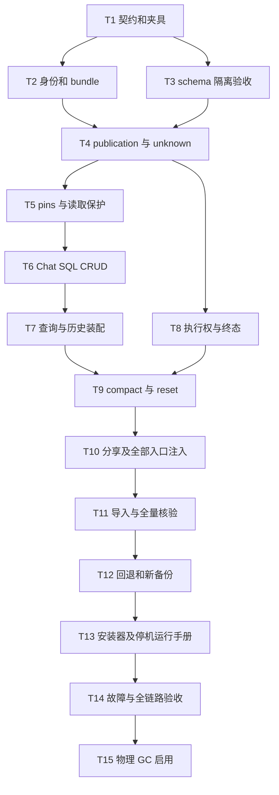

d# 会话 MySQL 元数据 / NAS 正文迁移实施计划

> **For agentic workers:** REQUIRED SUB-SKILL: Use superpowers:executing-plans to implement this plan task-by-task. Steps use checkbox (`- [ ]`) syntax for tracking. 在当前会话顺序执行，不因本计划默认启动子代理。

**Goal:** 实现六表会话元数据权威及不可变 NAS 正文存储，完整迁移已有数据和 CRUD，并支持一次连续停机整体切换、完整备份与保留新提交的回退。

**Architecture:** 在 `src/swe/app/conversation_storage/` 按业务能力组织身份、publication、查询、执行和维护组件，复用 `DatabaseConnection.transaction()` 的同连接事务，不引入第二套数据库驱动。Chat repository 与 Session/history/archive 接入同一可信 scope 装配入口；旧文件 reader 仅供离线兼容。生产先排空停旧服务，在同一维护窗口完成备份、导入、全量核验和七表安装，再启新服务。

**Tech Stack:** Python 3.10+、pytest/pytest-asyncio、现有 mysql-connector-python 异步驱动、MySQL 8.0.21+ 验收基线、共享 NAS；Console 继续使用现有 API，执行 Vitest 契约回归。

---

## 依据、状态与执行规则

- [已确认迁移设计](../specs/2026-10-30-nas-conversation-migration-plan.md)、[完整存储设计](../specs/2026-10-29-db-nas-conversation-storage-design.md)、ADR 0038/0039/0044/0045；ADR 0040 仅为被替代历史。
- 源码基线 `494171e55f1dd0a28b9d5f4626feb302c513ad28`，本文件中全部复选框初始未完成。写下命令不表示命令已运行。
- `bound-long-session-memory` OpenSpec 是现有 NAS 格式优化，保留其历史状态，不把本次 MySQL 实施任务追加到该 change，也不把它的完成项当成本次验收。
- 新目录/测试文件是计划新增，不应因当前不存在而跳过任务；既有文件路径已核对。开始执行前先按 AGENTS 使用 CodeGraph 查询对应符号，再精确读实现。
- 每个代码单元按“新增行为测试 → 确认以预期原因失败 → 最小实现 → 专项通过 → 检查差异”执行。每个任务完成后提交仅该任务文件；不暂存用户其他修改，不以 `git add .` 提交全部工作区。
- 修改现有大型文件仅限接入点；新逻辑置于本次新模块，不顺带重构 Runner。普通函数圈复杂度建议不超过 15、参数不超过 7；多个状态参数使用明确数据对象。
- 计划与设计写入当前文档工作区；运行时代码实施前建立独立分支/工作树并带入这些设计文档，避免覆盖已有未提交文件。新存储仅隔离测试装配，全部生产门槛通过才替换生产工厂，不保留 file-only 失败回退。

## 文件和职责

所有以下相对代码路径均从仓库根开始。新组件不承担外部领域的业务状态。

| 新文件/目录 | 职责 |
| --- | --- |
| `src/swe/app/conversation_storage/identity.py` | scope 与完整 Session 身份、UTF-8 字节长度校验 |
| `src/swe/app/conversation_storage/errors.py` | 存储不可用、完整性、冲突、未知提交的内部类型；边界转为现有 API 错误 |
| `src/swe/app/conversation_storage/bundle.py` | immutable bundle 编码、block/extent、durable 发布及有界读取 |
| `src/swe/app/conversation_storage/publications.py` | prepared/committed/aborted、原 operation key 对账、CAS 安装 |
| `src/swe/app/conversation_storage/retention.py` | scope guard、reader/dependency/backup pins 与 fence |
| `src/swe/app/conversation_storage/chat_repository.py` | 直接 SQL 实现既有 Chat repository 操作和专家 CAS |
| `src/swe/app/conversation_storage/history.py` | 在线/归档/Turn 查询、locator snapshot 和兼容视图装配 |
| `src/swe/app/conversation_storage/execution.py` | Session authority、准入/终态/Stop、完整恢复模块 |
| `src/swe/app/conversation_storage/archive.py` | compact、checkpoint、event ranges、reset 的原子安装 |
| `src/swe/app/conversation_storage/factory.py` | 可信 workspace 注入，统一实例及数据库/NAS 依赖 |
| `src/swe/app/conversation_storage/migration/` | inventory、manifest、legacy readers、导入、verify、export、install，各文件各一职责 |
| `src/swe/app/conversation_storage/backup.py`、`gc.py` | 一致备份/恢复、引用巡检与受控回收 |
| `src/swe/cli/conversation_storage_cmd.py` | 离线运维 CLI；显式目标、源清单、预览与 apply |
| `tests/unit/app/conversation_storage/` | 新组件的行为及故障测试 |
| `tests/integrated/conversation_storage/` | 专用隔离库与生产等价 NAS、双 Pod 验收 |

新模块必须从 `__init__.py` 导出确实被调用的入口，不提前建立通用插件注册器或抽象 DAO 框架。

## 依赖与部署边界



T1～T13 完成也不自动执行生产 DDL。T14 的隔离目标库/NAS与恢复证据缺失时保持未验收；T15 可晚于新系统上线，在此之前只保留和报告候选。

## Task 1：固定旧契约、旧格式夹具与新实现测试入口

**Files:**
- Create: `tests/unit/app/conversation_storage/conftest.py`
- Create: `tests/unit/app/conversation_storage/test_legacy_contracts.py`
- Create: `tests/integrated/conversation_storage/conftest.py`
- Read: `tests/unit/app/test_chat_pagination.py`、`test_cold_turn_point_queries.py`、`test_chat_history_message_identity.py`
- Read: `tests/unit/app/chat_sharing/test_router.py`、`tests/unit/routers/test_tracing_chats_api.py`

- [ ] 从既有测试提取创建 Chat、完整 Session 状态、重复源 Msg、Chat 独立 archive 的 fixture；已有测试仍保留旧实现基线，新增 contract 通过同一调用入口装配新实现，不把旧测试中的内存 repo 改名冒充 MySQL。
- [ ] 用以下固定数据覆盖完整身份：同 Session 两个 Chat；相同 `updated_at` 但不同 registry 次序；空 user；同外部 Session 不同 user/channel/source/agent；旧无 turn_states；重复 Msg.id；Chat 已删但分享仍存在；目标用户 Tracing。

```python
IDENTITY_CASES = [
    ("tenant", "source", "agent", "", "console", "session"),
    ("tenant", "source", "agent", "alice", "console", "session"),
    ("tenant", "other", "agent", "alice", "console", "session"),
    ("tenant", "source", "other", "alice", "console", "session"),
    ("tenant", "source", "agent", "alice", "cron", "session"),
]
```

- [ ] 建立只接受显式 `SWE_TEST_DB_HOST`、`SWE_TEST_DB_NAME` 的新库 fixture，使用 `DatabaseConfig`/`DatabaseConnection`；核查专用空 schema 后执行六表 DDL。连接业务 schema 或存在非测试对象时拒绝创建/清理；未配置只可 skip，报告明确“目标库未验收”。
- [ ] 跑旧契约基线并保存报告，不把以前会话中的通过数量抄作本次结果。

```bash
venv/bin/python -m pytest tests/unit/app/test_chat_pagination.py tests/unit/app/test_chat_answer_turn_api.py tests/unit/app/test_chat_compaction_history_api.py tests/unit/app/test_chat_history_message_identity.py tests/unit/app/test_cold_turn_point_queries.py tests/unit/app/chat_sharing/test_router.py tests/unit/routers/test_tracing_chats_api.py tests/unit/app/test_context_usage.py -q
```

Expected：列出本次 passed/skipped/failed；基线失败先定位，不在新适配器中顺带修复无关问题。

## Task 2：精确身份与 immutable bundle

**Files:** Create `src/swe/app/conversation_storage/__init__.py`、`identity.py`、`errors.py`、`bundle.py` 及 `tests/unit/app/conversation_storage/test_identity.py`、`test_bundle.py`。代码文件除首项外均位于本计划文件职责表规定的新目录。

- [ ] 先测 UTF-8 字节界限、空原值、大小写差异、超长 identity；不 trim、不 hash、不从 sanitized 路径恢复身份。实现 immutable scope/Session identity 数据对象。

```python
# tests/unit/app/conversation_storage/test_identity.py
import pytest

from swe.app.conversation_storage.identity import identity_bytes


@pytest.mark.parametrize(
    ("value", "limit", "expected"),
    [("", 256, b""), ("A", 256, b"A"), ("a", 256, b"a"),
     ("中" * 85, 256, ("中" * 85).encode("utf-8"))],
)
def test_identity_preserves_exact_utf8(value, limit, expected):
    assert identity_bytes(value, limit) == expected


def test_identity_rejects_utf8_byte_overflow():
    with pytest.raises(ValueError, match="byte limit"):
        identity_bytes("中" * 86, 256)
```

先单独运行此文件，预期因新模块尚不存在而失败；实现下列函数后，同样的测试必须通过。

```python
# identity.py 的独立长度校验，不包含大小写折叠或摘要。
def identity_bytes(value: str, limit: int) -> bytes:
    encoded = value.encode("utf-8")
    if len(encoded) > limit:
        raise ValueError("conversation identity exceeds byte limit")
    return encoded
```

- [ ] 字段界限与六表 SQL 对齐：tenant/source/agent/user 256，channel 64，external Session 1024，Chat/runtime Turn 128，question msgid 256 字节。缺失身份不能用空字符串冒充；空字符串仅表示源中真实合法空原值。
- [ ] 为 bundle 写行为测试：同 operation 不覆盖、offset/length 越界失败、格式版本未知失败、路径穿越/绝对路径/逃逸 symlink 被拒绝、截短文件报完整性错误。文件以二进制写入，extent 单位固定为字节。
- [ ] 编码固定版本 header + 独立 block table + payload；block table 定位消息、恢复根、archive、checkpoint 和 event batch。索引内容不含消息正文。operation key 使用安全随机 key，路径由服务端可信根构造。
- [ ] 发布流程实现临时文件写入→文件 fsync→同文件系统独占发布→父目录 fsync→格式/长度验证；失败保留可对账结果，不覆盖最终文件，不新建内容 checksum。
- [ ] 跑测试并确认错误来自契约验证，而非操作系统偶然失败。

```bash
venv/bin/python -m pytest tests/unit/app/conversation_storage/test_identity.py tests/unit/app/conversation_storage/test_bundle.py -q
```

Expected：全部通过；生产 NAS 原语能力仍由 Task 14 实测。

## Task 3：隔离数据库正式 DDL 与索引验收

**Files:** Modify `scripts/sql/conversation_metadata_tables.sql`、`scripts/sql/conversation_share_publication_extension.sql`；Create `tests/integrated/conversation_storage/test_schema.py`、`test_query_plans.py`。

- [ ] 加真实库行为测试：全身份唯一、空二进制 identity、NULL archive/session 顺序键、多 Chat/Session、同问题准入唯一、同 operation 唯一、scope guard 唯一。
- [ ] 原 SQL 在专用隔离 schema 执行并读取 SHOW CREATE；核对六表 151 列及分享三 locator 列的类型/中文注释、无 SQL JSON/外键/CONSTRAINT、实际字符集与索引宽度。不自动 `IF NOT EXISTS` 掩盖旧结构。
- [ ] 分享扩展仅对原分享表的 staging 副本执行；保留 token 列排序规则、八旧列、索引、默认值和计数。schema 不符时在任何 ADD 前 fail-fast。
- [ ] 使用代表基数分别执行侧栏 user/channel、归档页、Turn/source Msg、publication 反查与 context lookup 的 EXPLAIN，保存计划；不得靠强制索引掩盖错误 WHERE。管理端全量兼容允许有界范围排序，单独记录成本。
- [ ] 校验 `DatabaseConnection.transaction()` 支持分享与 publication 共用同一连接。连接丢失保留 unknown 语义，不因现有 wrapper 尝试 rollback 就认定 commit 未发生。

```bash
venv/bin/python -m pytest tests/integrated/conversation_storage/test_schema.py tests/integrated/conversation_storage/test_query_plans.py -v
```

Expected：目标库配置存在时全部通过；skip 不解除数据库验收门槛。真实执行前核对环境只指向隔离库。

## Task 4：publication 状态机、CAS 与未知提交对账

**Files:** Create `publications.py`、`tests/unit/app/conversation_storage/test_publications.py`、`tests/integrated/conversation_storage/test_publications_mysql.py`。

- [ ] 写故障测试：预留 INSERT 已提交但响应丢失；最终 COMMIT 已提交但响应丢失；查不到原预留但原事务尚未结束；writer 与对账器竞争；旧 generation 迟到；aborted key 重试；同 msgid 不同独立请求。
- [ ] 实现 prepared 预留，唯一约束字段 boundary/checkpoint/event 在预留时为 NULL；提交计划写入已校验的 prepared metadata 或 bundle header，不能只放进程内存。
- [ ] NAS durable 之后才进入短提交事务，锁行、校验 scope/关联/authority/revision/epoch、安装 Message/Turn/root/watermark，最后 publication=committed。使用同一 operation，不重跑模型或工具。

```sql
SELECT * FROM swe_conversation_publications
WHERE operation_key = %s FOR UPDATE;
-- 仅在 state=prepared 且关联 authority/CAS 仍有效时安装本次结果。
UPDATE swe_conversation_publications
SET state='committed', committed_at=UTC_TIMESTAMP(6)
WHERE id=%s AND state='prepared';
```

- [ ] 对账 committed 返回原身份；aborted 拒绝；prepared 先 fence 原 writer 再受控结算/终止。原行不存在时用同 key 的 aborted 预留参与唯一键竞争，锁等待/主库不可用继续保持 unknown，不能 unlink 正文。
- [ ] 全事务锁序：scope guard（仅需要时）→按整数 ID 升序 Session→Chat→Turn→publication；同级多行升序。GC/pin 走 guard→publication；普通新增依赖只锁已确定 publication 集合，不反向再拿 Session。实现代码中记录各操作锁集合并测试无逆序。

```bash
venv/bin/python -m pytest tests/unit/app/conversation_storage/test_publications.py -q
venv/bin/python -m pytest tests/integrated/conversation_storage/test_publications_mysql.py -v
```

Expected：响应丢失后最终恰有一份已安装结果；工具调用次数不增加；未知/过期结果不会被发布或回收。

## Task 5：scope guard、reader pin 与 dependency

**Files:** Create `retention.py`、`tests/unit/app/conversation_storage/test_retention.py`、`tests/integrated/conversation_storage/test_retention_mysql.py`。

- [ ] 测试首次创建无 Session 的 guard 竞争、legacy_share scope、pin 与 deleting 竞争、引用闭包、死 reader 清理条件；区分真实空 workspace 与 legacy_share 空身份。
- [ ] 以唯一 guard_marker=1 初始化每 scope guard，普通 retention marker=NULL；pin 在 publication 行锁下确认 committed/live、当前 locator 可见及权限后插入。
- [ ] 每页一次批量获取去重 publication pins，事务固定 locator 和 order high 后再读 NAS，不持 SQL 事务进行 NAS IO；返回前重验删除/授权，读后 finally 释放 pin。
- [ ] root/checkpoint 对旧 bundle 的依赖同事务安装 dependency pin，依赖只指较早 publication；不在 NAS payload 里藏未登记引用。reader 不靠 TTL 自动释放，只凭 owner incarnation 已结束等可验证条件回收。

```bash
venv/bin/python -m pytest tests/unit/app/conversation_storage/test_retention.py -q
venv/bin/python -m pytest tests/integrated/conversation_storage/test_retention_mysql.py -v
```

Expected：deleting 对象不能再新增引用，读到的 locator 在读期间保持物理存活；撤权/删除仍即时生效。

## Task 6：SQL Chat CRUD、分页和专家绑定

**Files:** Create `chat_repository.py`、`tests/unit/app/conversation_storage/test_chat_repository.py`、`tests/integrated/conversation_storage/test_chat_repository_mysql.py`；Modify `src/swe/app/runner/manager.py`，仅改造相关操作。

- [ ] 新测试先验证 get/list/filter/page/cursor、完整 meta、同 Session 多 Chat、registry tie、create-if-absent 重试、专家 CAS；复用 `ChatSpec`/`ChatPage`，不创建新外部返回模型。
- [ ] 新 repository 覆盖 `BaseChatRepository` 所有实际使用的 convenience methods，不继承其 load→整库修改→save；兼容 load 仅供明确全量读取，save 不做“删除后重建全部 Chat”。
- [ ] title 普通 update、binding revision、history revision 独立；update-if-exists 以未删除和 revision 条件更新，删除与 rename 并发时不复活。重绑身份先按锁序锁源/目标 Session 与 Chat，活动/settling 时冲突。

```sql
UPDATE swe_conversation_chats
SET title=%s, metadata_revision=metadata_revision+1, updated_at=%s
WHERE id=%s AND tenant_key=%s AND source_key=%s AND agent_key=%s
  AND deleted_at IS NULL AND metadata_revision=%s;
```

- [ ] 删除只提交 tombstone 与当前不可见，禁止 HTTP 路径递归删除 bundle；Session 和已有永久分享独立保留。场景/专家依赖目录的既有清理只在无活跃恢复引用后处理，不能机械复用 manager 当前即时 rmtree。
- [ ] cursor 排序保持 `updated_at DESC, external_chat_key DESC`；保留旧 creation cursor 和无分页数组；显式 scope/user/channel WHERE，不在应用全量过滤。前端逻辑 Session 选择保持原语义。

```bash
venv/bin/python -m pytest tests/unit/app/conversation_storage/test_chat_repository.py tests/unit/app/test_chat_pagination.py tests/unit/app/test_expert_main_binding.py -q
venv/bin/python -m pytest tests/integrated/conversation_storage/test_chat_repository_mysql.py -v
```

Expected：新实现实际 SQL 和并发契约通过；单测旧 repo 通过不能替代真实 MySQL 用例。

## Task 7：历史装配、归档分页与冷 Turn 点查

**Files:** Create `history.py`、`tests/unit/app/conversation_storage/test_history.py`；Modify `src/swe/app/runner/api.py`、`src/swe/app/routers/tracing.py`。

- [ ] 建立 SQL 数据集并走现有 API 的测试：memory/task/error 共享、Chat anchor 过滤、独立 archive、duplicate Msg.id/fragment、无 turn_states、显式 chat_id 优先、旧 status 推断、context usage 缺失/未来 schema。
- [ ] 实现 Message layer 有界索引、order high、archive `limit+1`；limit 计源 Msg，不计 fragment。旧无 turn_id 走非唯一 source 索引和原锚点切片，未知终态返回 NULL，不虚构 completed。

```sql
SELECT id, source_msg_key, publication_id, byte_offset, byte_length
FROM swe_conversation_messages
WHERE archive_chat_id=%s AND deleted_at IS NULL
  AND archive_order<%s AND archive_order<=%s
ORDER BY archive_order DESC LIMIT %s;
```

- [ ] 组合视图在短 read snapshot 固定 metadata/locator，批量 pin 后 extent 读 NAS，复用原 fragment/anchor suppression/脱敏。context usage 直接读数字快照，不构造 Agent；完整 meta 的内容部分按需批量读取。
- [ ] Tracing 保留它现在的 memory/task+审批视图，不借迁移增加 model error/archive 等；目标 user/source/agent 的权限和 overlay 使用目标 scope。

```bash
venv/bin/python -m pytest tests/unit/app/conversation_storage/test_history.py tests/unit/app/test_chat_answer_turn_api.py tests/unit/app/test_chat_compaction_history_api.py tests/unit/app/test_chat_history_message_identity.py tests/unit/app/test_cold_turn_point_queries.py tests/unit/routers/test_tracing_chats_api.py tests/unit/app/test_context_usage.py -q
```

Expected：返回路径/状态码/字段/顺序/外部 ID 与旧契约一致；点查不枚举整个 ledger/archive NAS。

## Task 8：Session 执行准入、fencing、Stop 和终态

**Files:** Create `execution.py`、`tests/unit/app/conversation_storage/test_execution.py`、`tests/integrated/conversation_storage/test_execution_mysql.py`；Modify `src/swe/app/runner/runner.py`、`src/swe/app/runner/session.py`、`src/swe/app/runner/command_dispatch.py`，仅在存储接入与结算边界。

- [ ] 新测试覆盖同 Session 两个 Chat 竞争、同 question msgid 幂等、不同 question busy、Stop/自然完成竞争、settling 阻止新 Turn、旧 generation 迟到、owner 死亡后不继续模型/工具、完整顶层恢复模块。
- [ ] 准入锁完整身份 Session，使用数据库时间校验 owner lease，分配 generation 和 admitted Turn；durable 问题与恢复状态提交成功后才调用 Agent。独立请求不排队，不因 Session 空闲查询结果启动重复执行。
- [ ] 不把文件 `SessionExecution` 长期锁替换成全程持 SQL 事务：SQL 仅用于短准入、续租、状态发布及结算；模型/工具期间靠 generation/lease+本地协调，不占行锁。
- [ ] 接通保存、加载、modify、history、cron merge、冷 Turn hydrate 全族，不只替换 save。根包含所有未知/已知顶层恢复模块，字段版本按旧 reader 兼容；TurnHistorySnapshot 不当作执行 snapshot。
- [ ] 工具完成、审批相关会话状态变化按语义边界发布；纯文本时间/字节/事件数有界批量。测试时注入很小阈值，基准再确定生产默认值；不是每 token 开事务。发布 unknown/失败先停止推进，原 key 对账；外部副作用不承诺恰好一次。
- [ ] 终态 CAS 和 Stop 使用同一 authority/锁序；释放 active Turn 与安装终态/root 同提交。失败结算保留可重试 pending settlement，恢复/新提交按已有503语义拒绝。命令流的 `last=True` 必须移到提交确认之后。

```sql
SELECT id, generation, owner_key, lease_until, active_turn_id, state_revision
FROM swe_conversation_sessions
WHERE tenant_key=%s AND source_key=%s AND agent_key=%s
  AND user_key=%s AND channel_key=%s AND external_session_key=%s
FOR UPDATE;
-- 执行模型前完成 admission publication 的同事务安装。
```

```bash
venv/bin/python -m pytest tests/unit/app/conversation_storage/test_execution.py tests/unit/app/test_query_session_execution.py tests/unit/app/test_session_state_merge_coordination.py tests/unit/app/test_runner_stop_append.py tests/unit/app/test_approval_turn_stop.py -q
venv/bin/python -m pytest tests/integrated/conversation_storage/test_execution_mysql.py -v
```

Expected：任何 DB/NAS 提交失败不产生成功终态；对账不增加模型/工具调用次数；完整状态可重启读回。

## Task 9：compact、checkpoint、event 和 reset 同次发布

**Files:** Create `archive.py`、`tests/unit/app/conversation_storage/test_archive.py`；Modify `src/swe/agents/memory/conversation_archive.py`、`src/swe/agents/memory/reme_light_memory_manager.py` 的存储注入/提交入口。

- [ ] 测试 compact 改共享 Session current projection，只为发起 Chat 建独立 archive occurrence；其他同 Session Chat 不自动获得归档。旧在线/archive 重叠沿原装配规则，不按 Msg.id 合并 occurrence。
- [ ] 一次 compact 的 archive、checkpoint、event range、恢复根与 Message 可见性在同 publication 安装；复用明确来源 extent，保留 boundary 外部 ID 和源/显示计数。
- [ ] event range 在 Chat 锁下要求 `event_first=event_high+1`、无重叠/跳号；checkpoint 校验 epoch/revision/watermark，旧 epoch worker 不可覆盖新根。prepared 时这些唯一字段不占正式值。
- [ ] `/new`、`/clear` 原子安装新根及相应 epoch、context usage 失效和可见性变化；不创建 compaction boundary，不因为重置删除仍应保留的历史。
- [ ] 恢复 evidence/attachment 入口不再自行构造 `ConversationArchiveStore`；使用 Task 5 的显式 dependency pin，无无限 root 链/全历史每 Turn 重写。

```bash
venv/bin/python -m pytest tests/unit/app/conversation_storage/test_archive.py tests/unit/app/test_chat_compaction_history_api.py tests/unit/app/test_cold_turn_point_queries.py -q
```

Expected：同 publication 恢复点全有或全无；失败候选/迟到 worker 不影响当前 root。

## Task 10：分享与统一 scope 装配，封闭全部旁路

**Files:** Create `factory.py`、`tests/unit/app/conversation_storage/test_factory.py`、`test_shares.py`；Modify：
- `src/swe/app/workspace/service_factories.py`
- `src/swe/app/chat_sharing/models.py`、`store.py`、`service.py`
- `src/swe/app/runner/api.py`、`src/swe/app/runner/runner.py`
- `src/swe/agents/tools/emit_wplus_sop_event.py`、`src/swe/app/wplus_sop/service.py`
- `src/swe/app/crons/managed_resources.py`、`managed_receipts.py`
- `src/swe/app/_app.py` 的依赖注入与 schema readiness 检查

- [ ] 先测试新 workspace 工厂、W+ 无 chats.json、目标 scope 路由、Cron 回执持久化，以及 DB 不可用时无文件回退。测试关闭旧类构造入口，意外调用直接失败，避免假装迁完却仍走文件。
- [ ] 工厂从已解析的 workspace 取 tenant/source/agent，注入同 `DatabaseConnection` 和可信 NAS root。保留现有部署 affinity；不新增跨 Pod 代理或请求自带可伪造 scope。
- [ ] 分享 record 增加 locator，原八列/API 保留。选中问答以用户 source msgid 读取，状态/权限创建前重验；publication+share INSERT 同连接同事务。
- [ ] 删除 service 当前 catch 任意 DB 错就 unlink 的补偿；对原 operation 对账。token GET 不 JOIN Chat 存活，原 Chat 已删仍读；缺 token404，正文/计数失败503。legacy_share 只供导入 token 读取，不能创建普通会话。
- [ ] `_app.py` 新存储启用时只核对 schema，不自动 CREATE/ALTER 六表或补 locator；测试新表不存在时 startup/readiness 明确失败，不把空数据当成功初始化。
- [ ] 再扫描全部直接入口，逐项记录去向。旧类可存在于离线导入和旧契约测试，但生产装配不得到达。

```bash
rg -n 'JsonChatRepository|SafeJSONSession|ConversationArchiveStore|chats\.json|\.turn-ledger|state-v2\.json' src/swe
venv/bin/python -m pytest tests/unit/app/conversation_storage/test_factory.py tests/unit/app/conversation_storage/test_shares.py tests/unit/app/chat_sharing/test_service.py tests/unit/app/chat_sharing/test_router.py tests/unit/app/test_managed_cron_result_recovery.py tests/unit/agents/tools/test_emit_wplus_sop_event.py -q
```

Expected：输出的每个运行时访问有归属；无需把旧兼容 reader 从仓库删除。Cron 定义/执行、Goal/SubAgent、W+ outbox、审批与 trace 的独立状态不搬表。

## Task 11：多格式 inventory、稳定清单、导入和全量 verify

**Files:** Create：
- `src/swe/app/conversation_storage/migration/inventory.py`
- `src/swe/app/conversation_storage/migration/manifest.py`
- `src/swe/app/conversation_storage/migration/legacy.py`
- `src/swe/app/conversation_storage/migration/importer.py`
- `src/swe/app/conversation_storage/migration/verify.py`
- `tests/unit/app/conversation_storage/test_migration_inventory.py`
- `tests/unit/app/conversation_storage/test_migration_import.py`
- `tests/integrated/conversation_storage/test_legacy_roundtrip.py`

- [ ] 先建立 v1/v2/v3 Session、v1 checkpoint/v2 journal、冷热 Turn、previous epochs、quarantine/pending、archive/.deleted、孤立 share 的 fixture；每类有完整导入对照及一例拒绝损坏输入，不只测试文件数量。
- [ ] inventory 输入显式 workspace 映射，列出所有文件/记录、真实完整身份、格式与阻塞项；不以扫描到的目录编码反推 tenant/source/agent，不按下划线拆 session 文件名。源路径只来自受控清单。
- [ ] 外部 manifest 固定 migration ID、旧镜像、源边界、source position→ID/operation key/path 映射及每批状态；第一次执行前持久化随机 operation key，重跑复用。它不是数据库第七张新表，不计算 fingerprint/checksum。
- [ ] importer 通过旧 reader 读已提交根，保留完整模块和未知字段；不只调用 `export_legacy_state`。旧校验/pending 恢复在工作副本执行并记录，原备份不写。未知 schema/归属/超长 identity/缺 extent 阻止本范围上线。
- [ ] 按 Session 计划分批预分配关联 ID/occurrence/order，使用 Task 4 发布；批失败可重入，不生成重复 occurrence。在线共享和 Chat archive 顺序分别维护；没有可靠归属不虚构 Turn。
- [ ] share 从源表副本导入全部 token、原 key、creator、tenant、计数和最后访问时间；locator 回填，孤立身份闭合走 legacy_share。
- [ ] verify 通过新 reader 与旧 reader 全量逐字段比较可见/恢复语义：角色、正文、顺序、外部 ID/fragment、层、状态、时间、meta、边界、epoch、水位、删除、绑定、分享及所有恢复模块。输出机器可读通过/阻塞报告，任一不一致退出非零。

```bash
venv/bin/python -m pytest tests/unit/app/conversation_storage/test_migration_inventory.py tests/unit/app/conversation_storage/test_migration_import.py -q
venv/bin/python -m pytest tests/integrated/conversation_storage/test_legacy_roundtrip.py -v
```

Expected：同清单执行两次，新表行数、源→目标映射、operation 身份及语义结果相同；原源文件字节不变；没有“跳过损坏也成功”。

## Task 12：完整反向导出与新备份恢复

**Files:** Create `migration/exporter.py`、`backup.py`、`tests/unit/app/conversation_storage/test_export.py`、`test_backup.py`、`tests/integrated/conversation_storage/test_rollback.py`；Modify `src/swe/app/backup/worker.py`、`src/swe/app/backup/memory_storage.py`、`src/swe/cli/memory_storage_cmd.py` 的新旧存储边界。

- [ ] 对新增问答、compact、Stop、删除、专家解绑、新分享/计数、完整恢复模块分别建立“新提交→导出→固定旧镜像读回继续写”测试。旧目标支持什么格式就完整导出什么，不预设生产一定支持 v3/v2。
- [ ] exporter 输入 DB 一致状态和全部引用 NAS 闭包，输出空 staging 目录及 share 表副本；保留旧 UUID/msgid、registry 次序、删除标记与完整 journal/ledger。不能表达的新状态显式失败，不删除字段凑成功。
- [ ] backup 创建 scope fence：短暂停 scope 发布、等待 commit 收敛、锁 guard 安装 fence、捕获一致 DB 快照；恢复写入后从快照枚举有效 publication 与 dependency 闭包，建 backup pins 后才撤 fence。复制/完整恢复验读完成才标备份成功。
- [ ] 同时备份 workspace scope 和该 tenant 下 legacy_share 集合；无活跃 Chat 的 share 不能漏。备份失败不自动释放保护，reader pin 不替代 backup pin。
- [ ] restore 只接受空目标 DB/NAS（或作业生成 staging），不把已有 generation 混合恢复。旧 `memory-storage` 命令在新权威模式明确拒绝“只恢复 NAS 就恢复会话”的操作，离线旧格式能力保留。

```bash
venv/bin/python -m pytest tests/unit/app/conversation_storage/test_export.py tests/unit/app/conversation_storage/test_backup.py tests/unit/app/backup/test_memory_storage_backup.py tests/unit/cli/test_memory_storage_cmd.py -q
venv/bin/python -m pytest tests/integrated/conversation_storage/test_rollback.py -v
```

Expected：新提交、删除和 share 计数全部保留；恢复后旧版能继续追加，备份恢复不遗漏依赖或孤立 share。

## Task 13：离线 CLI、七表安装器与连续停机手册

**Files:** Create `migration/install.py`、`src/swe/cli/conversation_storage_cmd.py`、`tests/unit/cli/test_conversation_storage_cmd.py`、`tests/integrated/conversation_storage/test_install.py`、`analysis/playbook/conversation-storage-cutover.md`；Modify `src/swe/cli/main.py` 注册延迟加载命令。

- [ ] 固定以下离线子命令；参数解析层不启动业务 workspace/Agent，默认 preview，变更操作要求 `--apply`。manifest 包含源/目标 scope、NAS 根、目标 staging/schema、旧镜像、报告引用，CLI 再次核验 manifest，不接受任意 NAS unlink 路径。

```text
swe conversation-storage inventory --manifest PATH
swe conversation-storage plan --manifest PATH
swe conversation-storage import --manifest PATH [--apply]
swe conversation-storage verify --manifest PATH
swe conversation-storage export --manifest PATH [--apply]
swe conversation-storage install --manifest PATH [--apply]
swe conversation-storage inspect --manifest PATH
```

- [ ] CLI 测试覆盖少 apply 不写、目标为业务非 staging 拒绝、源可写/未固定边界拒绝、verify 有 blocker 安装拒绝、旧 image 未固定拒绝、导出目标非空拒绝。验证报告覆盖完整清单，不接受用户手改一个 success 布尔值即跳过核验。
- [ ] install 检查同实例 staging、七表定义/触发器/视图/关联、权限、MDL、精确表名存在性；schema/table 名称由作业生成且只引用允许的七表，参数值仍用占位符。不能修改 `SWE_DB_NAME` 指向源快照，更不能备份恢复整个共享业务库。
- [ ] 一次多表 RENAME 安装六新表+share，原 share 改为生成的旧表名；六新表若已存在则停止核查，不覆盖。原子能力未验收不安装；真实执行前后表名状态记录支持在“无新写”前撤回。
- [ ] 手册逐步骤记录操作者、时间、命令、退出码、report 和恢复动作：停入口→排空→停全部 writer→最终备份→import→verify→install→新版本受控启动/冒烟→恢复入口。任何初始化/冒烟写入都进入“需反向导出”回退分支。
- [ ] 将“排空失败/备份失败/导入失败/核验失败/原子 DDL 不支持/启动失败/已有新写”逐项演练，不用“失败回滚”一句代替具体数据边界。

```bash
venv/bin/python -m pytest tests/unit/cli/test_conversation_storage_cmd.py -q
venv/bin/python -m pytest tests/integrated/conversation_storage/test_install.py -v
```

Expected：preview 零业务写；安装只影响七表；模拟无新写失败能恢复原 share/NAS/旧版，有新写失败保持数据并要求完整导出。

## Task 14：新实现全链路、真实双 Pod/NAS 与停机预算验收

**Files:** Create `tests/integrated/conversation_storage/test_faults.py`、`scripts/rehearse_conversation_storage.py`、`deploy/conversation-storage-verification-job.yaml`、`docs/superpowers/specs/2026-10-30-conversation-storage-verification-report.md`；复用 `deploy/session-nas-lock-verification-job.yaml` 的节点/PVC 取证方式。

- [ ] 在隔离同挂载运行两 Pod（不同节点），记录不可变 imageID、PVC/PV/StorageClass/挂载参数与退出码；只用作业生成的测试前缀，不指向生产会话目录。
- [ ] 注入文件/父目录 fsync、独占发布、NAS 不可读/缺失/截短、DB INSERT/COMMIT 响应丢失、owner 崩溃、旧 writer 迟到、Stop/终态竞争、reader/GC/backup fence 竞争。证明引用不会先于 durable body 可见，不自动重跑外部工具。
- [ ] 通过同 MySQL adapter 运行主设计 §10 的完整查询矩阵；补管理端无分页数组、无 user、多匹配同时间、cold Turn/旧无状态、孤立 token、W+无文件、目标审批 overlay。无法运行的全 app 用例单列，不能记为通过。
- [ ] Console 只做兼容回归，初始不改 UI。若 API 行为不兼容，优先修后端而非让前端绕过数据缺失。

```bash
# 仓库根：新单元层与历史契约
venv/bin/python -m pytest tests/unit/app/conversation_storage tests/unit/cli/test_conversation_storage_cmd.py -q
venv/bin/python -m pytest tests/unit/app/test_chat_pagination.py tests/unit/app/test_chat_answer_turn_api.py tests/unit/app/test_chat_compaction_history_api.py tests/unit/app/test_chat_history_message_identity.py tests/unit/app/test_cold_turn_point_queries.py tests/unit/app/chat_sharing tests/unit/routers/test_tracing_chats_api.py tests/unit/app/test_context_usage.py tests/unit/app/test_expert_main_binding.py tests/unit/app/test_managed_cron_result_recovery.py tests/unit/agents/tools/test_emit_wplus_sop_event.py -q
# 显式配置的隔离库与专用 NAS
venv/bin/python -m pytest tests/integrated/conversation_storage -v
```

Working directory `console/`：

```bash
pnpm test:run src/api/modules/chat.contextUsage.test.ts src/pages/Chat/sessionApi src/pages/Chat/components/ChatActionGroup/shareSelection.test.ts src/pages/Chat/useExpertBinding.test.tsx
```

- [ ] 全量生产规模副本从排空计时至恢复流量，记录各阶段秒数、总时长、峰值 RSS、NAS 字节/文件数、DB 锁等待、p95/p99 和回退耗时；给出部署窗口预算，不填未经测量的分钟承诺。
- [ ] 运行下面的检查命令，把既有失败和本次回归分开记录；只检查任务差异时显式列出该任务真实文件。

```bash
venv/bin/python -m pre_commit run --all-files
```

Expected：所有必需门槛有实际环境和结果证据；skip、静态 SQL 解析、本地双进程均不能代替真实目标库/双 Pod/NAS。此任务不自动部署生产。

## Task 15：GC 与巡检的物理启用

**Files:** Create `gc.py`、`tests/unit/app/conversation_storage/test_gc.py`、`tests/integrated/conversation_storage/test_gc_mysql.py`；Extend `retention.py`、运维 inspect 输出和切换手册。

- [ ] GC 最初只报告候选，测试 unknown/prepared/未结束 writer、有效 Message、root、Turn admission/terminal、checkpoint/content meta、share、retained_history、reader/backup/dependency pin 的每类保护。
- [ ] mark 时短事务锁 guard→publication，检查无 fence，所有反查使用 current read，不能沿候选扫描 RR snapshot；确认所有有效引用不存在才置 deleting。新引用和 mark 共锁 publication；deleting 不能复活。
- [ ] 事务外只 unlink 系统生成的准确 bundle，成功后 reclaimed；失败保留 deleting 重试。source 对象物理删除后才释放 dependency。aborted writer 的 incarnation/IO 未确认停止前不物理回收，tombstone key 保留防迟到发布。
- [ ] 巡检孤立引用/scope 不一致仅报告、隔离并阻止危险回收，不静默补零/级联；pin reaper 不靠 TTL 猜 owner 死亡，不以年龄删除有效历史。

```bash
venv/bin/python -m pytest tests/unit/app/conversation_storage/test_gc.py -q
venv/bin/python -m pytest tests/integrated/conversation_storage/test_gc_mysql.py -v
```

Expected：并发新增引用、备份、读取、删除均不产生丢正文；通过后由部署配置显式启用物理 GC，旧源备份不在其路径范围。

## 需求覆盖与交付清单

| 设计要求 | 任务 |
| --- | --- |
| 六表、SQL类型/注释/索引、少表、无外键/JSON/摘要 | T2～T4 |
| 可信 scope、UTF-8 原值、Session 多 Chat、旧标识 | T1/T2/T6/T7/T11 |
| CRUD、专家绑定、重绑、删除不复活、分页和完整 meta | T6/T7/T10 |
| NAS-first、unknown、fencing、busy、Stop、结算 | T4/T8/T9/T14 |
| checkpoint/event、共享在线/独立archive、完整恢复根 | T7～T9/T11 |
| reader/dependency/backup pin、永久分享/legacy_share | T5/T10/T12/T15 |
| 全入口和外部领域隔离、CLI/Cron/W+/Tracing | T7/T8/T10/T13 |
| 多格式导入、幂等、全量语义核验、无损回退 | T11/T12 |
| 一次连续停机、七表安装、无窗口丢失 | T13/T14 |
| 真实 MySQL/NAS、双 Pod、性能及停机预算 | T3/T14 |
| 一致备份/恢复、受控 GC | T5/T12/T15 |

本计划只规定实施与验收，不把上述新目录、CLI、适配器或报告当成已经存在。
每任务交付记录实际修改路径、测试命令/退出码/skip 原因和提交 ID；全部运行时任务
完成后再据真实状态更新主设计“未实现”的声明，不提前改成已迁移。
